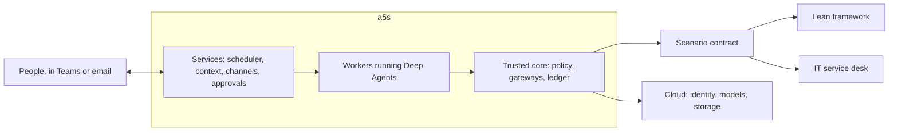

# a5s

**An agent OS on LangChain Deep Agents, for agents that live and work alongside people, under the rules people set.**

**Status:** Design only, v0.2. Nothing is built yet, and [phase 1](docs/phase-1.md) is the plan for the first version.

a5s runs agents the way an operating system runs programs. It installs them, gives each one an identity and only the rights it needs, wakes it when there's work, checks every call it makes, and records what happened. Unlike a task runner, it keeps agents alive between tasks: each one remembers its conversations with people, keeps track of what it owes them, and picks up where it left off, for months.

## Principles

| Principle | What it means |
| --- | --- |
| **Agents live and remember** | An agent keeps its identity, its conversations, what it knows about the people it works with, and what it owes them. Each piece of work runs fresh, and reads what it needs from a5s's records. |
| **Policy decides, not the model** | Every tool call, model call and message goes through a gateway, where policy allows, holds or denies it. Anything not allowed is denied, and if the check can't run, nothing runs. What an agent must never do, it never has the rights to do. |
| **People decide, agents propose** | How far an agent may act is a setting that the owner of each part of the business approves, for each type of action. |
| **Know whose words they are** | Code tracks which runs read outside content and where sensitive values came from. Outside words never steer an agent, and the facts people decide on are computed, never asserted by the model. |
| **Every action leaves evidence** | A tamper-evident ledger records what each agent did, for whom, under which policy and with what result. |
| **Loosening needs someone else** | Anyone can make a5s safer alone. Widening what an agent may do, or changing the trusted core, needs someone outside the team that runs it. Everyday changes stay quick. |
| **Scenarios plug in** | a5s knows no one business's rules. Each scenario brings its people, systems and restrictions through a [contract](docs/architecture.md#the-scenario-contract). |
| **Own the rules, rent the plumbing** | Identity, models, storage and telemetry come from the cloud, through open standards, so a5s can move. |

## A day with an agent

The governance coordinator, the first agent phase 1 builds, keeps track of exceptions to the lean framework's rules for the people who own them.

- **09:00.** An exception owner's digest arrives in Teams, at the time they chose: one message from all the agents together. An exception they own expires in two weeks, and the digest links to it.
- **09:20.** They reply that they're waiting on procurement until the 14th. The coordinator asks them to confirm, notes it, and stops chasing them until then.
- **Two weeks later,** they ask where the exception landed. A fresh run reads the topic's summary and the original turns, and answers with links. Nothing was lost between runs.
- **All along,** every call went through a gateway, was checked by policy and was recorded in the ledger. The coordinator could draft a renewal, but not renew the exception: it holds no right to.

On an IT service desk, a person could ask to reset their own password and have it done at once, because that [scenario](scenarios/it-service-desk.md) allows self-service the identity provider verifies. The lean framework allows nothing like it, and a5s lets each scenario decide.

## Why build it

Three kinds of product each solve part of the problem:

- **Agent frameworks,** such as Deep Agents, run a task well and stop. Identity, memory, obligations and rules are left to whoever builds on them.
- **Cloud agent platforms** from Microsoft, AWS and Google give agents identities and registries, and AWS and Google check tool calls at a gateway. None knows who in the business may approve what, or how far each agent may act in each part of it.
- **Personal agents,** such as Nous Research's Hermes Agent, stay on, remember and talk over chat, but nothing in them is a security boundary.

a5s is the small layer they leave out: levels that business owners set, conversations and obligations that make agents colleagues, evidence held outside the team, and rules for releases. It uses the rest. On AWS, for example, AgentCore Gateway and Policy could be its gateway and policy engine. The [research](docs/research/platform-lessons.md) has the evidence, as of October 2026.

| Outcome, in the lean scenario | Measured as, baselined in phase 1 [TBC] |
| --- | --- |
| Nothing lapses unnoticed | Exceptions reminded before they expire, and cases chased within their turnaround |
| Owners spend less time preparing | Time from a case being routed to its pack being ready, and time to prepare the owner review pack |
| People keep using the agents | People who come back to an agent within a month |

| Cost | Estimate |
| --- | --- |
| Build | [TBC: about three engineers for two quarters, for phase 1] |
| Models | About $0.50 a run before caching, at illustrative prices ([phase 1](docs/phase-1.md#costs)) |
| People | Agent owners' time, the outside approver for widening and core releases, and from phase 2 graders, at about 5 hours a quarter for each type of action at level 2 |

## Documents

| Document | What it holds |
| --- | --- |
| [Architecture](docs/architecture.md) | The trusted core, the scenario contract, a call step by step, policy, provenance, how an agent lives, context, evidence, independence, failure, operations and hosting |
| [Agent model](docs/agent-model.md) | Definitions, releases, instances, conversations and runs, roles, lifecycle, autonomy, and the definition format |
| [Phase 1](docs/phase-1.md) | What to decide, what to build in what order, what done means, and costs |
| [Lean framework](scenarios/lean-framework.md) | The first scenario and the baseline: its contract, its pack, five agents and the tests |
| [IT service desk](scenarios/it-service-desk.md) | A second scenario, on paper, to check the contract is general |
| [Critique](docs/critique.md) | What each adversarial review found, how the design answers it, and what each round removed |
| [Starting values](docs/starting-values.md) | The numbers a5s starts from, by phase |
| [Research](docs/research/platform-lessons.md) | What Deep Agents, Microsoft, AWS, Google and Hermes Agent offer, with the [notes](docs/research/notes/) behind it |

Every change to the design gets an adversarial review before it settles, from six angles: an outside attacker, insiders, failure, colleagues, the builder and funder, and a second scenario. Each round reports what it removed as well as what it added.

## Open decisions

`[TBC]` marks a value to confirm or a gap to fill. The biggest come [first in phase 1](docs/phase-1.md#decide-first): the cloud and identity provider, the channel, the form of the settings store, and who approves from outside the team.
