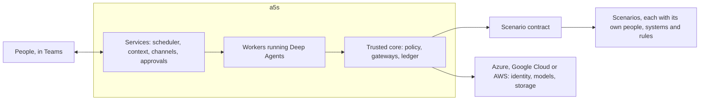

# a5s

**An agent OS on LangChain Deep Agents, for agents that live and work alongside people, under the rules people set.**

**Status:** Phase 1 has started. Its first step, a walking skeleton, runs locally against a sample scenario with real models ([progress](docs/phase-1.md#progress)).

a5s runs agents the way an operating system runs programs. It installs them, gives each one an identity and only the rights it needs, wakes it when there's work, checks every call it makes, and records what happened. Unlike a task runner, it keeps agents alive between tasks: each one remembers its conversations with people, keeps track of what it owes them, and picks up where it left off, for months.



## Principles

| Principle | What it means |
| --- | --- |
| **Agents live and remember** | An agent keeps its identity, its conversations, what it knows about the people it works with, and what it owes them. Each piece of work runs fresh, and reads what it needs from a5s's records. |
| **Policy decides, not the model** | Every tool call, model call and message goes through a gateway, where policy allows, holds or denies it. Anything not allowed is denied, and if the check can't run, nothing runs. What an agent must never do, it never has the rights to do. |
| **People decide, agents propose** | How far an agent may act is a setting that the owner of each part of the business approves, for each type of action. |
| **Know whose words they are** | Code tracks which runs read outside content and where sensitive values came from. Outside words never steer an agent, and the facts people decide on are computed, never asserted by the model. |
| **Every action leaves evidence** | A tamper-evident ledger records what each agent did, for whom, under which policy and with what result. |
| **Loosening needs someone else** | Anyone can make a5s safer alone. Widening what an agent may do, or changing the trusted core, needs someone outside the team that runs it. Everyday changes stay quick. |
| **Scenarios plug in** | a5s knows no one business's rules. Each scenario brings its people, systems and restrictions through a [contract](docs/architecture.md#the-scenario-contract). |
| **Own the rules, rent the plumbing** | Identity, models, storage and telemetry come from the cloud, through open standards, so a5s runs on Azure, Google Cloud and AWS alike, with any model behind an OpenAI- or Anthropic-compatible API. |

## A day with an agent

The assistant, one of the two reference agents phase 1 builds, keeps track of what people ask it to follow up.

- **Monday.** Someone asks the assistant in Teams to draft a reply to a customer's question, and to remind them on Friday if the customer hasn't answered. It drafts the reply, and records the reminder once they confirm it.
- **Friday, 09:00.** Their digest arrives at the time they chose: one message from all their agents together. It includes the reminder, with a link back to the conversation.
- **09:20.** They reply that they're waiting on finance until the 14th. The assistant notes it and stops reminding them until then.
- **Two weeks later,** they ask where the customer's question landed. A fresh run reads the topic's summary and the original turns, and answers with links. Nothing was lost between runs.
- **All along,** every call went through a gateway, was checked by policy and was recorded in the ledger. The assistant could draft the reply, but not send it outside the organisation: it holds no right to.

Each scenario decides what its agents may do beyond that. On an IT service desk, for example, a person could ask to reset their own password and have it done at once, because that [scenario](scenarios/it-service-desk.md) allows self-service the identity provider verifies. Another scenario could rule out anything like it.

## Why build it

Three kinds of product each solve part of the problem:

- **Agent frameworks,** such as Deep Agents, run a task well and stop. Identity, memory, obligations and rules are left to whoever builds on them.
- **Cloud agent platforms** from Microsoft, AWS and Google give agents identities and registries, and AWS and Google check tool calls at a gateway. None knows who in the business may approve what, or how far each agent may act in each part of it.
- **Personal agents,** such as Nous Research's Hermes Agent, stay on, remember and talk over chat, but nothing in them is a security boundary.

a5s is the small layer they leave out: levels that business owners set, conversations and obligations that make agents colleagues, evidence held outside the team, and rules for releases. It uses the rest. On AWS, for example, AgentCore Gateway could sit in front of a5s's own policy and ledger. The [research](docs/research/platform-lessons.md) has the evidence, as of October 2026.

| Outcome | Measured as, baselined in phase 1 [TBC] |
| --- | --- |
| Nothing lapses unnoticed | Obligations, promises and reminders met on time |
| People spend less time chasing | Time from something falling due to it being done |
| People keep using the agents | People who come back to an agent within a month |

| Cost | Estimate |
| --- | --- |
| Build | [TBC: about three engineers for two quarters, for phase 1] |
| Models | About $0.50 a run before caching, at illustrative prices ([phase 1](docs/phase-1.md#costs)) |
| People | Agent owners' time, the outside approver for widening and core releases, and from phase 2 graders, at about 5 hours a quarter for each type of action at level 2 |

## Run it

You need Python 3.12 or later, [uv](https://docs.astral.sh/uv/), Postgres 16, and a key for a model with an OpenAI- or Anthropic-compatible API. The approved models are in [`config/models.yaml`](config/models.yaml), and need `DEEPSEEK_API_KEY` or `QWEN_API_KEY`.

```sh
uv sync
uv run a5s up        # a local Postgres, the schema and a service token
uv run a5s apply     # the assistant, from agents/ and the sample's signed settings
uv run a5s dev &     # the core, its channels and the scheduler, in one process
uv run a5s say --as ana assistant "Which customer questions are still open?"
uv run a5s ledger tail
uv run a5s ledger verify
```

`a5s dev` takes people's word for who they are, which is for development only. Everywhere else, people sign in.

To run it as containers, the way each cloud would, build the image and run the [smoke test](deploy/smoke.sh). It starts the stack with stand-ins for the model, the identity provider and locked storage, and checks it end to end, from sign-in to the ledger's locked copies:

```sh
docker build -t a5s:dev .
sh deploy/smoke.sh
```

With a real model, start [`deploy/compose.yaml`](deploy/compose.yaml) with `A5S_DB_PASSWORD`, `A5S_SERVICE_TOKEN`, a provider's key, `A5S_ANCHOR_STORE`, the locked store for the ledger's copies, such as `s3://bucket/a5s`, and a password for each part's database role (`A5S_DB_GATEWAY_PASSWORD`, `A5S_DB_CHANNELS_PASSWORD`, `A5S_DB_SCHEDULER_PASSWORD` and `A5S_DB_ANCHOR_PASSWORD`) set, and send messages to the core's channels with `A5S_TOKEN=<a sign-in token> uv run a5s say ...`.

To have people sign in, point a5s at your identity provider with `A5S_OIDC_ISSUER`, `A5S_OIDC_AUDIENCE` and `A5S_OIDC_PERSON_CLAIM`, the claim that holds each person's id in the directory, such as `oid` for Entra ID. [`compose.identity.yaml`](deploy/compose.identity.yaml) does this with Keycloak in place of Entra ID, Google Cloud Identity or Okta. `a5s say` then sends the person's token from `A5S_TOKEN`.

For Teams, register a bot in your Entra ID tenant, and set `A5S_TEAMS_APP_ID`, `A5S_TEAMS_APP_SECRET` and `A5S_TEAMS_TENANT_ID` for the gateway and for `a5s channels`, the core's endpoints where messages arrive. Point the bot's messaging endpoint at `/channels/teams/messages` there, through your cloud's ingress. Each agent can be its own bot: list them in `A5S_TEAMS_BOTS`, as JSON with each bot's agent, app id and the variable that holds its secret. Compose publishes the channels only on localhost, so while developing, reach them through a tunnel.

To change the settings, edit [`settings.yaml`](scenarios/sample/settings.yaml), raise its serial, and sign the new version with `uv run a5s sign --as ana` before applying it. `uv run pytest` runs the tests against a scripted model, and `uv run pytest -m live` against the real providers. To serve another scenario, set `A5S_SCENARIO` to its class, such as `a5s.sample:SampleScenario`, and `A5S_SCENARIO_DIR` to its folder.

## Documents

| Document | What it holds |
| --- | --- |
| [Architecture](docs/architecture.md) | The trusted core, the scenario contract, a call step by step, policy, provenance, how an agent lives, context, evidence, independence, failure, operations and hosting |
| [Agent model](docs/agent-model.md) | Definitions, releases, instances, conversations and runs, roles, lifecycle, autonomy, and the definition format |
| [Phase 1](docs/phase-1.md) | What to decide, what to build in what order, what done means, and costs |
| [IT service desk](scenarios/it-service-desk.md) | A scenario on paper, to check the contract is general |
| [Critique](docs/critique.md) | What each adversarial review found, how the design answers it, and what each round removed |
| [Starting values](docs/starting-values.md) | The numbers a5s starts from, by phase |
| [Research](docs/research/platform-lessons.md) | What Deep Agents, Microsoft, AWS, Google and Hermes Agent offer, with the [notes](docs/research/notes/) behind it |

Every change to the design gets an adversarial review before it settles, from six angles: an outside attacker, insiders, failure, colleagues, the builder and funder, and a second scenario. Each round reports what it removed as well as what it added.

## Open decisions

Phase 1's [first decisions](docs/phase-1.md#decide-first) are made: all three clouds and identity providers at once, Teams, three ways to change settings, roles held by people rather than job titles, and models through OpenAI- or Anthropic-compatible APIs. `[TBC]` marks what's still to confirm, such as who holds each role in a deployment. Two more are open: whether the clouds run a5s on Kubernetes or on each cloud's own container service, and whether to keep the middleware that asks the core to explain a tool call first, which [round 4](docs/critique.md#round-4-the-code) proposes removing until phase 2.
