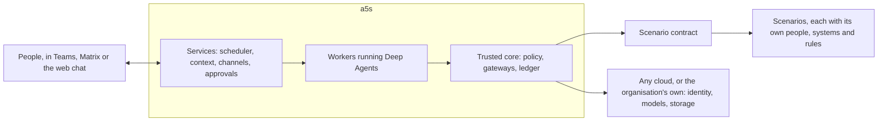

# a5s

**An agent OS on LangChain Deep Agents, for agents that live and work alongside people, under the rules people set.**

**Status:** a5s runs locally, as containers and on any Kubernetes cluster from one Helm chart, with real models, tested on a cluster of its own in CI ([deploy/helm](deploy/helm/README.md)). Running it in a cloud waits for an account, and connecting Teams for a test tenant ([phase 1](docs/phase-1.md#progress)). Built so far:

- agents that act: changes held for the people who decide them, and acting on its own once graded samples earn it ([phase 2](docs/phase-2.md#progress));
- group chats, agents asking each other what they know, and a notebook of what they learn from records ([phase 3](docs/phase-3.md#progress));
- long tasks, worked on in runs of their own, that survive a restart ([phase 4](docs/phase-4.md#progress));
- the studio, where people build, try, publish, run and watch agents ([studio](docs/studio.md#progress));
- three scenarios built again through the studio, each walked through every night on a real model ([phase 5](docs/phase-5.md#progress)).

Fifteen rounds of adversarial review have read it, and the [critique](docs/critique.md) records what each found and what became of it.

a5s runs agents the way an operating system runs programs. It installs them, gives each one an identity and only the rights it needs, wakes it when there's work, checks every call it makes, and records what happened. Unlike a task runner, it keeps agents alive between tasks: each one remembers its conversations with people, keeps track of what it owes them, and picks up where it left off, for months.



## Principles

| Principle | What it means |
| --- | --- |
| **Agents live and remember** | An agent keeps its identity, its conversations, what it knows about the people it works with, and what it owes them. Each piece of work runs fresh, and reads what it needs from a5s's records. |
| **Policy decides, not the model** | Every tool call, model call and message goes through a gateway, where policy allows, holds or denies it. Anything not allowed is denied, and if the check can't run, nothing runs. What an agent must never do, it never has the rights to do. |
| **People decide, agents propose** | How far an agent may act is a setting that the owner of each part of the business approves, for each type of action. |
| **Know whose words they are** | Code tracks which runs read outside content and where sensitive values came from. Outside words never steer an agent, and the facts people decide on are computed, never asserted by the model. |
| **Every action leaves evidence** | A tamper-evident ledger records what each agent did, for whom, under which policy and with what result. |
| **Loosening needs someone else** | Anyone can make a5s safer alone. Widening what an agent may do, or changing the trusted core, needs someone outside the team that runs it. Everyday changes stay quick. |
| **Scenarios plug in** | a5s knows no one business's rules. Each scenario brings its people, systems and restrictions through a [contract](docs/architecture.md#the-scenario-contract). |
| **Own the rules, rent the plumbing** | Identity, models, storage and telemetry come from wherever the organisation runs, through open standards, so a5s assumes no cloud and runs on Azure, Google Cloud, AWS and the organisation's own clusters alike, with any model behind an OpenAI- or Anthropic-compatible API. |

## A day with an agent

The assistant, one of the two reference agents phase 1 builds, keeps track of what people ask it to follow up.

- **Monday.** Someone asks the assistant in Teams to draft a reply to a customer's question, and to remind them on Friday if the customer hasn't answered. It drafts the reply, and records the reminder once they confirm it.
- **Friday, 09:00.** Their digest arrives at the time they chose: one message from all their agents together. It includes the reminder, with a link back to the conversation.
- **09:20.** They reply that they're waiting on finance until the 14th. The assistant notes it and stops reminding them until then.
- **Two weeks later,** they ask where the customer's question landed. A fresh run reads the topic's summary and the original turns, and answers with links. Nothing was lost between runs.
- **Wednesday.** They ask it to move the question's due date to next week. The change waits for the owner of the question's part, who gets a card, reads what it changes in words code works out, and approves it on the core's page. a5s makes the change, if the question hasn't changed meanwhile, and tells them.
- **All along,** every call went through a gateway, was checked by policy and was recorded in the ledger. The assistant could draft the reply, but not send it outside the organisation: it holds no right to. It read the customer's email only through a5s's reader, the extractor, which gives it values such as keys, amounts and dates rather than the customer's words, so nothing the customer wrote could tell it what to do.

Each scenario decides what its agents may do beyond that. On an IT service desk, for example, a person could ask to reset their own password and have it done at once, because that [scenario](scenarios/it-service-desk.md) allows self-service the identity provider verifies. Another scenario could rule out anything like it.

## Why build it

Three kinds of product each solve part of the problem:

- **Agent frameworks,** such as Deep Agents, run a task well and stop. Identity, memory, obligations and rules are left to whoever builds on them.
- **Cloud agent platforms** from Microsoft, AWS and Google give agents identities and registries, and AWS and Google check tool calls at a gateway. None knows who in the business may approve what, or how far each agent may act in each part of it.
- **Personal agents,** such as Nous Research's Hermes Agent, stay on, remember and talk over chat, but nothing in them is a security boundary.

a5s is the small layer they leave out: what business owners let agents do, conversations and obligations that make agents colleagues, evidence held outside the team, and rules for releases. It uses the rest. On AWS, for example, AgentCore Gateway could sit in front of a5s's own policy and ledger. The [research](docs/research/platform-lessons.md) has the evidence, as of October 2026.

| Outcome | Measured as, by `a5s measures`, and baselined in the [pilot](docs/pilot.md) [TBC] |
| --- | --- |
| Nothing lapses unnoticed | Obligations, promises and reminders met on time |
| People spend less time chasing | Time from something falling due to it being done |
| People keep using the agents | People who come back to an agent within a month |

| Cost | Estimate |
| --- | --- |
| Build | [TBC: about three engineers for two quarters, for phase 1] |
| Models | About $0.50 a run before caching, at illustrative prices ([phase 1](docs/phase-1.md#costs)) |
| People | Agent owners' time, the outside approver for widening and core releases, and from phase 2 graders, at about 5 hours a quarter for each type of action an agent takes on its own |

## Run it

You need Python 3.12 or later, [uv](https://docs.astral.sh/uv/), Postgres 16, Node 20.19 or later for the studio's pages, and a key for a model with an OpenAI- or Anthropic-compatible API. On Windows, the development database runs in Docker Desktop instead of a local Postgres installation. The approved models are in [`config/models.yaml`](config/models.yaml), and need `DEEPSEEK_API_KEY` or `QWEN_API_KEY`.

```sh
uv sync
npm ci --prefix studio && npm run build --prefix studio   # the studio's pages, as the image builds them
uv run a5s up        # a local Postgres, the schema, and the core's own token and seal key
uv run a5s apply     # the assistant, from agents/ and the sample's signed settings
uv run a5s dev &     # the core, its channels and the scheduler, in one process
uv run a5s say --as ana assistant "Which customer questions are still open?"
# or chat in a browser at http://127.0.0.1:8703/chat/
uv run a5s inbox --as ana    # her daily digest, from all her agents, once there's news
uv run a5s summaries --as ana   # what a5s keeps of her conversation, once it outgrows a run
uv run a5s ledger tail
uv run a5s status           # how a5s is doing: its queue, runs, denials, budgets and objectives
uv run a5s measures         # what the pilot measures: what was met, who came back, costs, decisions
uv run a5s health           # each model's day: its calls, failures and stalls, and whether it's stopped
uv run a5s export --person ben --by noor   # all a5s keeps about Ben, as Noor, the data protection officer, asks
uv run a5s erase --person ben --confirm ben --by noor   # and erase it, at Ben's request
# --by is for development only: where people sign in, the officer asks in the studio, /studio/officer
uv run a5s ledger verify
```

`a5s dev` takes people's word for who they are, and runs whatever release it is, which is for development only. Everywhere else, people sign in, and the core runs only a release its deployment's people have approved. Every minute, the scheduler also asks the core what falls due: the assistant reminds people of their open records once half the time allowed has passed, the core escalates what's overdue along each person's reporting line, the watcher tells each person what changed in their records and what fell due, and schedules in a release fire at their times. What agents write to someone on their own goes in one digest a day, from all their agents together, at a time they choose: the start of their working day unless they ask an agent for another.

To run it as containers, the way each cloud would, build the image and run the [smoke test](deploy/smoke.sh). It starts the stack with stand-ins for the model, the identity provider, a Matrix homeserver and locked storage, and checks it end to end: a sign-in, a chat in Matrix, a task someone asks for there, says yes to in a later message and hears is done in the same room, and the ledger's locked copies. With `--keep`, it leaves the stack running, to try the web chat and Matrix as the sample's people:

```sh
docker build -t a5s:dev .
sh deploy/smoke.sh          # or: sh deploy/smoke.sh --keep
```

Each other scenario a5s ships runs on the same containers, from the same image, which holds them all. [`deploy/smoke-scenario.sh`](deploy/smoke-scenario.sh) starts the stack serving one, has the scenario's own people approve its release, with their made-up keys, and one of them ask its assistant in Matrix. It checks the answer comes from the scenario's records, and that the core works its obligations out, gives its assurance the audit trail, and copies its ledger to locked storage. CI runs it for each:

```sh
sh deploy/smoke-scenario.sh master-data   # or software-delivery, or service-desk
```

The [soak test](deploy/soak.sh) starts the same stack, then has the sample's people talk to its agents for half an hour, or as many minutes as you give it, while Ana also asks the assistant for long tasks, each worked on in two slices. Along the way, it breaks the stack:

- a quarter of the way through, while a slice is at work, the assistant's worker is killed, and at three eighths the core, as a crash would;
- half way, the core, the scheduler and the assistant's workers restart, as an upgrade would;
- at five eighths, Postgres is away for half a minute, as in a managed database's failover, and people try again what a5s refuses meanwhile;
- at three quarters, the scheduler is killed.

It checks that every message had one answer, in time; that only those at work when something was killed, or while the database was away, were told it couldn't finish, and only those sent while it was away were refused; that every task Ana started ended done, told her once, by its number, and left no lease; that no part's memory or Postgres's connections kept growing; and that no part logged an error but in the minutes after a kill. CI runs it weekly, and when asked:

```sh
sh deploy/soak.sh 30
```

With a real model, start [`deploy/compose.yaml`](deploy/compose.yaml) with `A5S_DB_PASSWORD`, `A5S_SERVICE_TOKEN`, a provider's key, `A5S_ANCHOR_STORE`, the locked store for the ledger's copies, such as `s3://bucket/a5s`, and a password for each part's database role (`A5S_DB_GATEWAY_PASSWORD`, `A5S_DB_CHANNELS_PASSWORD`, `A5S_DB_SCHEDULER_PASSWORD` and `A5S_DB_ANCHOR_PASSWORD`) set, and send messages to the core's channels with `A5S_TOKEN=<a sign-in token> uv run a5s say ...`.

Before the core runs a release, the people its changes need approve it. In the stack, `a5s release show` prints the release. Each approver signs it, wherever they are, with `a5s release sign --as <their id> --key <their private key>`, and the first to sign names the release it follows, the last this deployment approved, which `a5s release status` names (`--follows`). The administrator records the signatures with `a5s release approve`, and `a5s release status` says what the release still needs, and why. Set `A5S_TEAM` to the directory's team that runs a5s, `platform` by default: nobody in it, or above it in its reporting line, can approve as the release approver. The smoke test does this with the sample's made-up people.

a5s's own words, on its pages and in chat, are in English. Agents answer people in the language they write in, Thai included, and where the directory gives someone a language (`language`, such as `th`), each agent is told to write to them in it unless they write in another ([`core/languages.py`](src/a5s/core/languages.py)). Thai that people and agents write is drawn in Ocean's IBM Plex Sans Thai, and a5s checks Thai dates and amounts in an agent's answers, and masks Thai dates of birth and addresses, as it does English ones.

Anyone can say "start afresh", or `/afresh`, as a message of its own: from then, no run of their conversation with that agent is given what came before, which stays on record, nor held back by what a5s read from outside before then, such as a file they sent. A run is held back that way only while it's given what a run that read outside content wrote, and where that alone holds a change for a person, whoever asked is told why ([outside content](docs/architecture.md#provenance-who-said-what)).

An agent can hand a person's conversation over to people, such as the service desk, at their word, with a short brief: the team reads the brief and what the person said, their own words alone, and answers them in the same chat, from the studio, until they hand it back, and the agent answers again, knowing what was said. An instance's settings name the teams it may hand one to (`hands_to`), which the owners of its parts approve ([handing a conversation over](docs/agent-model.md#handing-a-conversation-over)).

A change an agent made can be undone, for a while, where its tool says how: whoever it was for, or whoever decides changes like it in its record's part, undoes it on its page in the studio, signed in afresh for that alone, while the record is as the change left it, and the undo counts against the agent's accuracy, as a wrong grade of its work ([undoing a change](docs/agent-model.md#undoing-a-change)).

An agent can act in another system as the person it's for, with their own permissions there, never a5s's: each person connects their account, such as in ServiceNow, GitHub or Microsoft 365 through Entra ID, on their own page in the studio, and an MCP server declared `as_person` takes their token, which the core keeps sealed, for a run acting for them alone. The deployment names each system in `A5S_DELEGATION`, with a5s's client secret there for the core alone ([connectors](docs/connectors.md#acting-as-the-person)).

Beside the handbook in its release, an agent can search a scenario's document libraries in SharePoint, Confluence or a docs repository, which its `libraries.yaml` names, each document read only as far as its own permissions allow, for everyone the run acts for: in SharePoint and Confluence as each of them, with the accounts they connected, and in a docs repository by the readers each document names. A library nobody trusted as the handbook is trusted is read through a5s's reader, as content from outside ([document libraries](docs/connectors.md#document-libraries)).

Where a team's work arrives by email, a scenario's `mailboxes.yaml` names the shared mailboxes in Microsoft 365 it arrives in, which the core alone reads, as the deployment's app, for each mailbox's readers. Each new message starts a run of an agent whose release takes it, which reads the message through a5s's reader, as content from outside, and may leave a reply among the mailbox's drafts for the team to send: a5s sends no mail ([mailboxes](docs/connectors.md#mailboxes)).

A new version of an agent can answer what people ask an instance, beside it, sending and changing nothing, once the data protection officer chooses to let it (`shadow_runs`): a shadow is an instance whose settings name the one it shadows, and graders compare its answers with those sent on the studio's page, `/studio/shadows`, before anyone puts it to work ([shadow runs](docs/agent-model.md#shadow-runs)).

What agents' model calls cost shows on the studio's spending page, `/studio/spending`, each month, at the prices [`models.yaml`](config/models.yaml) gives each model, in the `currency` it names: by agent and by instance, each run's cost whole, never shared out among parts, with a forecast to the month's end and what each message answered cost, of every run, reports and chases too, though not yet what judges' calls cost, nor tries in the sandbox. Each month runs from midnight UTC on its first day. The signed settings can give each agent a monthly budget, which its owner approves (`spending: {agents: {assistant: 300}}`): the page sets the month against it, and tells its owners on their home once the month is on course to pass it. A budget stops no work; the token budgets in each agent's release do that ([`core/spending.py`](src/a5s/core/spending.py)).

Each agent's release names its model, one [`models.yaml`](config/models.yaml) approves, and may name others to fall back on (`fallbacks`). When a model call fails, the gateway asks the model once more, then the next that speaks the same API, in the same run, so the agent keeps its place; once every one has failed, the scheduler tries the message again on the next model ([model fallbacks](docs/model-fallbacks.md)). An instance's settings can give it another approved model (`model`). The gateway counts each model's calls, failures and stalls, day by day, and stops a model that fails too often, until a person puts it back with `a5s health --restore <model>`. The engineers and the release approver see each model's day on the studio's health page, `/studio/health`, with its scores on a fixed set of canary questions, each with one exact answer, which show when what answers under a model's name has changed (`a5s canaries`).

To change the settings, edit [`settings.yaml`](scenarios/sample/settings.yaml), raise its `serial`, and sign the new version with `uv run a5s sign --as ana` before applying it. Or, where people sign in, have the instance approvers approve it where they work: `a5s propose` sends each a card in Teams, or a link in their other chats, and the core applies the version once one of them approves it on the page the card opens, signed in afresh. For that, the gateway needs `A5S_SEAL_KEYS`, the core's own keys for sealing the approvals it checked, which the channels app refuses to hold, and `A5S_PUBLIC_URL`, where people reach the channels.

`uv run pytest` runs the tests against a scripted model, and `uv run pytest -m 'live and not forgejo'` against the real providers, including each agent's own regression suite, from its folder's `tests/`. The repository connector's tests against a real Forgejo run with `sh deploy/forgejo.sh` ([testing](docs/testing.md)).

To serve another scenario, set `A5S_SCENARIO` to its class, such as `a5s.master_data:MasterDataScenario`, `A5S_SCENARIO_DIR` to its folder, such as `/app/scenarios/master-data` in the image, and `A5S_AGENTS_DIR` to its agents' folder, if it brings its own. The stack passes them on to each part that reads them.

### Chats

Each deployment turns on the chats its people use, by setting each one's settings for the gateway and for `a5s channels`, the core's endpoints where messages arrive. Compose passes them on from its environment. Any number can be on at once, and `a5s channels` logs which are on when it starts.

| Chat | On where these are set | What it needs |
| --- | --- | --- |
| The command line | Always on | `a5s say` and `a5s inbox`, with the person's sign-in token in `A5S_TOKEN` |
| The web chat | `A5S_WEBCHAT_CLIENT_ID`, or in development | A public client at your identity provider, using PKCE, that may return to the page at `/chat/` on the channels' address, and to `/studio/` for the studio, where people approve settings, decide held changes, grade samples, keep the agents' notebook and make the data protection officer's requests, over HTTPS or on localhost |
| Matrix | `A5S_MATRIX_HOMESERVER`, `A5S_MATRIX_SERVER_NAME`, `A5S_MATRIX_AS_TOKEN` and `A5S_MATRIX_HS_TOKEN` | A homeserver of your own, such as Synapse, with a5s registered on it as an application service |
| Teams | `A5S_TEAMS_BOTS` and `A5S_TEAMS_TENANT_ID` | Microsoft 365, a bot for each agent registered in your Entra ID tenant, and the internet |
| Slack | `A5S_SLACK_BOTS` and `A5S_SLACK_TEAM` | A Slack app for each agent in your workspace, its events sent to `/channels/slack/events` and its buttons to `/channels/slack/actions`, and the internet |

A reply goes back through the chat the message came from. An agent that writes first, such as with a reminder, writes only as its own bot: in the conversation the person last had with it, or else in the chat they last wrote in. In Matrix its bot starts a direct chat, and in Slack its app opens a direct message. In Teams it writes first only to people who've added its app, which an administrator can do for everyone. Otherwise, and once someone leaves an agent's chat, it waits in their inbox, in the web chat and on the command line. The directory names each person in each chat they use, such as `entra:<object id>` for Teams, `slack:<team id>/<user id>` for Slack and `matrix:@ana:example.org` for Matrix. The command line and the web chat share the core's local channel, so the web chat shows what was said in either.

To have people sign in, to the command line and the web chat, point a5s at your identity provider with `A5S_OIDC_ISSUER`, `A5S_OIDC_AUDIENCE` and `A5S_OIDC_PERSON_CLAIM`, the claim that holds each person's id in the directory, such as `preferred_username` for Keycloak or `oid` for Entra ID, and `A5S_OIDC_MFA`, how the provider shows a second factor ([the first day](docs/first-day.md#2-peoples-sign-in) has each provider's). [`compose.identity.yaml`](deploy/compose.identity.yaml) does this with Keycloak, as an organisation's provider, whichever it is, and with a client for the web chat. `a5s say` sends the person's token from `A5S_TOKEN`.

For Matrix, register a5s on your homeserver as an application service, with a registration file like the one [`configure.py`](deploy/matrix/configure.py) writes for the stand-in. The homeserver sends what happens in a5s's rooms to `/channels/matrix` on the channels' address, and a5s speaks as each agent's bot, `@a5s-<agent>:<your server>`. A person starts a direct chat with an agent's bot, and a5s joins if the directory knows them. People can also bring an agent's bot into a room of up to 20 people the directory knows, whose history shows people only what was said once they joined, and it answers whoever mentions it there. It reads only rooms without encryption: in any other, it says so and does nothing more. [`compose.matrix.yaml`](deploy/compose.matrix.yaml) runs Synapse as a stand-in that federates with nobody.

For Teams, register a bot for each agent in your Entra ID tenant, so each talks to people as itself, and point each one's messaging endpoint at `/channels/teams/messages` on the channels' address, through your cloud's ingress. List them in `A5S_TEAMS_BOTS`, as JSON with each bot's agent, app id and the variable that holds its secret, such as `A5S_TEAMS_SECRET_ASSISTANT`. Compose publishes the channels only on localhost, so while developing, reach them through a tunnel.

For Slack, make an app for each agent in your workspace, so each talks to people as itself, with Socket Mode and token rotation off and people allowed to write to it from its Messages tab, and install it. Its bot needs the scopes `chat:write`, `im:history`, `im:read`, `im:write`, `mpim:history`, `mpim:read`, `app_mentions:read`, `channels:read`, `groups:read`, `users:read`, `files:read`, for what people share with it, and `reactions:read`; it subscribes to the bot events `message.im`, `message.mpim`, `app_mention` and `reaction_added`, for a 👎 on its answers, sent to `/channels/slack/events` on the channels' address, and its interactivity goes to `/channels/slack/actions`, which takes a card's button and does nothing more. List the apps in `A5S_SLACK_BOTS`, as JSON with each app's agent, app id and the variables that hold its signing secret and bot token, and the workspace's team id in `A5S_SLACK_TEAM`. a5s checks each request's signature and time before it reads it, answers in direct messages and in group DMs when someone mentions the agent, and tells whoever mentions it in a channel, privately, that it works in neither public nor private channels, since anyone who joins one reads back through it.

People can send an agent files with a message, in Teams, Slack, Matrix or the web chat, such as a screenshot of an error or a supplier's invoice: text files, PDFs and images, five to a message, each at most 10 MB, or 4 MB in all in the web chat, where they're attached, pasted or dropped beside what's written, and it says beside them why it won't send one. The web chat's files wait in a5s's database until a day after they're answered, so it holds three of someone's messages with files unanswered at most, and 40 MB of their files a day. The agent reads none of it itself. Each is one of its run's documents, D-1 and on, which it asks a5s's reader about, as it would an email from outside, and its run is marked from the start, so it can never act on its own. The core fetches a file only once the agent asks about it, as the agent's own bot, from the chat's own file host alone: Slack's, the homeserver's media, or, for a file uploaded in Teams, the SharePoint link Teams gives it, which carries its own access, so the bot's token goes nowhere else. In Teams, an agent's app needs `supportsFiles` in its manifest for people to send it files in a one-to-one chat, and an image someone pastes there, which Teams calls only an image, a5s knows by its own bytes. In a Matrix room, a file comes as a message of its own, which can't mention the agent, so it hears no file there: people send one in their own chat with it. An image goes only to a model that [`models.yaml`](config/models.yaml) approves for images, with `images: true`: with any other, the agent hears it can't look, and asks the person what it shows. What a5s turns away, a zip for one, the agent hears about, so it can tell them. A file goes a day after its message is answered ([`core/files.py`](src/a5s/core/files.py)).

People can say an agent's answer was wrong, wherever they talk to it: a 👎 on it in Slack or Matrix, Teams' own buttons under it, or **That's wrong** under it in the web chat, which asks why, in their words, and says first what the agent's owners will see. Its owners find it on the agent's page in the studio, and on their home, with the answer, their words and the run behind it, as far as they may see that run's records, and grade it right, wrong or critical. Who said it they see only once the data protection officer agrees to names in the studio ([`core/feedback.py`](src/a5s/core/feedback.py)).

Other systems can start an agent's work too, such as a ticket opened in the service desk's system. An agent's release says which events it takes and what to do with each (`events` in its `agent.yaml`: each one's type, the system it comes from and its task), and the deployment says which systems may send them, each with its signing secret, in `A5S_EVENT_SOURCES`. A system posts an event to `/channels/events/<source>` on the channels' address, as JSON with its own `id`, its `type`, the `records` it's about, five keys at most, and the `person` it's about, if anyone, as the directory names them, such as `entra:<object id>`: nothing else, since the agent reads what it needs of a record itself, through its tools. It signs the body with `X-A5S-Timestamp`, the time in seconds, and `X-A5S-Signature`, `v1=` and the hex HMAC-SHA256 of `v1:<timestamp>:<body>` under its secret. a5s refuses one more than five minutes from now, keeps each once by its id, and within a minute, the instance at work in every record's part works on it: acting for the person it names, where it serves them, and writing to them, or else for nobody, as a schedule's run does.

### On your own premises, with any provider

a5s ties itself to no cloud and no identity provider. It runs on your own premises, even on a network with no way out:

| Part | On your own premises |
| --- | --- |
| Hosts | The one image, on any Kubernetes cluster with [the Helm chart](deploy/helm/README.md), or on any container host, with your own Postgres 16 or later. [`compose.yaml`](deploy/compose.yaml) is the reference. |
| Sign-in | Any provider that speaks OpenID Connect, such as Keycloak, Authentik, Zitadel or Active Directory Federation Services. Active Directory or another LDAP directory on its own connects through Keycloak or Dex. Set `A5S_OIDC_METADATA_URL` if the provider's metadata isn't at the issuer's well-known address. |
| Models | Any server that speaks the OpenAI- or Anthropic-compatible API, such as vLLM, Ollama, llama.cpp or SGLang, with a model that supports tool calling. Leave out `key_env` if it needs no key. [`models.yaml`](config/models.yaml) has an example. |
| The ledger's copies | Any S3-compatible store with object lock in compliance mode, run by assurance, such as Ceph or NetApp StorageGRID. Point the copier at it with `AWS_ENDPOINT_URL_S3`. |
| Your own certificate authority | `SSL_CERT_FILE`, a bundle with your CA, for sign-in, models and Teams; `AWS_CA_BUNDLE` for the ledger's copies; and `sslrootcert` in the database's URL |
| Chats | The web chat, which the core serves, and Matrix, on a homeserver of your own, need nothing outside your network. Teams needs Microsoft 365 and the internet, and Slack needs Slack and the internet. |
| The image | Built where the internet is, then brought in through your own registry, or with `docker save` and `docker load` |

The smoke test runs this way: Keycloak for sign-in, Synapse for Matrix, a model inside the stack that needs no key, locked storage that speaks S3, and workers that can't reach the internet.

## Documents

| Document | What it holds |
| --- | --- |
| [Using a5s today](docs/user-journey.md) | The current interface in pictures: asking an agent for help, running one, and building and deploying one, in code or in the studio |
| [Design](docs/design.md) | The look every page shares, Ocean: its tokens in two layers, the colours for what a tool does and how things stand, its bundled type, what the tests hold it to, and how to change the brand |
| [Testing](docs/testing.md) | Unit, integration, live-model, browser, container and soak tests: how to run them, what each proves, and how to read failures and scorecards |
| [Architecture](docs/architecture.md) | The trusted core, the scenario contract, a call step by step, policy, provenance, how an agent lives, context, evidence, independence, failure, operations and hosting |
| [Agent model](docs/agent-model.md) | Definitions, releases, instances, conversations and runs, roles, lifecycle, autonomy, and the definition format |
| [Model fallbacks](docs/model-fallbacks.md) | The other approved models an agent's release names, tried in order when its own isn't answering, and the live tests' judged wording checks |
| [Model execution](docs/model-execution.md) | A design for review: model calls that survive a provider's failure, replies checked before they reach a person, and each model's health measured. Its status says which parts are built |
| [Phase 1](docs/phase-1.md) | What to decide, what to build in what order, what done means, and costs |
| [Phase 2](docs/phase-2.md) | Agents that act: held proposals, signed decisions, counts, acting on its own once graded samples earn it, and the extractor |
| [Phase 3](docs/phase-3.md) | Group conversations, agent to agent, and a notebook of what agents learn from records |
| [Phase 4](docs/phase-4.md) | Resumable long-running tasks: durable state, bounded runs, heartbeats, budgets, cancellation and parent/child evidence |
| [Phase 5](docs/phase-5.md) | The service desk, software delivery and master data scenarios built again, and their unbuilt agents built, in the studio: published, signed, put to work, run, graded and audited through a5s's own pages, with nothing typed into an agent's file. Steps 0, 2, 4, 5 and 6 are done and step 3 is under way, and each walk-through runs on DeepSeek every night |
| [Studio](docs/studio.md) | One place to build, try, publish, run and watch agents, as a maker studio does: its API first, drafts tried in a sandbox, tools built by the development team, and no signature skipped. Steps 1 to 3, watching, authoring and instances, are built |
| [Administration and audit](docs/administration.md) | Who administers what, scoped to parts and agents, with roles from the identity provider's groups and a page for administrators; how people sign in, with a second factor for what counts; and how auditors read the ledger, on their own page and the command line. A draft, all built but sending the ledger to the organisation's security monitoring |
| [Pilot](docs/pilot.md) | One team, on whichever cloud or cluster the organisation runs a5s on, in stages: what each shows, what stops it, and how what it shows chooses the work after it |
| [The first day](docs/first-day.md) | The pilot's stage 0, step by step: a5s on the organisation's own cluster, with each cloud's and identity provider's settings side by side, and the four checks only the real services can make |
| [Data protection](docs/data-protection.md) | For the data protection officer's assessment: what a5s keeps about people, why, where, for how long and who sees it, what models see, and requests for someone's data |
| [IT service desk](scenarios/it-service-desk.md) | Synthetic tickets, accounts, devices and a knowledge vault behind MCP servers, replies on tickets held for each service area's decider, self-service the identity provider verifies, its desk assistant, and the two agents the desk never built, built in the studio |
| [Software delivery](scenarios/software-delivery.md) | An engineering team's issues and pull requests behind the forge's MCP server, need-to-know for security issues, customers' comments through the reader, a review request held for its repository's owners, and its dev assistant; with a [read-only pilot](docs/guides/software-delivery/pilot.md) against a real Forgejo |
| [SAP master data](scenarios/master-data.md) | Master data governance: change requests and data quality checked by code, bank details as handles, suppliers' letters through the reader, corrections each data object's owner decides, one kind made on its own once graded samples earn it, and daily reports to each owner |
| [Connectors](docs/connectors.md) | The tools of the MCP servers a scenario declares, and how a5s governs each call; acting as the person, with their own permissions; document libraries; shared mailboxes; and the REST, GitHub and repository connectors |
| [Critique](docs/critique.md) | What each adversarial review found, how the design answers it, and what each round removed |
| [Starting values](docs/starting-values.md) | The numbers a5s starts from, by phase |
| [Runbooks](docs/runbooks.md) | For the team that runs a5s: what to do when each part of `a5s status` goes wrong |
| [Configuration](docs/configuration.md) | Every setting a deployment gives a5s, with its default and what it takes; where each kind of value lives and who decides it; how each part checks its settings as it starts, and how to see what a part runs with |
| [Research](docs/research/platform-lessons.md) | What Deep Agents, Microsoft, AWS, Google and Hermes Agent offer, with the [notes](docs/research/notes/) behind it |

Every change to the design gets an adversarial review before it settles. Reviewers who didn't write it read it cold, each from one angle, such as an outside attacker, an insider, failure, or one of the people who'll use it, and each round reports what it removed as well as what it added.

## Open decisions

Phase 1's [first decisions](docs/phase-1.md#decide-first) are made, and some have moved on since. a5s assumes no cloud: it runs on Kubernetes everywhere, from one Helm chart, the organisation's own clusters included. People sign in through any identity provider that speaks OpenID Connect, and reach agents in Teams, a web chat of a5s's own, Matrix or Slack, each deployment turning on the chats it uses. Settings change through files in git, approval cards in the chat, and the studio. Roles are held by people, never by job titles. Models come through OpenAI- or Anthropic-compatible APIs, and real data goes only to models the organisation approves for it.

A signed release deploys itself from git, with [Flux](deploy/gitops/README.md): what each environment runs is a folder, changed by pull request, which merges itself once the signatures over its release meet what the release needs. Its approvers sign with their own keys, never a sign-in, so its approval never rests on the team that runs a5s, and what they sign names the release's image, the release it follows and whether it's a baseline, so nobody on that team approves a release alone ([round 11](docs/critique.md#round-11-releases-settings-authoring-and-the-pages-people-sign-on)).

`[TBC]` marks what's still to confirm, such as who holds each role in a deployment, and which model the pilot uses. The [pilot](docs/pilot.md) says what each of its stages needs decided first.
