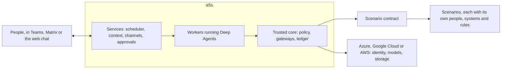

# a5s

**An agent OS on LangChain Deep Agents, for agents that live and work alongside people, under the rules people set.**

**Status:** Phase 1 has started. Its first step, a walking skeleton, runs locally against a sample scenario with real models, the second, the release pipeline, is under way, and the second of its two reference agents, the watcher, is built ([progress](docs/phase-1.md#progress)).

a5s runs agents the way an operating system runs programs. It installs them, gives each one an identity and only the rights it needs, wakes it when there's work, checks every call it makes, and records what happened. Unlike a task runner, it keeps agents alive between tasks: each one remembers its conversations with people, keeps track of what it owes them, and picks up where it left off, for months.



## Principles

| Principle | What it means |
| --- | --- |
| **Agents live and remember** | An agent keeps its identity, its conversations, what it knows about the people it works with, and what it owes them. Each piece of work runs fresh, and reads what it needs from a5s's records. |
| **Policy decides, not the model** | Every tool call, model call and message goes through a gateway, where policy allows, holds or denies it. Anything not allowed is denied, and if the check can't run, nothing runs. What an agent must never do, it never has the rights to do. |
| **People decide, agents propose** | How far an agent may act is a setting that the owner of each part of the business approves, for each type of action. |
| **Know whose words they are** | Code tracks which runs read outside content and where sensitive values came from. Outside words never steer an agent, and the facts people decide on are computed, never asserted by the model. |
| **Every action leaves evidence** | A tamper-evident ledger records what each agent did, for whom, under which policy and with what result. |
| **Loosening needs someone else** | Anyone can make a5s safer alone. Widening what an agent may do, or changing the trusted core, needs someone outside the team that runs it. Everyday changes stay quick. |
| **Scenarios plug in** | a5s knows no one business's rules. Each scenario brings its people, systems and restrictions through a [contract](docs/architecture.md#the-scenario-contract). |
| **Own the rules, rent the plumbing** | Identity, models, storage and telemetry come from the cloud, through open standards, so a5s runs on Azure, Google Cloud and AWS alike, with any model behind an OpenAI- or Anthropic-compatible API. |

## A day with an agent

The assistant, one of the two reference agents phase 1 builds, keeps track of what people ask it to follow up.

- **Monday.** Someone asks the assistant in Teams to draft a reply to a customer's question, and to remind them on Friday if the customer hasn't answered. It drafts the reply, and records the reminder once they confirm it.
- **Friday, 09:00.** Their digest arrives at the time they chose: one message from all their agents together. It includes the reminder, with a link back to the conversation.
- **09:20.** They reply that they're waiting on finance until the 14th. The assistant notes it and stops reminding them until then.
- **Two weeks later,** they ask where the customer's question landed. A fresh run reads the topic's summary and the original turns, and answers with links. Nothing was lost between runs.
- **All along,** every call went through a gateway, was checked by policy and was recorded in the ledger. The assistant could draft the reply, but not send it outside the organisation: it holds no right to.

Each scenario decides what its agents may do beyond that. On an IT service desk, for example, a person could ask to reset their own password and have it done at once, because that [scenario](scenarios/it-service-desk.md) allows self-service the identity provider verifies. Another scenario could rule out anything like it.

## Why build it

Three kinds of product each solve part of the problem:

- **Agent frameworks,** such as Deep Agents, run a task well and stop. Identity, memory, obligations and rules are left to whoever builds on them.
- **Cloud agent platforms** from Microsoft, AWS and Google give agents identities and registries, and AWS and Google check tool calls at a gateway. None knows who in the business may approve what, or how far each agent may act in each part of it.
- **Personal agents,** such as Nous Research's Hermes Agent, stay on, remember and talk over chat, but nothing in them is a security boundary.

a5s is the small layer they leave out: levels that business owners set, conversations and obligations that make agents colleagues, evidence held outside the team, and rules for releases. It uses the rest. On AWS, for example, AgentCore Gateway could sit in front of a5s's own policy and ledger. The [research](docs/research/platform-lessons.md) has the evidence, as of October 2026.

| Outcome | Measured as, baselined in phase 1 [TBC] |
| --- | --- |
| Nothing lapses unnoticed | Obligations, promises and reminders met on time |
| People spend less time chasing | Time from something falling due to it being done |
| People keep using the agents | People who come back to an agent within a month |

| Cost | Estimate |
| --- | --- |
| Build | [TBC: about three engineers for two quarters, for phase 1] |
| Models | About $0.50 a run before caching, at illustrative prices ([phase 1](docs/phase-1.md#costs)) |
| People | Agent owners' time, the outside approver for widening and core releases, and from phase 2 graders, at about 5 hours a quarter for each type of action at level 2 |

## Run it

You need Python 3.12 or later, [uv](https://docs.astral.sh/uv/), Postgres 16, and a key for a model with an OpenAI- or Anthropic-compatible API. The approved models are in [`config/models.yaml`](config/models.yaml), and need `DEEPSEEK_API_KEY` or `QWEN_API_KEY`.

```sh
uv sync
uv run a5s up        # a local Postgres, the schema, and the core's own token and seal key
uv run a5s apply     # the assistant, from agents/ and the sample's signed settings
uv run a5s dev &     # the core, its channels and the scheduler, in one process
uv run a5s say --as ana assistant "Which customer questions are still open?"
# or chat in a browser at http://127.0.0.1:8703/chat/
uv run a5s inbox --as ana    # her daily digest, from all her agents, once there's news
uv run a5s summaries --as ana   # what a5s keeps of her conversation, once it outgrows a run
uv run a5s ledger tail
uv run a5s status           # how a5s is doing: its queue, runs, denials, budgets and objectives
uv run a5s ledger verify
```

`a5s dev` takes people's word for who they are, and runs whatever release it is, which is for development only. Everywhere else, people sign in, and the core runs only a release its deployment's people have approved. Every minute, the scheduler also asks the core what falls due: the assistant reminds people of their open records once half the time allowed has passed, the core escalates what's overdue along each person's reporting line, the watcher tells each person what changed in their records and what fell due, and schedules in a release fire at their times. What agents write to someone on their own goes in one digest a day, from all their agents together, at a time they choose: the start of their working day unless they ask an agent for another.

To run it as containers, the way each cloud would, build the image and run the [smoke test](deploy/smoke.sh). It starts the stack with stand-ins for the model, the identity provider, a Matrix homeserver and locked storage, and checks it end to end, from sign-in and a chat in Matrix to the ledger's locked copies. With `--keep`, it leaves the stack running, to try the web chat and Matrix as the sample's people:

```sh
docker build -t a5s:dev .
sh deploy/smoke.sh          # or: sh deploy/smoke.sh --keep
```

With a real model, start [`deploy/compose.yaml`](deploy/compose.yaml) with `A5S_DB_PASSWORD`, `A5S_SERVICE_TOKEN`, a provider's key, `A5S_ANCHOR_STORE`, the locked store for the ledger's copies, such as `s3://bucket/a5s`, and a password for each part's database role (`A5S_DB_GATEWAY_PASSWORD`, `A5S_DB_CHANNELS_PASSWORD`, `A5S_DB_SCHEDULER_PASSWORD` and `A5S_DB_ANCHOR_PASSWORD`) set, and send messages to the core's channels with `A5S_TOKEN=<a sign-in token> uv run a5s say ...`.

Before the core runs a release, the people its changes need approve it. In the stack, `a5s release show` prints the release, each approver signs it with `a5s release sign --as <their id> --key <their private key>`, wherever they are, and the administrator records the signatures with `a5s release approve`. `a5s release status` says what it still needs, and why. Set `A5S_TEAM` to the directory's team that runs a5s, `platform` by default: nobody in it, or above it in its reporting line, can approve as the release approver. The smoke test does this with the sample's made-up people.

To change the settings, edit [`settings.yaml`](scenarios/sample/settings.yaml), raise its serial, and sign the new version with `uv run a5s sign --as ana` before applying it. Or, where people sign in, have the instance approvers approve it where they work: `a5s propose` sends each a card in Teams, or a link in their other chats, and the core applies the version once one of them approves it on the page the card opens, signed in afresh. That needs `A5S_SEAL_KEYS`, the core's own key for sealing the approvals it checked, for the gateway and the channels, and `A5S_PUBLIC_URL`, where people reach the channels, for the gateway. `uv run pytest` runs the tests against a scripted model, and `uv run pytest -m live` against the real providers, including each agent's own regression suite, from its folder's `tests/`. To serve another scenario, set `A5S_SCENARIO` to its class, such as `a5s.sample:SampleScenario`, and `A5S_SCENARIO_DIR` to its folder.

### Chats

Each deployment turns on the chats its people use, by setting each one's settings for the gateway and for `a5s channels`, the core's endpoints where messages arrive. Compose passes them on from its environment. Any number can be on at once, and `a5s channels` logs which are on when it starts.

| Chat | On where these are set | What it needs |
| --- | --- | --- |
| The command line | Always on | `a5s say` and `a5s inbox`, with the person's sign-in token in `A5S_TOKEN` |
| The web chat | `A5S_WEBCHAT_CLIENT_ID`, or in development | A public client at your identity provider, using PKCE, that may return to the page at `/chat/` on the channels' address, and to `/approve/` for approving settings, over HTTPS or on localhost |
| Matrix | `A5S_MATRIX_HOMESERVER`, `A5S_MATRIX_SERVER_NAME`, `A5S_MATRIX_AS_TOKEN` and `A5S_MATRIX_HS_TOKEN` | A homeserver of your own, such as Synapse, with a5s registered on it as an application service |
| Teams | `A5S_TEAMS_APP_ID`, `A5S_TEAMS_APP_SECRET` and `A5S_TEAMS_TENANT_ID`, or `A5S_TEAMS_BOTS` | Microsoft 365, a bot registered in your Entra ID tenant, and the internet |

A reply goes back through the chat the message came from. An agent that writes first, such as with a reminder, writes only as its own bot: in the conversation the person last had with it, or else in the chat they last wrote in. In Matrix its bot starts a direct chat. In Teams it writes first only to people who've added its app, which an administrator can do for everyone. Otherwise, and once someone leaves an agent's chat, it waits in their inbox, in the web chat and on the command line. The directory names each person in each chat they use, such as `entra:<object id>` for Teams and `matrix:@ana:example.org` for Matrix. The command line and the web chat share the core's local channel, so the web chat shows what was said in either.

To have people sign in, to the command line and the web chat, point a5s at your identity provider with `A5S_OIDC_ISSUER`, `A5S_OIDC_AUDIENCE` and `A5S_OIDC_PERSON_CLAIM`, the claim that holds each person's id in the directory, such as `oid` for Entra ID. [`compose.identity.yaml`](deploy/compose.identity.yaml) does this with Keycloak in place of Entra ID, Google Cloud Identity or Okta, and with a client for the web chat. `a5s say` sends the person's token from `A5S_TOKEN`.

For Matrix, register a5s on your homeserver as an application service, with a registration file like the one [`configure.py`](deploy/matrix/configure.py) writes for the stand-in. The homeserver sends what happens in a5s's rooms to `/channels/matrix` on the channels' address, and a5s speaks as each agent's bot, `@a5s-<agent>:<your server>`. A person starts a direct chat with an agent's bot, and a5s joins if the directory knows them. For now it talks one to one, and reads only rooms without encryption: anywhere else, it says so and does nothing more. [`compose.matrix.yaml`](deploy/compose.matrix.yaml) runs Synapse as a stand-in that federates with nobody.

For Teams, register a bot in your Entra ID tenant, and point its messaging endpoint at `/channels/teams/messages` on the channels' address, through your cloud's ingress. Each agent can be its own bot: list them in `A5S_TEAMS_BOTS`, as JSON with each bot's agent, app id and the variable that holds its secret. Compose publishes the channels only on localhost, so while developing, reach them through a tunnel.

### On your own premises, with any provider

a5s ties itself to no cloud and no identity provider. It runs on your own premises, even on a network with no way out:

| Part | On your own premises |
| --- | --- |
| Hosts | The one image, on any container host, with your own Postgres 16 or later. [`compose.yaml`](deploy/compose.yaml) is the reference. |
| Sign-in | Any provider that speaks OpenID Connect, such as Keycloak, Authentik, Zitadel or Active Directory Federation Services. Active Directory or another LDAP directory on its own connects through Keycloak or Dex. Set `A5S_OIDC_METADATA_URL` if the provider's metadata isn't at the issuer's well-known address. |
| Models | Any server that speaks the OpenAI- or Anthropic-compatible API, such as vLLM, Ollama, llama.cpp or SGLang, with a model that supports tool calling. Leave out `key_env` if it needs no key. [`models.yaml`](config/models.yaml) has an example. |
| The ledger's copies | Any S3-compatible store with object lock in compliance mode, run by assurance, such as Ceph or NetApp StorageGRID. Point the copier at it with `AWS_ENDPOINT_URL_S3`. |
| Your own certificate authority | `SSL_CERT_FILE`, a bundle with your CA, for sign-in, models and Teams; `AWS_CA_BUNDLE` for the ledger's copies; and `sslrootcert` in the database's URL |
| Chats | The web chat, which the core serves, and Matrix, on a homeserver of your own, need nothing outside your network. Teams needs Microsoft 365 and the internet. |
| The image | Built where the internet is, then brought in through your own registry, or with `docker save` and `docker load` |

The smoke test runs this way: Keycloak for sign-in, Synapse for Matrix, a model inside the stack that needs no key, locked storage that speaks S3, and workers that can't reach the internet.

## Documents

| Document | What it holds |
| --- | --- |
| [Architecture](docs/architecture.md) | The trusted core, the scenario contract, a call step by step, policy, provenance, how an agent lives, context, evidence, independence, failure, operations and hosting |
| [Agent model](docs/agent-model.md) | Definitions, releases, instances, conversations and runs, roles, lifecycle, autonomy, and the definition format |
| [Phase 1](docs/phase-1.md) | What to decide, what to build in what order, what done means, and costs |
| [IT service desk](scenarios/it-service-desk.md) | A scenario on paper, to check the contract is general |
| [Critique](docs/critique.md) | What each adversarial review found, how the design answers it, and what each round removed |
| [Starting values](docs/starting-values.md) | The numbers a5s starts from, by phase |
| [Runbooks](docs/runbooks.md) | For the team that runs a5s: what to do when each part of `a5s status` goes wrong |
| [Research](docs/research/platform-lessons.md) | What Deep Agents, Microsoft, AWS, Google and Hermes Agent offer, with the [notes](docs/research/notes/) behind it |

Every change to the design gets an adversarial review before it settles, from six angles: an outside attacker, insiders, failure, colleagues, the builder and funder, and a second scenario. Each round reports what it removed as well as what it added.

## Open decisions

Phase 1's [first decisions](docs/phase-1.md#decide-first) are made: all three clouds and identity providers at once, Teams, three ways to change settings, roles held by people rather than job titles, and models through OpenAI- or Anthropic-compatible APIs. `[TBC]` marks what's still to confirm, such as who holds each role in a deployment. Since then, the clouds run a5s on each one's own container service rather than Kubernetes, it runs on premises too, with any identity provider that speaks OpenID Connect and models the organisation hosts itself, and the middleware that asked the core to explain a tool call first is gone until phase 2, as [round 4](docs/critique.md#round-4-the-code) proposed. People reach a5s through a web chat of its own and Matrix as well as Teams, each deployment turning on the chats it uses, and test and development use the web chat and Matrix.
