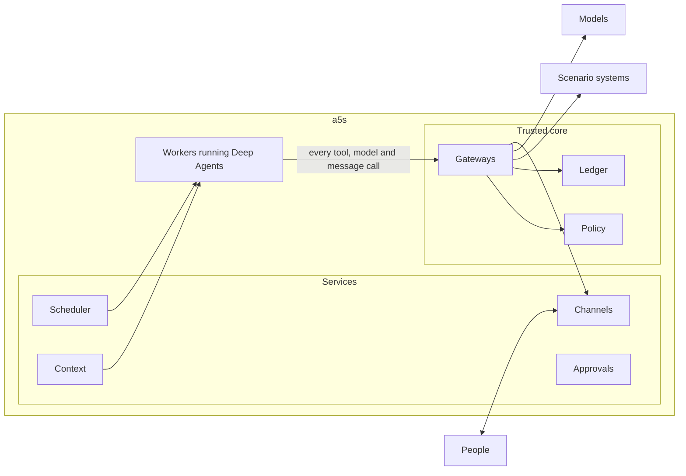

# Architecture

**Status:** Draft v0.2, design only · **Under:** [a5s](../README.md)

a5s runs agents the way an operating system runs programs. It installs them, gives each one an identity and only the rights it needs, wakes it when there's work, checks every call it makes, and keeps a record of what happened. Agents run on LangChain Deep Agents. Each scenario, such as the [lean framework](../scenarios/lean-framework.md), plugs in through a [contract](#the-scenario-contract) and brings its own people, systems and rules.

## The trusted core and the rest

| Part | What it is | A change needs |
| --- | --- | --- |
| Trusted core | Policy, written in Cedar; the gateways for tools, models and outgoing messages; the credential broker; the ledger writer; masking. Also the data they decide on: grants, levels, caps, instance status and held calls. | Approval from outside the team that runs a5s, a protected branch and an attested build ([independence](#independence)) |
| Services | The scheduler, context, channels, approvals and assurance services, and the register's interface. They change core data only through the core's own interfaces, which apply the rules for loosening. | The team's own review and tests |
| Workers | Run each piece of work as a Deep Agents run, with no credentials and no network except to the gateways | As services |

A fault or a compromise in a service or a worker can make an agent slow, wrong or silent. It can't make one do what policy denies, because every call goes through the core.

## The scenario contract

A scenario plugs into a5s by providing these, or by taking a5s's defaults:

| Interface | Gives a5s | a5s's default |
| --- | --- | --- |
| Directory | People, their roles, and what each may see, for any record | The organisation's identity provider, with roles the scenario maps |
| Settings | Parts and their owners and delegates, how far each agent may act in each part and type of action, limits, sensitive fields and classes of data. Each version is signed by its owner. | a5s's settings store, with signed versions [TBC: edited through a simple app, or in git] |
| Tools | The systems agents use, as MCP servers, with each tool's risk attributes | None |
| Records | Where obligations come from, such as cases past their due time, and the events that wake agents | None |
| Governed process | Where agents' requests to change data go, and who decides them | Held proposals in a5s itself, from phase 2 |
| Decision surface | Where people decide | Cards in the channel, signed through the identity provider [TBC] |
| Policy pack | The scenario's own restrictions, which can only add to a5s's base pack | None |
| Tests | The scenario's tests, run against its systems or a fake of them | None |

Each scenario starts with a fake of its contract: fake systems, records and settings. The fake is also the test bench for building locally. The [IT service desk](../scenarios/it-service-desk.md) is a second scenario on paper, to check the contract is general.

## A call, step by step

Every tool call, model call and outgoing message takes the same path:

1. The agent's middleware asks the core to explain the call: allow, hold or deny, with the reasons, reserving nothing. The agent can change course before it commits.
2. The middleware sends the call to a gateway with the run's envelope: the instance, the run, the people it acts for, whether it has read outside content, and any value handles.
3. In one Postgres transaction, the gateway reads the settings, evaluates the Cedar policies, reserves any counts, and writes the ledger entry. Settings are cached for at most [TBC: 30 seconds], and a change clears the cache. If any step fails, the call is denied.
4. On allow, the gateway gets a short-lived credential for that one call, resolves the handles to values, and makes the call. It tokenises classified values in what comes back, tags it with its source, and records the outcome.
5. On deny, the agent gets the reason. A hold is a Cedar annotation on a permit, used for a5s's own held proposals from phase 2.

The model gateway also checks each model's provider, deployment, region and dated version, and records prompts by hash, not by content.

## Policy

Policy answers **allow**, **hold** or **deny**, and denies by default.

- **Inputs:** the instance, the people it acts for, the tool or model and its risk attributes (reads, writes, sensitive, destructive, sends outside), the fields it touches with their parts and classes, the level for that part and type of action, the counts, the budget, and the scenario's switches.
- **Rights come first.** Actions a scenario forbids are never in any agent's grant, so no instruction can talk an agent into them. Policy is the second line, not the only one.
- **Levels** come from the scenario's settings for each instance, part and type of action. The instance works at the lower of that setting and a5s's own cap ([autonomy](agent-model.md#autonomy)).
- **Counts** stop a piece of work going past a limit the scenario sets, such as a mass-change size, and send the rest to whoever approves it. Code, not the model, decides what a piece of work is. From phase 2.
- **Failing closed.** If policy, the settings, the counts or the ledger can't be reached, calls are denied, the run ends and its trigger waits.
- **Packs.** a5s's base pack holds what's always enforced, and a scenario's pack can only add restrictions.

## Provenance: who said what

a5s answers "whose words are these?" in code, never by asking the model, at three grains:

- **Runs.** A run that has read outside content, through the extractor, stays marked. It can't act at level 2 or write anyone's profile, and what it drafts says so.
- **Values the agent shouldn't retype.** Tools return sensitive values, such as a contact or a bank account, as handles. The agent passes the handle on, the gateway resolves it when it calls a system, and code renders it for people. The source of each such value is exact, and the model never needs to see it.
- **Typed values.** Keys, amounts, dates and codes the agent writes are matched exactly against what the run has read. A match carries its source, and anything else is flagged as the agent's own.

Free text the agent writes is always its own. Facts a person relies on to decide, such as whether a check was done, are computed by code and shown apart from the agent's narrative. A run acts for everyone whose words it serves: whoever sent the message, set the reminder, or wrote the reply a request came from. They're named on whatever the agent drafts or raises, and none of them may decide it. This follows the CaMeL pattern of keeping untrusted data out of what decides the next step. It's the first part of a5s to prototype.

## Proposals and approvals

At level 1, an agent's work reaches people in one of three ways:

| Way | When | Who decides |
| --- | --- | --- |
| Draft | The agent prepares something for a person to use, such as a pre-filled request or a case pack | The person, by using it or not |
| Request | The action belongs to a governed process | Whoever the process routes it to. The process checks the agent's level with a5s before it approves anything automatically. |
| Held proposal, from phase 2 | The action has no governed process | The owner of what it touches. a5s holds the exact call, and the agent carries on. Once it's approved, the gateway makes the call, if the records haven't changed. |

Drafts and requests carry a handoff note and the agent's flags, so whoever decides sees them. A decision on a sensitive item is signed by its decider for that one decision, through the identity provider, and each signature works once. It's taken only on the decision surface, never in a chat with the agent, and after a decider's authenticator is reset, their decisions wait a day before they take effect [TBC]. At level 2, actions run and are reported, and the agent owner can reverse them through the scenario's own process.

## How an agent lives

An instance lives in records: its identity, register entry, triggers, obligations and context. Compute is temporary.

1. **Wake.** A message, an event, a schedule or an obligation falling due wakes it. So does a sweep, which runs only while the instance is idle and starts no model when nothing has changed. Every agent can be talked to.
2. **Lease.** The scheduler takes a lease on the topic or case the work belongs to, so each runs one thing at a time. It checks that the instance is active and has budget left.
3. **Assemble.** The context service builds the run's context, within a budget for each part:
   - the release's instructions, and the skills for the parts in play;
   - the person's profile;
   - the topic's summary and recent turns;
   - a brief of the case, built from records;
   - what a search of the history finds.
4. **Run.** A fresh Deep Agents run, on a LangGraph thread that lasts only as long as the run. Every call goes through the gateways.
5. **Record.** The context service adds the turn to the conversation and updates the topic's summary. The scheduler updates the obligations, and the lease ends.

- **Obligations** are worked out by code from the scenario's records, never inferred by the model, with one for each record and person across all agents. A person can say what they're waiting on, which pauses chases to them until the date they give.
- **Promises and reminders.** When an agent promises a follow-up, or a person asks for a reminder, a typed tool records it and the person confirms it. It's theirs alone, and content from outside can't set one.
- **Triggers and schedules** come with the release, and an agent can't create its own.
- **Repeats are safe.** Tools are idempotent, with keys made from the piece of work, the record and the change.

## Context and memory

People get one conversation with each agent, and it never runs out of room, however many runs it takes. Each run starts fresh and reads the conversation from a5s's records, so long conversations stay cheap and upgrades never strand them.

| Context | What it is | Written by | Checked by |
| --- | --- | --- | --- |
| Conversation | Every turn with a person, across channels, organised in topics such as one per request | a5s, as turns happen | The person, who can see all of it |
| Summaries | A structured summary of each topic: decisions, commitments, open questions, and facts by handle | a5s after each run. Code checks that every key, amount and date survives. | The person, who can correct it |
| Profile | Typed preferences, such as digest time and channel, and a short "how I like to work" note | The person, or the agent with their confirmation | The person |
| Case briefs | The state and history of a case, built for each run | Code, from records | Nobody needs to: the records are the source |
| Instructions and skills | How the agent works | Only a release | The release approver |

- **One conversation per person per agent,** whichever of the agent's instances does the work. Each run's grant comes from the instance, so its scope is enforced at the tools.
- **Records beat recollection.** Commitments and decisions live in records, never only in a conversation, and answers about the past retrieve the original turns, not just the summary.
- **People stay separate.** Nothing from one person's conversation enters a run for someone else. An agent acting for someone sees only what the directory says that person may see.
- **Classified values** are tokenised in conversations, and shown back only to people who may see them.
- **Later:** group conversations, and a notebook of what an agent learns from records, from phase 3.

## Channels

Each agent talks to people under one identity, never a person's, and says it's an AI agent. Outgoing messages go through the gateway. It keeps only text and record links that the scenario's systems build, and sends only to the scenario's audience [default: people inside the organisation].

- **Who can start a run.** Only people the directory knows. Email starts one only from a sender who passes DMARC and matches the directory, and the agent never answers a Reply-To address. Any other email goes to the extractor as a document.
- **Contact.** Each person gets one digest a day from all the agents together, at a time they choose. Urgent items, and outcomes people are waiting for, go at once, within a limit per person. Escalation follows the scenario's chain, in people's working hours.
- **When an agent can't help,** because it's suspended, out of budget or stopped by an outage, the channel service says so in code and names who to ask.

## Data protection

- **Classes** of data come from the scenario's settings, and decide what's masked and which models may see it.
- **Tokens.** The ledger, conversations, traces and test data hold tokens with record keys, not classified values.
- **Models.** Each approved model names its provider, deployment, region and version. The model gateway refuses anything else, including a failover to an unapproved model.
- **Outside content.** Documents from outside go through an extractor that has no tools and fixed schemas. It can also answer a person's question about a document in free text, marked as outside content and never used as an instruction. Classifiers such as Prompt Shields, Model Armor or Bedrock Guardrails add signals. They're never the boundary.
- **Supply chain.** Skills are copied into the release and pinned by hash. The gateway refuses tool servers' requests to ask people for input or to run the agent's model.

## Evidence

The ledger is a hash-chained Postgres table, written in the same transaction as each policy decision. It records the instance and release, the people acted for, the call and its masked arguments, the decision with the policy and settings versions, and the outcome. It's copied to object-lock storage, and its latest hash is lodged with the scenario's assurance every [TBC: hour], so a rewritten history shows. That makes it tamper-evident. Because it holds tokens, deleting a token's mapping when its retention ends removes the personal data without breaking the chain.

The same events go out as OpenTelemetry spans, using the GenAI conventions at a pinned version, since they're still at Development stability. Traces are for debugging. The ledger is the evidence.

## Assurance

- **Tests.** Each release passes its regression suite and the scenario's tests, attempted injections included.
- **Measures.** Work handled, acceptance and edit rates, time to decision, chases, cost, and how many people use the agents. Measures of individual people judge outcomes, not speed. They're agreed with the data protection officer, and with works councils where there are any, before they start.
- **Samples and level-ups, from phase 2.** Code draws samples of an agent's work, and people outside the team that built it grade them. A sequential test decides when the evidence supports level 2 ([starting values](starting-values.md)).

## Independence

- **Loosening needs someone else.** Anyone with the role can make a5s safer alone: suspend an instance, lower a cap or withdraw a release. Anything that loosens it needs someone outside the team that runs a5s, and is reported to assurance. That covers resuming someone else's suspension, raising a level or cap by hand, widening a grant, and changing the trusted core.
- **Releases are proportionate.**

  | A release that | Needs |
  | --- | --- |
  | Changes only instructions or skills, and widens nothing | The agent owner and a second engineer, after the regression suite and a re-run of the last graded samples |
  | Widens a tool, grant, trigger, model, class of data or cap | The release approver, from outside the team |
  | Fixes a security advisory | Nothing more: it goes in at once, at level 1 at most |
  | Changes the trusted core | The release approver, an attested build, and assurance's tests |

- **Evidence and grading** sit outside the team. The ledger's anchor is with assurance, and nobody from the team that built an agent grades its work.

## When things fail

The scenario's own processes work without agents. So when a5s can't run safely, it stops, says so, and people carry on there.

- A run whose dependency fails ends, and its trigger waits. A circuit breaker pauses new runs while the dependency is down.
- Budgets are kept per person and per source of triggers, with a share kept for obligations, and outside parties are rate-limited.
- An instance can always go straight back to the release it ran before.

## Operations

Phase 1 sets these up [TBC]:

- **Environments:** local, against the scenario's fake; test; and production. Each scenario's data and agents are kept apart.
- **Objectives:** for example, how quickly an agent replies, and the share of obligations chased on time.
- **Dashboards and runbooks** for the team that runs a5s: runs, denials, queues, costs and suspensions, and what to do when each goes wrong. Who's on call.

## Hosting

Phase 1 runs a5s's own services and workers on one cloud, with Postgres [TBC: which cloud, following the organisation's identity estate]. Nothing waits inside a host's session: conversations and held calls live in a5s's records, so a5s can move hosts or use a managed runtime later.

| Host | Runs on | Identity | Gateway |
| --- | --- | --- | --- |
| Any | a5s's own workers | The organisation's identity provider | An MCP gateway such as agentgateway, with a5s's policy |
| AWS | AgentCore Runtime | AgentCore Identity | AgentCore Gateway and Policy, which also uses Cedar |
| Microsoft | Foundry hosted agents | Entra Agent ID | a5s's own |
| Google | Agent Runtime | Agent Identity | Agent Gateway, managed only for Agent Runtime so far |

## What a5s uses from Deep Agents

a5s pins its versions, and treats each upgrade as a release. It needs deepagents 0.7.25 or later, which fixed a way around its approval rules.

| Uses | Doesn't use |
| --- | --- |
| The agent loop, scratch files for a run, synchronous subagents with a5s's middleware, skills loaded read-only from the release, and summarisation and offloading within a long run | The editable `AGENTS.md` memory, the long-term store, interrupts, file permissions as a boundary, and the Agent Server |

If the list shrinks further, LangChain's own `create_agent` could be the base instead.

## Agent to agent

From phase 3. Agents will call each other over A2A, only between registered instances. The people the caller acts for travel with the call, and authority never passes from one agent to the other.

## Standards

| For | Standard |
| --- | --- |
| Tools | MCP, specification 2026-07-28 |
| Agent to agent | A2A v1.0 |
| Skills | Agent Skills |
| Identity and delegation | OAuth as MCP uses it, and token exchange (RFC 8693) |
| Policy | Cedar |
| Telemetry | OpenTelemetry GenAI conventions, pinned |

## What a5s won't do

- Let an agent change anything in its own release in production.
- Let a model approve an action, or assert a fact someone relies on to decide.
- Give a model, a worker or a sandbox credentials.
- Take a decision on a proposal anywhere but the decision surface.
- Let an agent act without telling anyone. There's no level above 2.
- Move money. No agent can make, approve or release a payment.
- Write to a system of record except through its own governed process.
