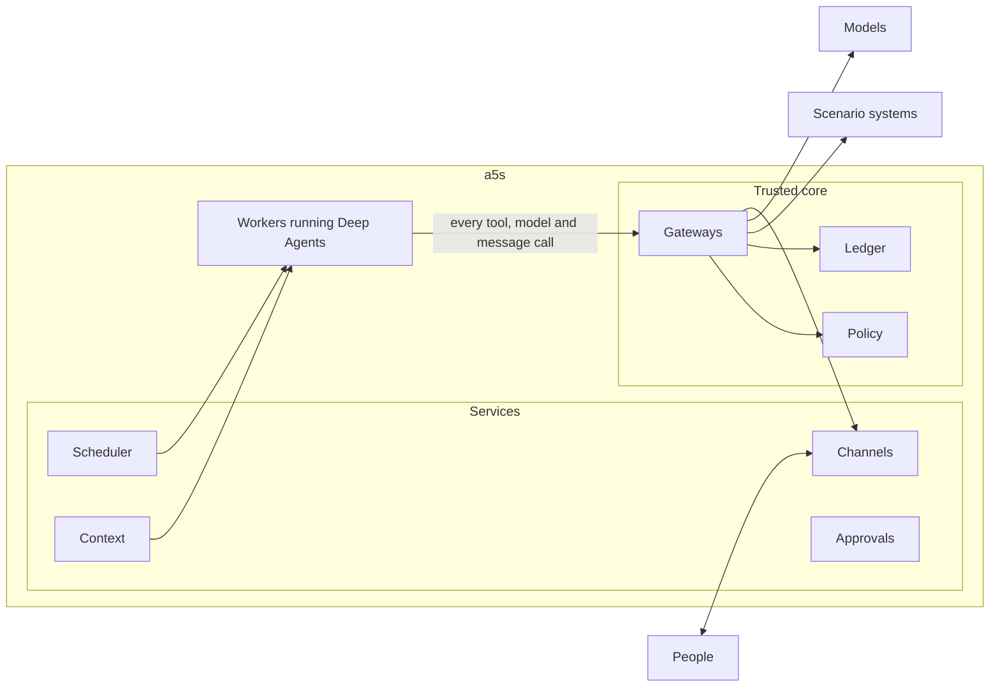

# Architecture

**Status:** Draft v0.3. Phase 1's first step is built ([progress](phase-1.md#progress)) · **Under:** [a5s](../README.md)

a5s runs agents the way an operating system runs programs. It installs them, gives each one an identity and only the rights it needs, wakes it when there's work, checks every call it makes, and keeps a record of what happened. Agents run on LangChain Deep Agents. Each scenario plugs in through a [contract](#the-scenario-contract) and brings its own people, systems and rules.

## The trusted core and the rest

| Part | What it is | A change needs |
| --- | --- | --- |
| Trusted core | Policy, written in Cedar; the gateways for tools, models and outgoing messages; the endpoints where people's messages arrive, which check who sent each one; the credential broker; the ledger writer; masking. Also the data they keep, which changes only through their own interfaces: grants, caps, instance status, run envelopes and held calls. | Approval from outside the team that runs a5s, a protected branch and an attested build ([independence](#independence)) |
| Services | The scheduler, context, channels, approvals and assurance services, and the register's interface. They change core data only through the core's own interfaces, which apply the rules for loosening. | The team's own review and tests |
| Workers | Run each piece of work as a Deep Agents run, with no credentials and no network except to the gateways | As services |

A fault or a compromise in a service or a worker can make an agent slow, wrong or silent. It can't make one do what policy denies, because every call goes through the core.

## The scenario contract

A scenario plugs into a5s by providing these, or by taking a5s's defaults:

| Interface | Gives a5s | a5s's default |
| --- | --- | --- |
| Directory | People, the roles they hold, such as who owns each part, their teams, reporting lines and working hours, which may cross midnight, and what each may see, for any record | The organisation's identity provider, such as Entra ID, Google Cloud Identity, Okta or Keycloak, or its own directory, such as Active Directory, with roles assigned as groups |
| Settings | The parts each instance works in, whom it serves, by name or as a team or a role's holders, which the directory resolves at each run, how far each agent may act in each part and type of action, limits, sensitive fields, classes of data, the escalation chain, who agents may talk to, and the scenario's switches. A version counts only once the owner of each part its instances work in has signed it, with their own key or through the identity provider, and an instance approver for any instance in no part, or for new classes of data. Its serial only rises, so an older version can't be replayed. | a5s's settings store, with signed versions from files in git, or approved on cards in the chat, which people can ask for in a5s's settings app |
| Tools | The systems agents use, as MCP servers, with each tool's risk attributes | None |
| Records | Where obligations come from, such as cases past their due time, each person's records as they stand, for reports of what changed, one record by its key, for a case's brief, the part each record is in, and the events that wake agents | None |
| Governed process | Where agents' requests to change data go, and who decides them | Held proposals in a5s itself, from phase 2 |
| Decision surface | Where people decide | Cards in the chat, which open the core's own page, apart from the conversation. Each decision there is signed through the identity provider for that one decision. |
| Policy pack | The scenario's own restrictions, which can only add to a5s's base pack | None |
| Tests | The scenario's tests, run against its systems or a fake of them | None |

Each scenario starts with a fake of its contract: fake systems, records and settings, which are also its test bench. a5s has a sample scenario of its own, a fake of every interface with synthetic data, for phase 1 and for building locally. An [IT service desk](../scenarios/it-service-desk.md), written against the contract alone in round 5's tests, checks that the contract is general: its tools answer with objects, as MCP tools do, its keys have their own pattern, and its night shift works across midnight.

## A call, step by step

Every tool call, model call and outgoing message takes the same path:

1. The agent sends the call to a gateway with the run's id, and nothing else about the run. The core keeps each run's envelope itself: the instance and the people it acts for, taken from the trigger when the run opened, with a message's sender checked against the channel's signed identity; whether the run has read outside content, which the gateway marks when it returns some; and the handles it issued.
2. In one Postgres transaction, the gateway reads the settings, checks them against their signatures, evaluates the Cedar policies, reserves any counts, and writes the ledger entry. Nothing is cached: while the settings in force don't check out, every call is denied. If any step fails, the call is denied. A run's model calls go one at a time, so calls made together can't overrun its budgets.
3. On allow, the gateway gets a short-lived credential for that one call, resolves the handles to values, and makes the call. In what comes back, at any depth, it withholds records the run may not see, tokenises classified values, puts any handle's value back as its handle, tags it with its source, and records the outcome. Text in the arguments is cleaned at any depth too.
4. On deny, the call never runs, and the agent gets the reasons in words, so it can change course. On hold, it doesn't run either: a hold is a Cedar annotation on a permit, and the gateway keeps the call as a held proposal for a person to decide, answering the agent at once with who decides ([proposals](#proposals-and-approvals)).

The model gateway also checks each model's provider, deployment, region and dated version, and records prompts by hash, not by content. The ledger records every text the same way, by its hash: what people say, what agents write and the arguments of a5s's own tools. Only record keys and a5s's own ids are kept as they are.

## Policy

Policy answers **allow**, **hold** or **deny**, and denies by default.

- **Inputs:** the instance, the people it acts for, the tool or model and its risk attributes (reads, writes, sensitive, destructive, sends outside), the fields it touches with their parts and classes, the level for that part and type of action, the counts, the budget, and the scenario's switches.
- **Rights come first.** Actions a scenario forbids are never in any agent's grant, so no instruction can talk an agent into them. Policy is the second line, not the only one.
- **Levels** come from the scenario's settings for each instance, part and type of action. The instance works at the lower of that setting and a5s's own cap ([autonomy](agent-model.md#autonomy)).
- **Counts** stop a piece of work going past a limit the scenario sets, such as a mass-change size, and send the rest to whoever approves it. Code, not the model, decides what a piece of work is: a run. The settings give each type of action a limit for a run, and one for each person acted for in 30 days, across every agent. The gateway counts in the transaction that decides the call, under a lock, and the same change made again in a run counts once.
- **Failing closed.** If policy, the settings, the counts or the ledger can't be reached, calls are denied, the run ends and its trigger waits.
- **A schema.** A Cedar schema lists the facts every call carries. A call missing any of them is denied, and a pack that refers to anything else fails to load.
- **Packs.** a5s's base pack holds what's always enforced: deny by default, the people a run acts for never decide what it raises, a marked run never acts at level 2 or writes a profile, and [what a5s won't do](#what-a5s-wont-do). A scenario's pack can only add restrictions.

## Provenance: who said what

a5s answers "whose words are these?" in code, never by asking the model, at three grains:

- **Runs.** A run that has read outside content, through the extractor, stays marked. It can't act at level 2 or write anyone's profile, and what it drafts says so.
- **Values the agent shouldn't retype.** Tools return sensitive values, such as a contact or a bank account, as handles. The agent passes the handle on, the gateway resolves it when it calls a system, and code renders it for people. The source of each such value is exact, and the model never needs to see it.
- **Typed values.** Keys, amounts, dates and codes the agent writes are matched exactly against what the run has read. A match carries its source, and anything else is flagged as the agent's own.

Free text the agent writes is always its own. Facts a person relies on to decide, such as whether a check was done, are computed by code and shown apart from the agent's narrative. A run acts for everyone whose words it serves: whoever sent the message, set the reminder, or wrote the reply a request came from. They're named on whatever the agent drafts or raises, and none of them may decide it. This follows the CaMeL pattern of keeping untrusted data out of what decides the next step. Phase 1 built typed values and handles alongside conversations, and phase 2 marked runs, with the extractor.

## Proposals and approvals

At level 1, an agent's work reaches people in one of three ways:

| Way | When | Who decides |
| --- | --- | --- |
| Draft | The agent prepares something for a person to use, such as a pre-filled request or a case pack | The person, by using it or not |
| Request | The action belongs to a governed process | Whoever the process routes it to. The process checks the agent's level with a5s before it approves anything automatically. |
| Held proposal | The action has no governed process | The owners of each part it touches, and anyone they name to decide beside them, with an approval for each part, never anyone it was for. a5s holds the exact call, and the agent carries on. Once it's approved, the gateway makes the call, if the records haven't changed, and tells whoever it was for and everyone who decided it. |

Drafts and requests carry a handoff note and the agent's flags, so whoever decides sees them. A decision on a held proposal is signed by its decider for that decision on exactly that change, through the identity provider, and each signature works once. Changes that aren't sensitive can be decided together with one signature, which names each of them. Settings are approved this way from phase 1: a card in each instance approver's chat opens the core's page, where they sign in afresh with a nonce that commits to approving that version, so the provider's signature covers the decision. The channels app, which people reach, checks the sign-in and records it; the gateway, which nobody outside reaches, checks it again and seals the approval with a key only it holds, so breaking into the part people reach gives nobody that key. The approval outlasts the provider's keys, and editing the database approves nothing. Decisions on held changes and grades are sealed the same way. Decisions are taken only on the decision surface, never by telling the agent in conversation, and after a decider's authenticator is reset, their decisions wait a day before they take effect [TBC]. At level 2, actions run and are reported, to the instance's owner and deputy, or else the owners of the parts they touch, with what each replaced, and the person it was for hears from a5s; the agent owner can reverse them through the scenario's own process.

## How an agent lives

An instance lives in records: its identity, register entry, triggers, obligations and context. Compute is temporary.

1. **Wake.** A message, an event, a schedule or an obligation falling due wakes it. So does a sweep, which runs only while the instance is idle and starts no model when nothing has changed. Every agent can be talked to.
2. **Lease.** The scheduler takes a lease on the person's conversation with the agent, so it runs one thing at a time [TBC: a lease for each topic], and asks the core to open the run, which checks that the instance is active and has budget left. The core puts the work in a topic or case: an event or obligation by its record, and a message in the conversation's current topic, unless it names another record or the conversation has been quiet for a few hours.
3. **Assemble.** The context service builds the run's context, within a budget for each part:
   - the release's instructions, and the skills for the parts in play;
   - the person's profile;
   - the conversation's latest turns, and in a case, the case's summary and older turns;
   - a brief of the case, built from records;
   - what a search of the history finds.
4. **Run.** A fresh Deep Agents run, on a LangGraph thread that lasts only as long as the run. Every call goes through the gateways.
5. **Record.** The context service adds the turn to the conversation, and folds the topic's turns that no longer fit into its summary. The scheduler updates the obligations, and the lease ends.

- **Obligations** are worked out by code from the scenario's records, never inferred by the model, with one for each record and person across all agents, naming the instance that acts on it. A person can say what they're waiting on, which pauses chases to them until the date they give.
- **Reports** are worked out by code too. An agent whose release reports on a kind of record, such as the watcher, tells each person it serves, in their daily digest, what changed in their records since it last told them, and what fell due. Code compares the records with what it last told them, so the model only words the facts, and a day with nothing new starts no model. Each report acts for its person alone.
- **Promises and reminders.** When an agent promises a follow-up, or a person asks for a reminder, a typed tool records it in a5s's own records, and it counts only once the person confirms it, in a later message of their own. It's theirs alone: only a run answering their own message can set one, and content from outside can't. When it falls due, the agent reminds them, and if the agent can't act, the core reminds them itself.
- **Triggers and schedules** come with the release, and an agent can't create its own.
- **Repeats are safe.** Tools are idempotent, with keys made from the piece of work, the record and the change.

## Context and memory

People get one conversation with each agent, and it never runs out of room, however many runs it takes. Each run starts fresh and reads the conversation from a5s's records, so long conversations stay cheap and upgrades never strand them.

| Context | What it is | Written by | Checked by |
| --- | --- | --- | --- |
| Conversation | Every turn with a person, across channels, organised in topics such as one per request | a5s, as turns happen | The person, who can see all of it |
| Summaries | A structured summary of each topic: decisions, commitments, open questions, and facts by handle | a5s, once a topic's turns no longer fit in its runs. Code keeps every key, amount and date they had, and keeps no summary that has one nobody said. | The person, who can correct it |
| Profile | Typed preferences, such as digest time and channel, and a short "how I like to work" note | The person, or the agent with their confirmation | The person |
| Case briefs | The state and history of a case, built for each run | Code, from records | Nobody needs to: the records are the source |
| Instructions and skills | How the agent works | Only a release | The release approver |

- **One conversation per person per agent,** whichever of the agent's instances does the work. A message that names a record goes to the instance that works in the record's part. Each run's grant comes from the instance, so its scope is enforced at the tools.
- **a5s's own words** in an agent's chat, such as an escalation or a reminder the core gives itself, go in that conversation as a5s's notices, so the agent's next run knows what the person is answering. They're never taken for the agent's words, nor counted as something the person said.
- **Records beat recollection.** Commitments and decisions live in records, never only in a conversation, and answers about the past retrieve the original turns, not just the summary.
- **People stay separate.** Nothing from one person's conversation enters a run for someone else. An agent acting for people sees only what the directory says all of them may see.
- **Classified values** are tokenised in conversations, and shown back only to people who may see them.
- **Group conversations.** In a Teams group chat or a Matrix room of up to 20 people the directory knows, an agent answers whoever mentions it there, and hears nothing else, which it's told. It acts for everyone in the chat, as the chat itself lists them at each message, so a run there finds, sees and says only what all of them may see. Its changes are for whoever asked and whoever spoke in what it was given: only they don't decide them, and only their limits count them. Its day's budget is the asker's, and it writes only to the group. A Matrix room is someone's own only while nobody else can join or read it, and someone's own chat that another person joins becomes a group's, so a5s writes to them first in a new one. The group's conversation is its own, apart from each person's, with who said each turn and who heard it, and a run is given only what everyone now in the chat heard, so someone added later gets nothing said before. Its summaries are of what everyone in it heard, each fact with who said it, and a run is given one only if everyone it acts for heard all it holds: once someone joins, the next summary starts afresh, from what they heard. What's one person's own stays one to one: notes on how they like to work, digests, their list of reminders, and agents writing first. A reminder asked for in a group is the asker's alone, and what becomes of a held change reaches the asker ([`core/groups.py`](../src/a5s/core/groups.py)).
- **A notebook** of what an agent learns from records, for its instance's later runs, such as which kind of question comes up on a kind of record. Only a run that acts for nobody notes anything, such as one on a schedule its release brings: it hears nobody's words, so a note comes from records alone, never from what someone said, and a run that has read content from outside notes nothing. Code keeps a note only if every record it names was read by the run with a tool, in its instance's parts, and what the run read of them holds every key, amount and date in it. A note reaches only people who may see every record its run read, since it may draw on any of them, and only runs on a case it names, as something to check, not as found. It goes once its records change, checked each day apart from the retention sweep, and the notebook keeps its newest 50. The agent's owner, or whoever runs its instance, reads and removes notes on the core's page, `/notebook/` ([`core/notebook.py`](../src/a5s/core/notebook.py)).

## Channels

Each agent talks to people under one identity, never a person's, and says it's an AI agent. Outgoing messages, and the text of drafts, go through a gateway that keeps only text and the record links the scenario's systems build. Messages go only to the audience the settings name [default: people inside the organisation].

- **Which chats.** Each deployment turns on the chats its people use, any number at once: a web chat the core serves, Matrix on the organisation's own homeserver, and Teams, as well as the command line. The directory names each person in each chat they use. A reply goes back through the chat its message came from. An agent that writes first writes only as its own bot: in the conversation the person last had with it, or else in the chat they last wrote in, where its bot starts one if the chat lets it. Otherwise, and once the person leaves that conversation, it waits in their inbox in the web chat and on the command line. An agent works in a group chat too, answering only when someone mentions it: in Teams, a group chat, never a team's channel, and in Matrix, a room that shows nobody what was said before they joined.
- **Who can start a run.** Only people the directory knows, and the core itself, for the obligations it works out from records and the schedules releases bring. Every message arrives at the core first, which checks who sent it and records it: a sign-in token from the organisation's identity provider, which names the person by a claim they can't change, such as Entra ID's object id; for Teams, the Bot Framework's signed token, which doesn't cover what a message says, so only the core may receive one; or, for Matrix, the organisation's own homeserver, which proves each delivery with a token only the core holds, and vouches only for its own people. A run that answers a message takes its sender from that record and can use it once, so no service can say a message came from someone else, and a person's token goes no further than the core. a5s's own notices go only in answer to someone, apart from escalations, which the core writes itself from the records. Email starts one only from a sender who passes DMARC and matches the directory, and the agent never answers a Reply-To address. Any other email goes to the extractor as a document.
- **Contact.** Each person gets one digest a day from all the agents together, at a time they choose: the start of their working day unless they ask for another. What agents write to them on their own, such as chases, reports and reminders for a day, waits for it, and the agents' work for it is done when its time comes, so nothing in it is stale. What comes up after it waits for the next one. A digest with one item is that item, from its agent. In Teams and Matrix, each agent's items go in its own chat; in the inbox, one with more is a5s's own message, with each item under its agent. A digest waits half an hour at most for its agents' work, and goes once a day, by the person's own date. Outcomes people are waiting for, such as answers to their messages, go at once. So do urgent items, such as escalations and reminders for a particular time, up to five a day for each person across all the agents. A reminder someone asked for at a particular time doesn't count toward the five. After the five, the rest wait, and go together once an hour, in the person's working hours. Escalation follows the scenario's chain, in people's working hours, and goes only to people who may see the record.
- **Delivery.** Everything a5s sends to a chat it writes to itself, such as Teams or Matrix, goes in the outbox in the transaction that decides it, and is delivered after. One the chat doesn't take is tried again after a minute, then two, four and eight, and after five tries it waits in the person's inbox instead, which the ledger records and the status counts. A reminder or chase whose run doesn't finish, because the model is down or the budget is spent, is given by the core itself, in its own words.
- **When an agent can't help,** because it's suspended, out of budget, stopped by an outage or no longer approved, the channel service says so in code and names who to ask. Its obligations escalate in code along the scenario's chain as they fall due.

## Data protection

- **Classes** of data come from the scenario's settings, and decide what's masked and which models may see it.
- **Tokens.** The ledger, conversations, traces and test data hold tokens with record keys, not classified values.
- **Retention.** A conversation is kept for 12 months after the last thing a person and an agent said to each other, and then deleted, with its summaries and the messages that carried it. Notes on how people like to work, and reminders, go 12 months after they ended or, if never confirmed, were offered, and a note someone asks to forget goes at once. What someone waits on goes with the date they named, and what a report told a person goes once it's told. The values a run is handed as handles go once it's over. The ledger records what each deletion removed, in counts, and keeps nothing that was said. What a5s keeps for someone who leaves is archived where it is, a day after the directory stops naming them, under a name no person has, and goes on the same clock ([`core/departures.py`](../src/a5s/core/departures.py)).
- **Models.** Each approved model names its provider, deployment, region and version: a dated version where the provider offers one, and otherwise the version each response reports, checked every time. The model gateway refuses anything else, including a failover to an unapproved model. It speaks both OpenAI-compatible and Anthropic-compatible APIs, so a model from any provider that offers either can be approved, including open-weight models an organisation hosts in its own cloud or on its own premises. A server on the organisation's own network may need no key.
- **Outside content.** A scenario's tool says which fields of what it returns are content from outside the organisation, such as an email's body, and the fixed form a5s's extractor fills from them: keys, amounts, dates, yes or no, choices from a list, and sensitive values, never free text. The agent never gets those fields: the extractor, a call to the instance's own approved model with no tools, fills the form, and code keeps only values the document itself contains, sensitive ones as handles. An agent can also ask the extractor a question about a document its run has read, and the answer comes back in free text, marked as outside content and never used as an instruction. The run is marked from its first outside content. Classifiers such as Prompt Shields, Model Armor or Bedrock Guardrails add signals. They're never the boundary.
- **Supply chain.** Skills are copied into the release and pinned by hash, and so are the schemas of the tools it uses, so the gateway refuses a tool whose schema has changed. a5s's image pins its base images by digest and its packages by hash, its build's provenance is signed, and the actions that build it are pinned by commit. It also refuses tool servers' requests to ask people for input or to run the agent's model.

## Evidence

The ledger is a hash-chained Postgres table, written in the same transaction as each policy decision. It records the instance and release, the people acted for, the call and its masked arguments, the decision with the policy and settings versions, and the outcome. Every [TBC: hour], the entries since the last copy, and the hash of the last of them, go to object-lock storage that belongs to the scenario's assurance, in an account the team that runs a5s can't administer: S3 Object Lock, Azure's immutable Blob Storage or Google Cloud Storage's object retention. Nobody can change or delete a copy until its retention ends, and a5s won't copy a history that no longer matches its copies. So a rewritten history shows, even if every hash after the change is recomputed. That makes the ledger tamper-evident. Because it holds tokens, deleting a token's mapping when its retention ends removes the personal data without breaking the chain.

The same events go out as OpenTelemetry spans, using the GenAI conventions at a pinned version, since they're still at Development stability. Traces are for debugging. The ledger is the evidence.

## Assurance

- **Tests.** Each release passes its regression suite and the scenario's tests, attempted injections included.
- **Measures.** Work handled, acceptance and edit rates, time to decision, chases, cost, and how many people use the agents. Measures of individual people judge outcomes, not speed. They're agreed with the data protection officer, and with works councils where there are any, before they start.
- **Samples and level-ups.** a5s keeps its cap for a behaviour: an agent, its model, and the tools of a type of action it may use, as pinned, so a release that changes only instructions keeps the level its grades earned. Code draws samples of an agent's changes: every held change someone decided, while its cap is 1, and at level 2 changes made, at random, about 100 a quarter. People who hold the grader role grade them on the core's page, signing in afresh to give exactly those grades, which the core seals: never from the team that built the agent or the teams that run the instance, nor anyone a change was for, who decided it, or who reports to whoever did, and only for records they may see. An anytime-valid sequential test, on the grades given since the cap last changed, raises the cap when the evidence shows accuracy meets the part's threshold, and lowers it when it shows it doesn't, or at once on a critical error. The core seals each cap with the ledger entry that set it ([starting values](starting-values.md)).

## Independence

- **Loosening needs someone else.** Anyone with the role can make a5s safer alone: suspend an instance, lower a cap or withdraw a release. Anything that loosens it needs someone outside the team that runs a5s and its manager's reporting line, and is reported to assurance. That covers resuming someone else's suspension, raising a level or cap by hand, widening a grant, and changing the trusted core. A scenario can also mark an agent as a check, such as one that reconciles changes for auditors. Stopping or changing it then needs the scenario's assurance to agree.
- **Releases are proportionate.**

  | A release that | Needs |
  | --- | --- |
  | Changes only instructions or skills, and widens nothing | The agent owner and a second engineer, after the regression suite and a re-run of the last graded samples |
  | Changes a tool, or widens a grant, trigger, model, class of data or cap | The release approver, from outside the team |
  | Fixes a security advisory | Nothing more: it goes in at once, at level 1 at most |
  | Changes the trusted core | The release approver, an attested build, and assurance's tests |

  Each organisation's people approve each release for their own deployment, by signing what it is there. The core works out what changed since the release they approved before, checks the signatures against the directory, and opens no run until the release has what it needs ([lifecycle](agent-model.md#lifecycle)).

- **Evidence and grading** sit outside the team. The ledger's anchor is with assurance, and nobody from the team that built an agent grades its work.

## When things fail

The scenario's own processes work without agents. So when a5s can't run safely, it stops, says so, and people carry on there.

- A run whose dependency fails ends, and its trigger waits. A circuit breaker pauses new runs while the dependency is down.
- Budgets are kept per person and per source of triggers, with a share kept for obligations, and outside parties are rate-limited.
- An instance can always go straight back to the release it ran before.

## Operations

Phase 1 sets these up:

- **Environments:** local, against the scenario's fake; test; and production. Each scenario's data and agents are kept apart [TBC].
- **Objectives:** how quickly people get answers, nine in ten within two minutes, and the share of what's owed that's chased before it falls due, 95% [TBC: from the first users' baseline].
- **Status and runbooks** for the team that runs a5s: the queue, runs, denials, budgets, suspensions and breakers, and the objectives, from `a5s status` or a dashboard, and what to do when each goes wrong ([runbooks](runbooks.md)). On call: once people depend on a5s, a weekly working-hours rota of the team that runs it, paged out of hours only for the ledger's copies, a change stopped part way, and a sudden rise in denials, since a5s stops safely and people carry on without it ([on call](runbooks.md#on-call)).
- **Traces** as masked OpenTelemetry spans, which carry no prompt, reply, message, tool argument or person, kept for 14 days.

## Hosting

Phase 1 runs a5s's own services and workers on Kubernetes, in each cloud's managed Kubernetes, AKS, GKE and EKS, each with managed Postgres, so nothing ties a5s to one cloud. The same chart runs on the organisation's own clusters on premises, even on a network with no way out, with its own Postgres, identity provider, models and locked storage. They run as one container image, and network policies keep workers away from everything but the gateway ([deploy](../deploy/)). Nothing waits inside a host's session: conversations and held calls live in a5s's records, so a5s can move hosts or use a managed runtime later.

| Host | Runs on | Identity | Gateway |
| --- | --- | --- | --- |
| Any, including the organisation's own premises | a5s's own workers | The organisation's identity provider, through OpenID Connect | An MCP gateway such as agentgateway, with a5s's policy |
| AWS | AgentCore Runtime | AgentCore Identity | AgentCore Gateway |
| Microsoft | Foundry hosted agents | Entra Agent ID | a5s's own |
| Google | Agent Runtime | Agent Identity | Agent Gateway, managed only for Agent Runtime so far |

A host's gateway sits in front of a5s's own policy and ledger, because the decision, the counts and the ledger entry are one transaction.

## What a5s uses from Deep Agents

a5s pins its versions, and treats each upgrade as a release. It needs deepagents 0.7.25 or later, which fixed a way around its approval rules.

| Uses | Doesn't use |
| --- | --- |
| The agent loop, reading a tool result too large for one message from the run's scratch files, skills loaded read-only from the release, and summarisation and offloading within a long run | The editable `AGENTS.md` memory, the long-term store, interrupts, file permissions as a boundary, the Agent Server, and the shell, file and subagent tools, which each model call would carry for nothing |

If the list shrinks further, LangChain's own `create_agent` could be the base instead.

## Agent to agent

An agent asks another what it knows, such as the assistant asking the watcher what changed on someone's records, with the typed tool `ask_agent`. Only instances of one deployment ask each other, and only those an instance's settings name, which the owners of the parts both work in approve, and a release says whether its agent asks at all. The core opens a run of the instance asked at once, acting for the same people as the run that asks, and the worker that asked runs it, as it runs its own, so a question never waits for a worker another run holds. The people travel with the question and authority never passes from one agent to the other: the run asked works within its own grant and level, and what those people may see, and nobody it acts for decides what it holds. It sees no class of data the asking model may not see either, since its answer goes there, and its day's budget is the asker's. An agent that reports on records, such as the watcher, is given what its reports would tell those people. It writes to nobody: its answer goes back to the run that asked, as the tool's result. The question carries the asker's mark to it, and its answer carries its own mark back, so a run that hears from one that read content from outside works as one that has. Only the values it read with its tools and what a5s told it count as found for the run that asked, never those it was asked about, and what came from outside stays from outside, so a value an agent wrote itself is noted as such when it's passed on. An agent that's asked can't ask another, so questions never chain, a run asks three at most, and the ledger links the two runs. A question and its answer can be given as an A2A task, in A2A 1.0's shapes for a message and a task, so agents outside a5s can come later without a second way of asking ([`core/asking.py`](../src/a5s/core/asking.py)).

## Standards

| For | Standard |
| --- | --- |
| Tools | MCP, specification 2026-07-28 |
| Models | OpenAI-compatible and Anthropic-compatible APIs |
| People's identity | OpenID Connect |
| Agent to agent | A2A v1.0 |
| Skills | Agent Skills |
| Identity and delegation | OAuth as MCP uses it, and token exchange (RFC 8693) |
| Policy | Cedar |
| Telemetry | OpenTelemetry GenAI conventions, pinned |

## What a5s won't do

- Let an agent change anything in its own release in production.
- Let a model approve an action, or assert a fact someone relies on to decide.
- Give a model, a worker or a sandbox credentials.
- Take a decision on a proposal anywhere but the decision surface.
- Let an agent act without telling anyone. There's no level above 2.
- Move money. No agent can make, approve or release a payment.
- Write to a system of record except through its own governed process.
