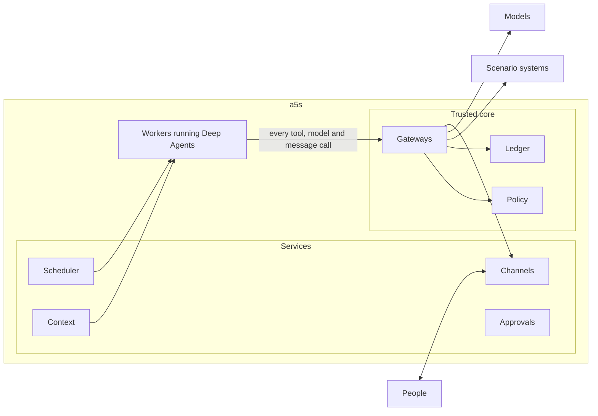

# Architecture

**Status:** Draft v0.3. Phase 1's first step is built ([progress](phase-1.md#progress)) · **Under:** [a5s](../README.md)

a5s runs agents the way an operating system runs programs. It installs them, gives each one an identity and only the rights it needs, wakes it when there's work, checks every call it makes, and keeps a record of what happened. Agents run on LangChain Deep Agents. Each scenario plugs in through a [contract](#the-scenario-contract) and brings its own people, systems and rules.

## The trusted core and the rest

| Part | What it is | A change needs |
| --- | --- | --- |
| Trusted core | Policy, written in Cedar; the gateways for tools, models and outgoing messages; the endpoints where people's messages arrive, which check who sent each one; the credential broker; the ledger writer; masking. Also the data they keep, which changes only through their own interfaces: grants, caps, instance status, run envelopes and held calls. | Approval from outside the team that runs a5s, a protected branch and an attested build ([independence](#independence)) |
| Services | The scheduler, context, channels, approvals and assurance services, and the register's interface. They change core data only through the core's own interfaces, which apply the rules for loosening. | The team's own review and tests |
| Workers | Run each piece of work as a Deep Agents run, with no credentials and no network except to the gateways | As services |

A fault or a compromise in a service or a worker can make an agent slow, wrong or silent. It can't make one do what policy denies, because every call goes through the core.

## The scenario contract

A scenario plugs into a5s by providing these, or by taking a5s's defaults:

| Interface | Gives a5s | a5s's default |
| --- | --- | --- |
| Directory | People, the roles they hold, their teams, reporting lines and working hours, and what each may see, for any record | The organisation's identity provider, such as Entra ID, Google Cloud Identity, Okta or Keycloak, or its own directory, such as Active Directory, with roles assigned as groups |
| Settings | Parts and their owners and delegates, how far each agent may act in each part and type of action, limits, sensitive fields, classes of data, the escalation chain, who agents may talk to, and the scenario's switches. Each version is signed by its owner, with their own key or through the identity provider, and an unsigned one doesn't count. Its serial only rises, so an older version can't be replayed. | a5s's settings store, with signed versions from files in git or approved on cards in the chat, and from phase 1's step 6 a simple app |
| Tools | The systems agents use, as MCP servers, with each tool's risk attributes | None |
| Records | Where obligations come from, such as cases past their due time, each person's records as they stand, for reports of what changed, and the events that wake agents | None |
| Governed process | Where agents' requests to change data go, and who decides them | Held proposals in a5s itself, from phase 2 |
| Decision surface | Where people decide | Cards in the chat, which open the core's own page, apart from the conversation. Each decision there is signed through the identity provider for that one decision. |
| Policy pack | The scenario's own restrictions, which can only add to a5s's base pack | None |
| Tests | The scenario's tests, run against its systems or a fake of them | None |

Each scenario starts with a fake of its contract: fake systems, records and settings, which are also its test bench. a5s has a sample scenario of its own, a fake of every interface with synthetic data, for phase 1 and for building locally. Scenarios on paper, such as an [IT service desk](../scenarios/it-service-desk.md), check that the contract is general.

## A call, step by step

Every tool call, model call and outgoing message takes the same path:

1. The agent sends the call to a gateway with the run's id, and nothing else about the run. The core keeps each run's envelope itself: the instance and the people it acts for, taken from the trigger when the run opened, with a message's sender checked against the channel's signed identity; whether the run has read outside content, which the gateway marks when it returns some; and the handles it issued.
2. In one Postgres transaction, the gateway reads the settings, evaluates the Cedar policies, reserves any counts, and writes the ledger entry. Settings are cached for at most [TBC: 30 seconds], and a change clears the cache. If any step fails, the call is denied.
3. On allow, the gateway gets a short-lived credential for that one call, resolves the handles to values, and makes the call. It tokenises classified values in what comes back, tags it with its source, and records the outcome.
4. On deny, the call never runs, and the agent gets the reasons in words, so it can change course. A hold is a Cedar annotation on a permit, used for a5s's own held proposals from phase 2. With them comes a way for the agent to ask the core to explain a call before making it: allow, hold or deny, with the reasons, reserving nothing.

The model gateway also checks each model's provider, deployment, region and dated version, and records prompts by hash, not by content.

## Policy

Policy answers **allow**, **hold** or **deny**, and denies by default.

- **Inputs:** the instance, the people it acts for, the tool or model and its risk attributes (reads, writes, sensitive, destructive, sends outside), the fields it touches with their parts and classes, the level for that part and type of action, the counts, the budget, and the scenario's switches.
- **Rights come first.** Actions a scenario forbids are never in any agent's grant, so no instruction can talk an agent into them. Policy is the second line, not the only one.
- **Levels** come from the scenario's settings for each instance, part and type of action. The instance works at the lower of that setting and a5s's own cap ([autonomy](agent-model.md#autonomy)).
- **Counts** stop a piece of work going past a limit the scenario sets, such as a mass-change size, and send the rest to whoever approves it. Code, not the model, decides what a piece of work is. From phase 2.
- **Failing closed.** If policy, the settings, the counts or the ledger can't be reached, calls are denied, the run ends and its trigger waits.
- **A schema.** A Cedar schema lists the facts every call carries. A call missing any of them is denied, and a pack that refers to anything else fails to load.
- **Packs.** a5s's base pack holds what's always enforced: deny by default, the people a run acts for never decide what it raises, a marked run never acts at level 2 or writes a profile, and [what a5s won't do](#what-a5s-wont-do). A scenario's pack can only add restrictions.

## Provenance: who said what

a5s answers "whose words are these?" in code, never by asking the model, at three grains:

- **Runs.** A run that has read outside content, through the extractor, stays marked. It can't act at level 2 or write anyone's profile, and what it drafts says so.
- **Values the agent shouldn't retype.** Tools return sensitive values, such as a contact or a bank account, as handles. The agent passes the handle on, the gateway resolves it when it calls a system, and code renders it for people. The source of each such value is exact, and the model never needs to see it.
- **Typed values.** Keys, amounts, dates and codes the agent writes are matched exactly against what the run has read. A match carries its source, and anything else is flagged as the agent's own.

Free text the agent writes is always its own. Facts a person relies on to decide, such as whether a check was done, are computed by code and shown apart from the agent's narrative. A run acts for everyone whose words it serves: whoever sent the message, set the reminder, or wrote the reply a request came from. They're named on whatever the agent drafts or raises, and none of them may decide it. This follows the CaMeL pattern of keeping untrusted data out of what decides the next step. It's prototyped early in phase 1, alongside conversations.

## Proposals and approvals

At level 1, an agent's work reaches people in one of three ways:

| Way | When | Who decides |
| --- | --- | --- |
| Draft | The agent prepares something for a person to use, such as a pre-filled request or a case pack | The person, by using it or not |
| Request | The action belongs to a governed process | Whoever the process routes it to. The process checks the agent's level with a5s before it approves anything automatically. |
| Held proposal, from phase 2 | The action has no governed process | The owner of what it touches. a5s holds the exact call, and the agent carries on. Once it's approved, the gateway makes the call, if the records haven't changed. |

Drafts and requests carry a handoff note and the agent's flags, so whoever decides sees them. From phase 2, a decision on a sensitive item is signed by its decider for that one decision, through the identity provider, and each signature works once. Settings are approved this way from phase 1: a card in each instance approver's chat opens the core's page, where they sign in afresh with a nonce that commits to approving that version, so the provider's signature covers the decision. The core seals each approval once it has checked it, with a key only the core holds. The approval outlasts the provider's keys, and editing the database approves nothing. Decisions are taken only on the decision surface, never by telling the agent in conversation, and after a decider's authenticator is reset, their decisions wait a day before they take effect [TBC]. At level 2, actions run and are reported, and the agent owner can reverse them through the scenario's own process.

## How an agent lives

An instance lives in records: its identity, register entry, triggers, obligations and context. Compute is temporary.

1. **Wake.** A message, an event, a schedule or an obligation falling due wakes it. So does a sweep, which runs only while the instance is idle and starts no model when nothing has changed. Every agent can be talked to.
2. **Lease.** The context service puts the work in a topic or case: an event or obligation by its record, and a message in the person's current topic, unless it names another record or they start a new one. The scheduler takes a lease on that topic or case, so each runs one thing at a time, and asks the core to open the run, which checks that the instance is active and has budget left.
3. **Assemble.** The context service builds the run's context, within a budget for each part:
   - the release's instructions, and the skills for the parts in play;
   - the person's profile;
   - the topic's summary and recent turns;
   - a brief of the case, built from records;
   - what a search of the history finds.
4. **Run.** A fresh Deep Agents run, on a LangGraph thread that lasts only as long as the run. Every call goes through the gateways.
5. **Record.** The context service adds the turn to the conversation and updates the topic's summary. The scheduler updates the obligations, and the lease ends.

- **Obligations** are worked out by code from the scenario's records, never inferred by the model, with one for each record and person across all agents, naming the instance that acts on it. A person can say what they're waiting on, which pauses chases to them until the date they give.
- **Reports** are worked out by code too. An agent whose release reports on a kind of record, such as the watcher, tells each person it serves, in their daily digest, what changed in their records since it last told them, and what fell due. Code compares the records with what it last told them, so the model only words the facts, and a day with nothing new starts no model. Each report acts for its person alone.
- **Promises and reminders.** When an agent promises a follow-up, or a person asks for a reminder, a typed tool records it in a5s's own records, and it counts only once the person confirms it, in a later message of their own. It's theirs alone: only a run answering their own message can set one, and content from outside can't. When it falls due, the agent reminds them, and if the agent can't act, the core reminds them itself.
- **Triggers and schedules** come with the release, and an agent can't create its own.
- **Repeats are safe.** Tools are idempotent, with keys made from the piece of work, the record and the change.

## Context and memory

People get one conversation with each agent, and it never runs out of room, however many runs it takes. Each run starts fresh and reads the conversation from a5s's records, so long conversations stay cheap and upgrades never strand them.

| Context | What it is | Written by | Checked by |
| --- | --- | --- | --- |
| Conversation | Every turn with a person, across channels, organised in topics such as one per request | a5s, as turns happen | The person, who can see all of it |
| Summaries | A structured summary of each topic: decisions, commitments, open questions, and facts by handle | a5s after each run. Code checks that every key, amount and date survives. | The person, who can correct it |
| Profile | Typed preferences, such as digest time and channel, and a short "how I like to work" note | The person, or the agent with their confirmation | The person |
| Case briefs | The state and history of a case, built for each run | Code, from records | Nobody needs to: the records are the source |
| Instructions and skills | How the agent works | Only a release | The release approver |

- **One conversation per person per agent,** whichever of the agent's instances does the work. Each run's grant comes from the instance, so its scope is enforced at the tools.
- **Records beat recollection.** Commitments and decisions live in records, never only in a conversation, and answers about the past retrieve the original turns, not just the summary.
- **People stay separate.** Nothing from one person's conversation enters a run for someone else. An agent acting for people sees only what the directory says all of them may see.
- **Classified values** are tokenised in conversations, and shown back only to people who may see them.
- **Later:** group conversations, and a notebook of what an agent learns from records, from phase 3.

## Channels

Each agent talks to people under one identity, never a person's, and says it's an AI agent. Outgoing messages, and the text of drafts, go through a gateway that keeps only text and the record links the scenario's systems build. Messages go only to the audience the settings name [default: people inside the organisation].

- **Which chats.** Each deployment turns on the chats its people use, any number at once: a web chat the core serves, Matrix on the organisation's own homeserver, and Teams, as well as the command line. The directory names each person in each chat they use. A reply goes back through the chat its message came from. An agent that writes first writes only as its own bot: in the conversation the person last had with it, or else in the chat they last wrote in, where its bot starts one if the chat lets it. Otherwise, and once the person leaves that conversation, it waits in their inbox in the web chat and on the command line.
- **Who can start a run.** Only people the directory knows, and the core itself, for the obligations it works out from records and the schedules releases bring. Every message arrives at the core first, which checks who sent it and records it: a sign-in token from the organisation's identity provider, which names the person by a claim they can't change, such as Entra ID's object id; for Teams, the Bot Framework's signed token, which doesn't cover what a message says, so only the core may receive one; or, for Matrix, the organisation's own homeserver, which proves each delivery with a token only the core holds, and vouches only for its own people. A run that answers a message takes its sender from that record and can use it once, so no service can say a message came from someone else, and a person's token goes no further than the core. a5s's own notices go only in answer to someone, apart from escalations, which the core writes itself from the records. Email starts one only from a sender who passes DMARC and matches the directory, and the agent never answers a Reply-To address. Any other email goes to the extractor as a document.
- **Contact.** Each person gets one digest a day from all the agents together, at a time they choose: the start of their working day unless they ask for another. What agents write to them on their own, such as chases, reports and reminders for a day, waits for it, and the agents' work for it is done when its time comes, so nothing in it is stale. What comes up after it waits for the next one. A digest with one item is that item, from its agent; one with more is a5s's own message, with each item under its agent. Urgent items, and outcomes people are waiting for, such as answers to their messages, escalations and reminders for a particular time, go at once [TBC: within a limit per person]. Escalation follows the scenario's chain, in people's working hours.
- **When an agent can't help,** because it's suspended, out of budget, stopped by an outage or no longer approved, the channel service says so in code and names who to ask. Its obligations escalate in code along the scenario's chain as they fall due.

## Data protection

- **Classes** of data come from the scenario's settings, and decide what's masked and which models may see it.
- **Tokens.** The ledger, conversations, traces and test data hold tokens with record keys, not classified values.
- **Models.** Each approved model names its provider, deployment, region and version: a dated version where the provider offers one, and otherwise the version each response reports, checked every time. The model gateway refuses anything else, including a failover to an unapproved model. It speaks both OpenAI-compatible and Anthropic-compatible APIs, so a model from any provider that offers either can be approved, including open-weight models an organisation hosts in its own cloud or on its own premises. A server on the organisation's own network may need no key.
- **Outside content,** from phase 2. Until then, agents' tools return none. Documents from outside go through an extractor that has no tools and fixed schemas. It can also answer a person's question about a document in free text, marked as outside content and never used as an instruction. Classifiers such as Prompt Shields, Model Armor or Bedrock Guardrails add signals. They're never the boundary.
- **Supply chain.** Skills are copied into the release and pinned by hash, and so are the schemas of the tools it uses, so the gateway refuses a tool whose schema has changed. a5s's image pins its base images by digest and its packages by hash, its build's provenance is signed, and the actions that build it are pinned by commit. It also refuses tool servers' requests to ask people for input or to run the agent's model.

## Evidence

The ledger is a hash-chained Postgres table, written in the same transaction as each policy decision. It records the instance and release, the people acted for, the call and its masked arguments, the decision with the policy and settings versions, and the outcome. Every [TBC: hour], the entries since the last copy, and the hash of the last of them, go to object-lock storage that belongs to the scenario's assurance, in an account the team that runs a5s can't administer: S3 Object Lock, Azure's immutable Blob Storage or Google Cloud Storage's object retention. Nobody can change or delete a copy until its retention ends, and a5s won't copy a history that no longer matches its copies. So a rewritten history shows, even if every hash after the change is recomputed. That makes the ledger tamper-evident. Because it holds tokens, deleting a token's mapping when its retention ends removes the personal data without breaking the chain.

The same events go out as OpenTelemetry spans, using the GenAI conventions at a pinned version, since they're still at Development stability. Traces are for debugging. The ledger is the evidence.

## Assurance

- **Tests.** Each release passes its regression suite and the scenario's tests, attempted injections included.
- **Measures.** Work handled, acceptance and edit rates, time to decision, chases, cost, and how many people use the agents. Measures of individual people judge outcomes, not speed. They're agreed with the data protection officer, and with works councils where there are any, before they start.
- **Samples and level-ups, from phase 2.** Code draws samples of an agent's work, and people outside the team that built it grade them. A sequential test decides when the evidence supports level 2 ([starting values](starting-values.md)).

## Independence

- **Loosening needs someone else.** Anyone with the role can make a5s safer alone: suspend an instance, lower a cap or withdraw a release. Anything that loosens it needs someone outside the team that runs a5s and its manager's reporting line, and is reported to assurance. That covers resuming someone else's suspension, raising a level or cap by hand, widening a grant, and changing the trusted core. A scenario can also mark an agent as a check, such as one that reconciles changes for auditors. Stopping or changing it then needs the scenario's assurance to agree.
- **Releases are proportionate.**

  | A release that | Needs |
  | --- | --- |
  | Changes only instructions or skills, and widens nothing | The agent owner and a second engineer, after the regression suite and a re-run of the last graded samples |
  | Changes a tool, or widens a grant, trigger, model, class of data or cap | The release approver, from outside the team |
  | Fixes a security advisory | Nothing more: it goes in at once, at level 1 at most |
  | Changes the trusted core | The release approver, an attested build, and assurance's tests |

  Each organisation's people approve each release for their own deployment, by signing what it is there. The core works out what changed since the release they approved before, checks the signatures against the directory, and opens no run until the release has what it needs ([lifecycle](agent-model.md#lifecycle)).

- **Evidence and grading** sit outside the team. The ledger's anchor is with assurance, and nobody from the team that built an agent grades its work.

## When things fail

The scenario's own processes work without agents. So when a5s can't run safely, it stops, says so, and people carry on there.

- A run whose dependency fails ends, and its trigger waits. A circuit breaker pauses new runs while the dependency is down.
- Budgets are kept per person and per source of triggers, with a share kept for obligations, and outside parties are rate-limited.
- An instance can always go straight back to the release it ran before.

## Operations

Phase 1 sets these up [TBC]:

- **Environments:** local, against the scenario's fake; test; and production. Each scenario's data and agents are kept apart.
- **Objectives:** for example, how quickly an agent replies, and the share of obligations chased on time.
- **Dashboards and runbooks** for the team that runs a5s: runs, denials, queues, costs and suspensions, and what to do when each goes wrong. Who's on call.

## Hosting

Phase 1 runs a5s's own services and workers on Azure, Google Cloud and AWS at once, each with managed Postgres, so nothing ties a5s to one cloud. The same image runs on the organisation's own premises, even on a network with no way out, with its own Postgres, identity provider, models and locked storage. They run as one container image, and the networks keep workers away from everything but the gateway ([deploy](../deploy/)). Nothing waits inside a host's session: conversations and held calls live in a5s's records, so a5s can move hosts or use a managed runtime later.

| Host | Runs on | Identity | Gateway |
| --- | --- | --- | --- |
| Any, including the organisation's own premises | a5s's own workers | The organisation's identity provider, through OpenID Connect | An MCP gateway such as agentgateway, with a5s's policy |
| AWS | AgentCore Runtime | AgentCore Identity | AgentCore Gateway |
| Microsoft | Foundry hosted agents | Entra Agent ID | a5s's own |
| Google | Agent Runtime | Agent Identity | Agent Gateway, managed only for Agent Runtime so far |

A host's gateway sits in front of a5s's own policy and ledger, because the decision, the counts and the ledger entry are one transaction.

## What a5s uses from Deep Agents

a5s pins its versions, and treats each upgrade as a release. It needs deepagents 0.7.25 or later, which fixed a way around its approval rules.

| Uses | Doesn't use |
| --- | --- |
| The agent loop, scratch files for a run, synchronous subagents held to the same gateway and with no shell, skills loaded read-only from the release, and summarisation and offloading within a long run | The editable `AGENTS.md` memory, the long-term store, interrupts, file permissions as a boundary, and the Agent Server |

If the list shrinks further, LangChain's own `create_agent` could be the base instead.

## Agent to agent

From phase 3. Agents will call each other over A2A, only between registered instances. The people the caller acts for travel with the call, and authority never passes from one agent to the other.

## Standards

| For | Standard |
| --- | --- |
| Tools | MCP, specification 2026-07-28 |
| Models | OpenAI-compatible and Anthropic-compatible APIs |
| People's identity | OpenID Connect |
| Agent to agent | A2A v1.0 |
| Skills | Agent Skills |
| Identity and delegation | OAuth as MCP uses it, and token exchange (RFC 8693) |
| Policy | Cedar |
| Telemetry | OpenTelemetry GenAI conventions, pinned |

## What a5s won't do

- Let an agent change anything in its own release in production.
- Let a model approve an action, or assert a fact someone relies on to decide.
- Give a model, a worker or a sandbox credentials.
- Take a decision on a proposal anywhere but the decision surface.
- Let an agent act without telling anyone. There's no level above 2.
- Move money. No agent can make, approve or release a payment.
- Write to a system of record except through its own governed process.
