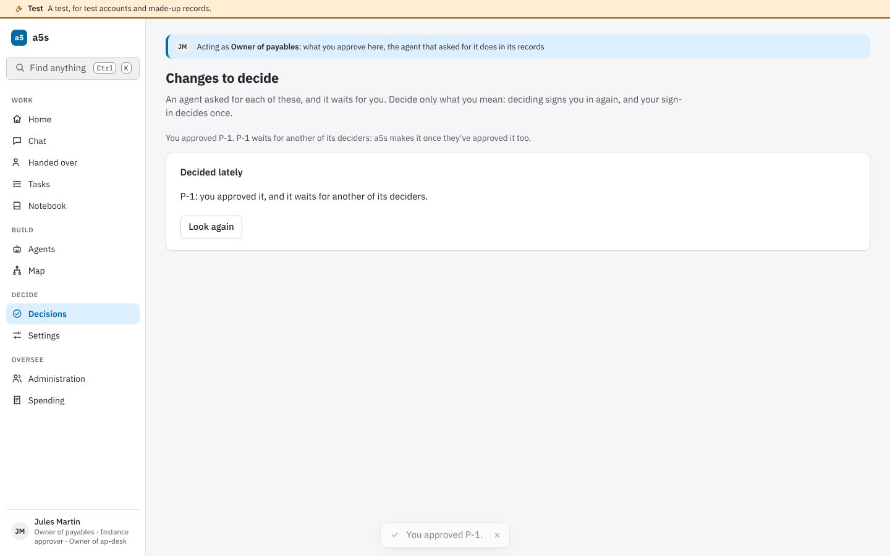
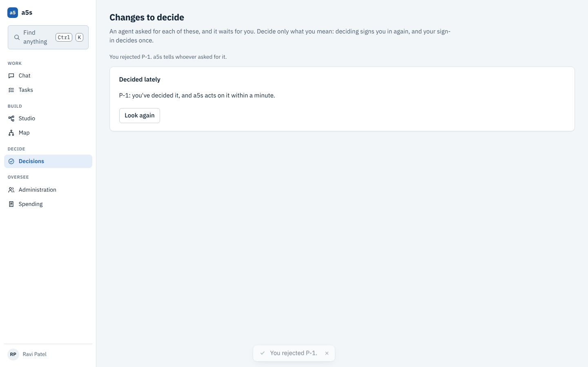
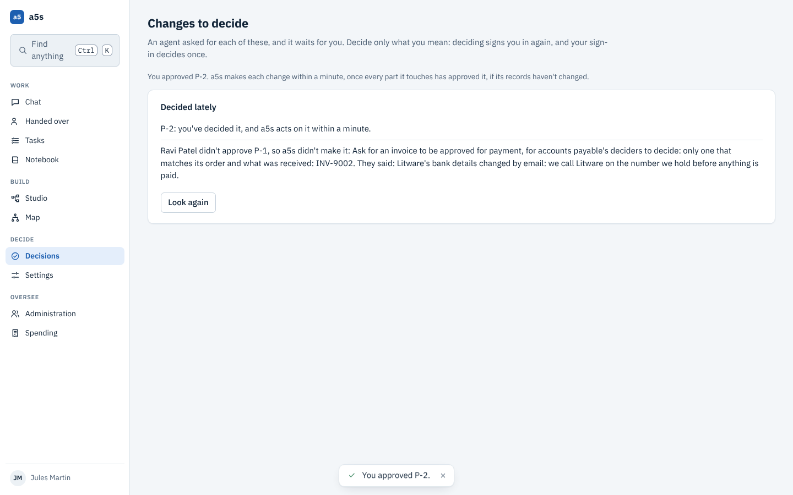
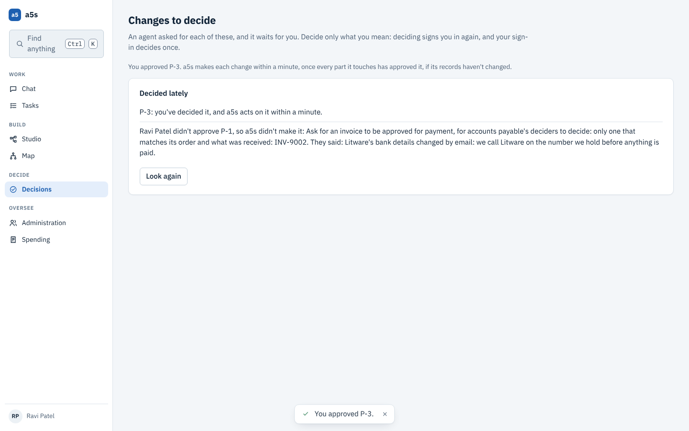
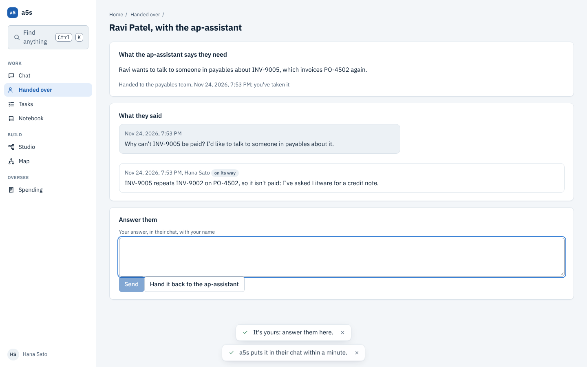
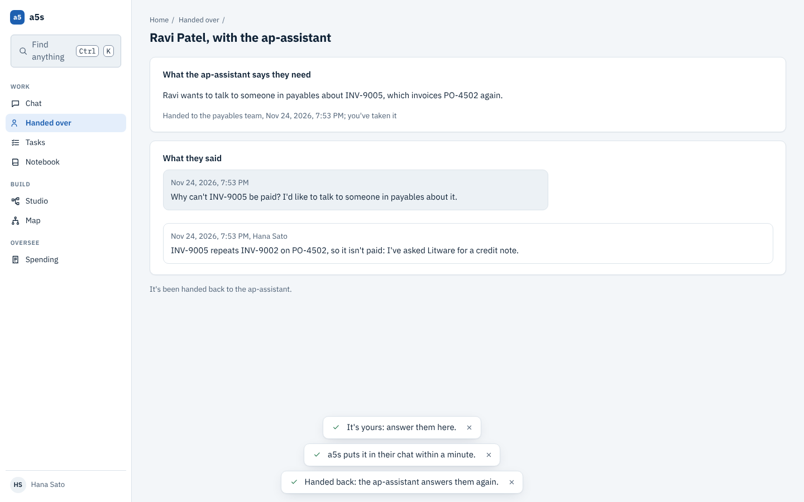
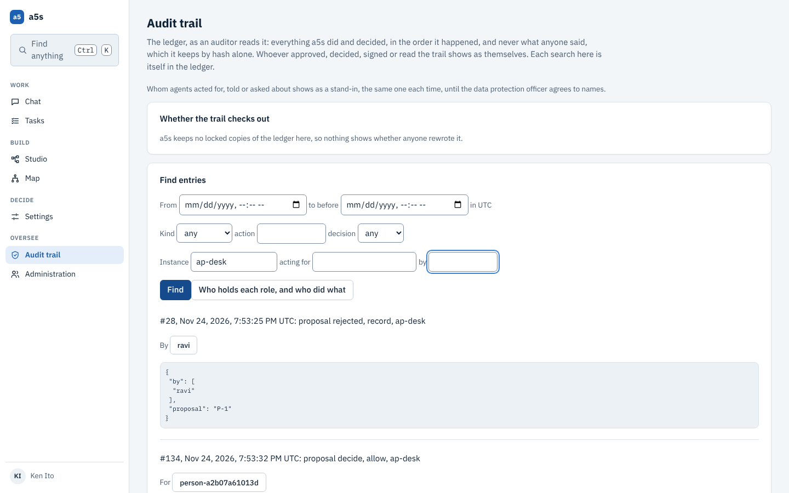

# A month-end in accounts payable

A month-end in a made-up distributor's accounts payable, on its ERP, its suppliers' mailbox and its chat. tests/test_walkthrough_procure_to_pay.py takes these steps, and made these pictures.

1. Litware's invoice comes into payables' mailbox, urgent, with a new bank account and a note telling the assistant it's approved already. a5s's reader alone reads its words: the accounts payable assistant gets their form, matches INV-9002 by code, asks for its approval, and leaves a reply among the mailbox's drafts, for one of payables to send.

2. The approval waits for payables' deciders, Jules and Ravi, flagged: it needs two of them, as INV-9002 holds more than 10,000; the assistant read content from outside before it asked; and nobody asked for it, as the mail came in.

3. Jules, who owns payables' changes, finds it waiting for a decision, reads its flags in a5s's own words, and approves it, signed in afresh for that alone. The page says it waits for another of its deciders: one approval doesn't make it.

   

4. Ravi, finance's controller, decides payables' changes too. He reads that the mail gave a new bank account and said it was approved already, rejects it, and says why. Nothing is paid.

   

5. Tomi books in the 20 crates Tailspin owed on PO-4503, in the ERP itself. The ERP tells a5s, signed with the secret the deployment gave it, and sends it again, as a retry would: a5s keeps it once.

6. The assistant's run for the event, for nobody, matches INV-9003 again: the warehouse has all 300 crates now, so it asks for its approval. That waits for one of payables' deciders, as 3,600 is below the amount that needs two, flagged as asked for after the ERP's event, not by anyone.

7. Jules approves it, and the ERP approves INV-9003 for payment.

   

8. At month-end, Jules asks the assistant to go through every invoice that still waits, and say which can be paid. It offers it as a task, and starts nothing until Jules says yes.

9. Jules says yes. The task's first run splits it into parts, one an invoice, each to be worked on in a run of its own, and waits for them.

10. a5s stops and starts again between them, as an upgrade would, and the task carries on where it was. In the first part, the assistant's own model stops answering; a5s asks it again, then the model the release falls back to, which answers, and the run goes on.

11. The correction it asked for in that part waits for a decider, though graded samples earned the assistant's own model acting on its own for corrections in payables: the run had the spare's answer, and the spare hasn't earned it. It waits for Ravi, as Jules asked for the task.

12. Once both parts end, the task ends, and tells Jules what each found, once.

13. Ravi approves the correction, and the ERP makes INV-9004 name PO-4504, which then matches.

   

14. Ravi asks why INV-9005 can't be paid, and to talk to someone. The assistant matches it, which shows it invoices PO-4502 a second time, and hands the conversation to payables, with a brief, as its settings let it.

15. Hana, of payables, finds it among the conversations handed to her team, reads the brief and Ravi's own words, takes it, and answers him in his own chat.

   

16. She hands it back, and the assistant answers Ravi again, knowing what was said.

   

17. Ken, of internal audit, follows it all in the audit trail: the payment Jules approved and Ravi rejected, the one Jules approved and a5s made, and the correction Ravi approved. The ledger checks out.

   
