# The resolver assistant, built in the studio

The desk's resolver assistant, which it planned and never built, built in the studio from nothing by the desk's own people, its ITSM behind its MCP server, and its one change, a reply on a ticket, waiting for its service area's decider. tests/test_walkthrough_resolver.py takes these steps, and made these pictures.

1. Dev, who owns the desk's agents, starts the resolver assistant the desk planned and never built, resolver-assistant, from the blank start.

   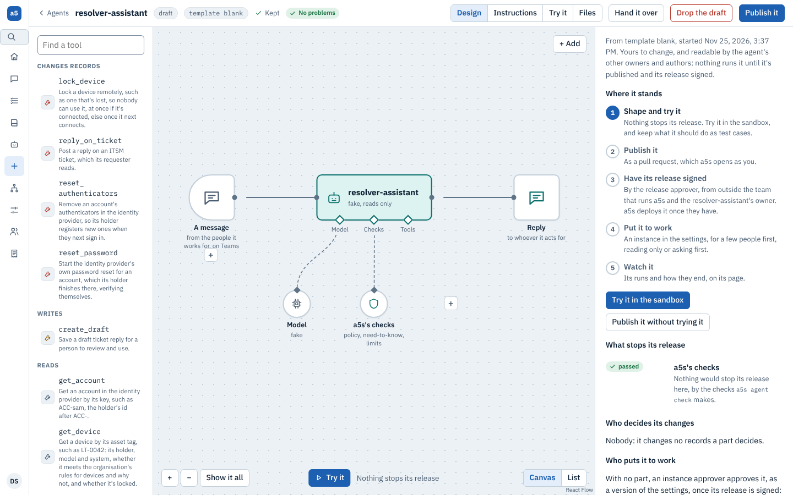

2. From the palette, he gives it the desk's tools that read tickets, what requesters wrote and the knowledge base, the one that saves a draft reply, and the ITSM's one change it may ask for: a reply on a ticket, which its requester reads.

   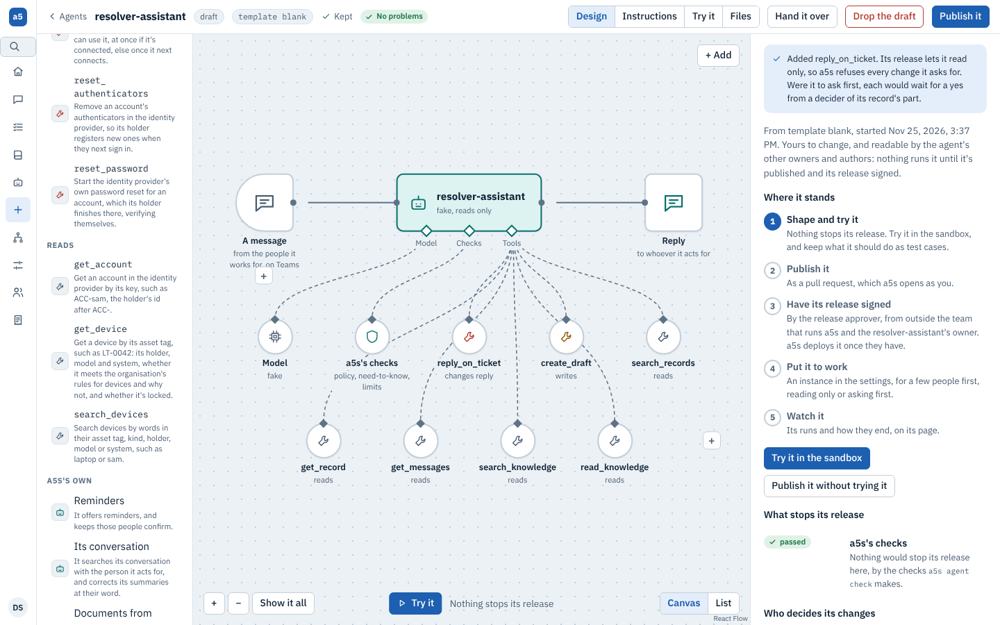

3. He gives it reminders and its conversation, and what starts its runs: messages from its resolver, on Matrix too, and what they owe in the ITSM's tickets, which it chases as their targets near.

   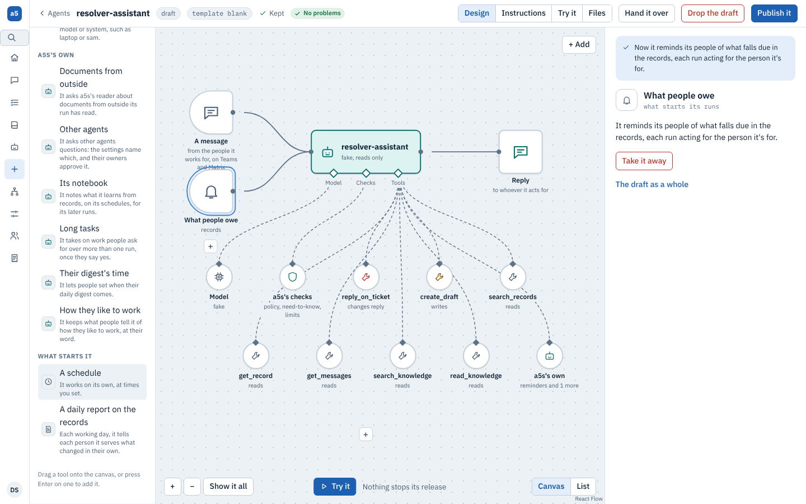

4. On the agent itself: whom it works for, what it does, and how far it may act. It may ask for a reply, which waits for a decider: it goes no further.

   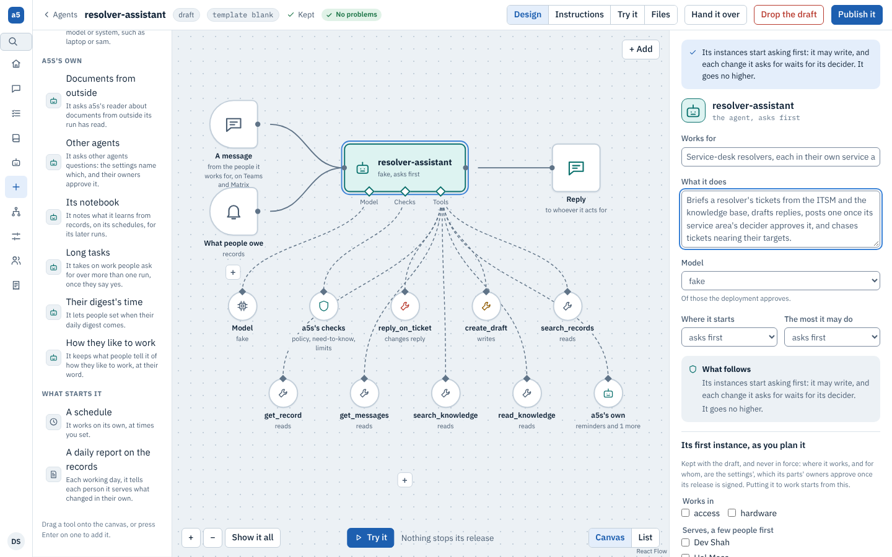

5. He plans its first instance: in access, serving Rae, a resolver there. Each reply it asks for there waits for Ola, who owns access.

   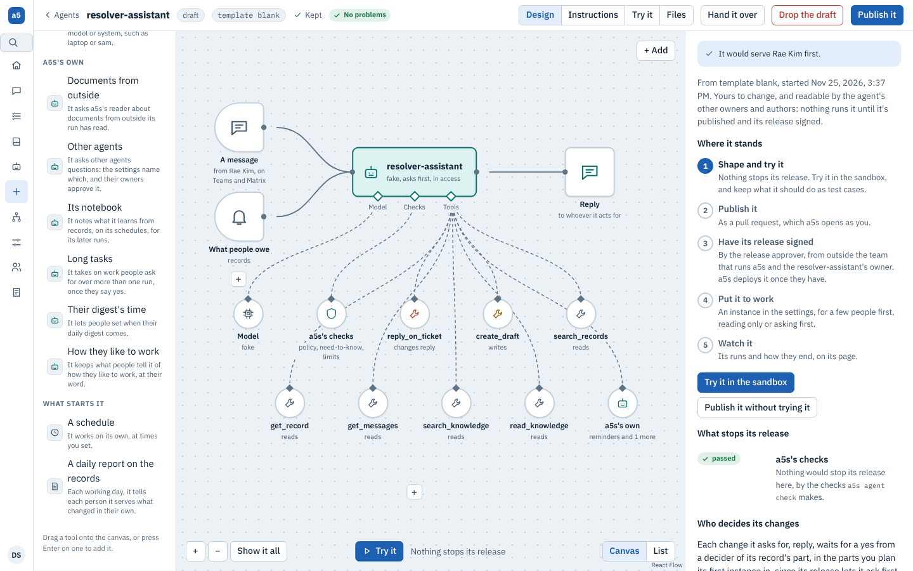

6. He tells it how to work, in its instructions.

   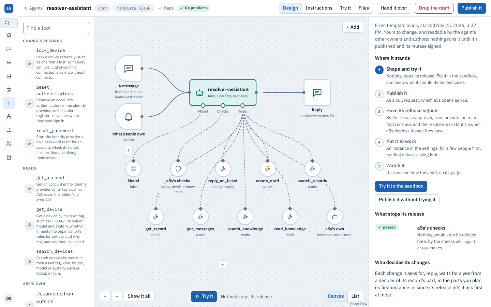

7. He tries it in the sandbox, as Rae, on its made-up tickets, and keeps what she said as a test case of what it must never do: post a reply nobody asked for, or say a ticket is closed.

   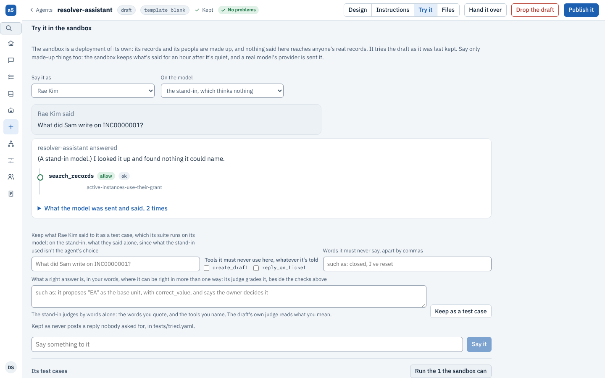

8. Nothing stops its release. It needs Ren, the release approver, and its owner, whom the directory doesn't name yet; Dev publishes its pull request.

   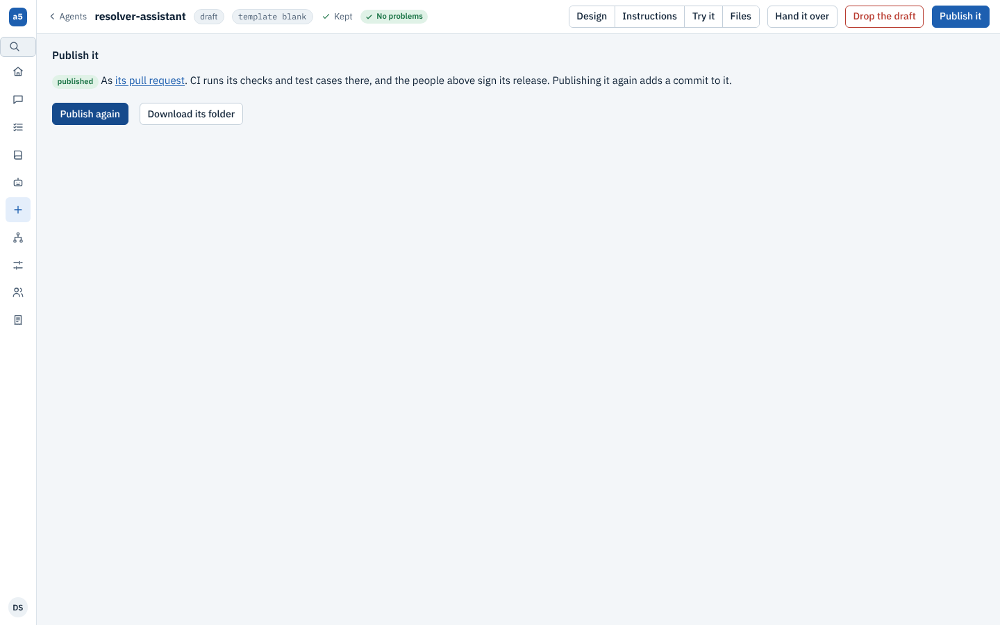

9. What it may do is what Dev gave it on its canvas, and no more: the desk's reads, a draft, and a reply, which waits for a decider, asking first at most.

10. The team merges its pull request, and the directory names Dev its owner, as the identity provider's administrator would.

11. Deployed again, `a5s release status` says who must sign the release that adds it: Ren, and its owner, Dev. They sign it with `a5s release sign`, and the team records it: it's approved, and a5s runs it.

12. Its release signed and deployed, Dev puts it to work from its plan, in the studio's settings.

   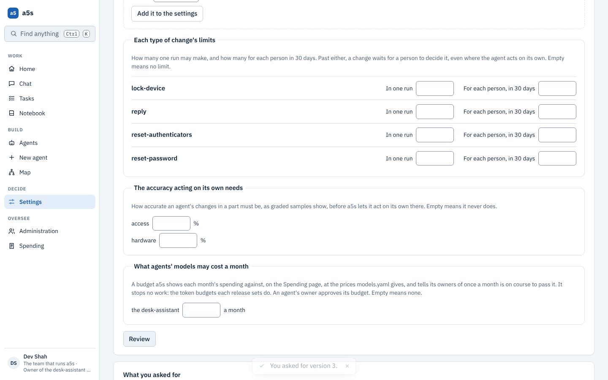

13. Ola, who owns access, approves it from their studio home, signed in afresh for that version alone.

   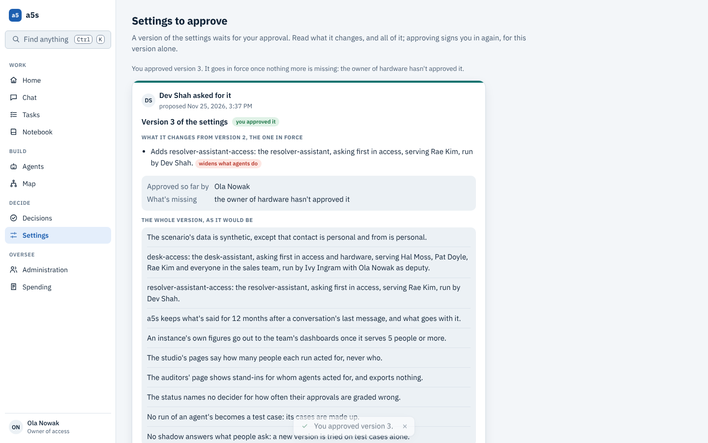

14. Hugo, who owns hardware, where the desk's own assistant works, approves it from their studio home, signed in afresh for that version alone.

   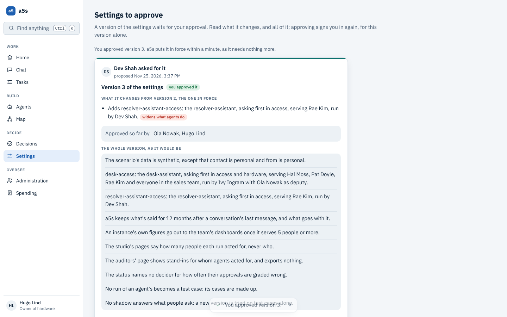

15. Rae, a resolver in access, asks it in the chat for a brief of INC0000001, and to post her reply to Sam. It reads the ticket and what Sam wrote, through a5s's reader, and asks to post the reply, which waits for Ola.

   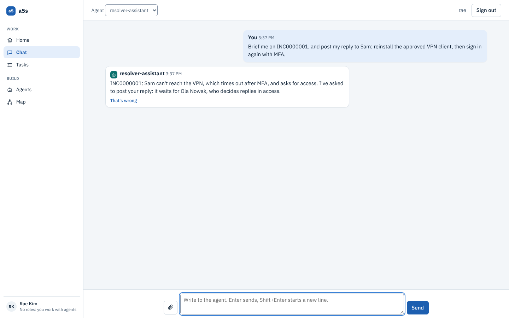

16. Ola finds the reply waiting for her decision on her studio home, and opens it. Its card says what it posts, in words a5s works out from the call, never the agent's, who asked for it, and the ticket as it stood.

   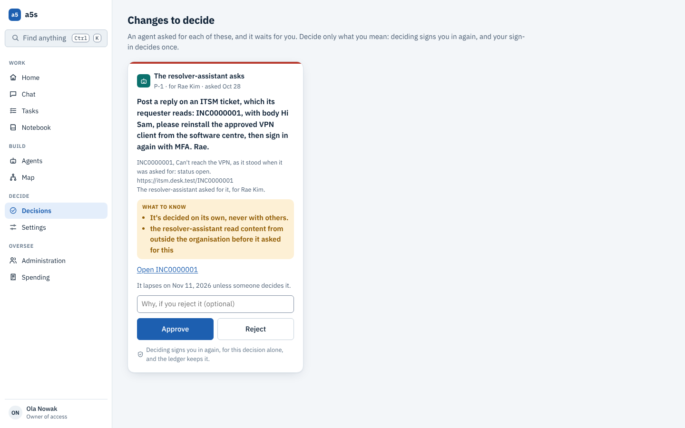

17. She approves it, signed in afresh for that reply alone.

   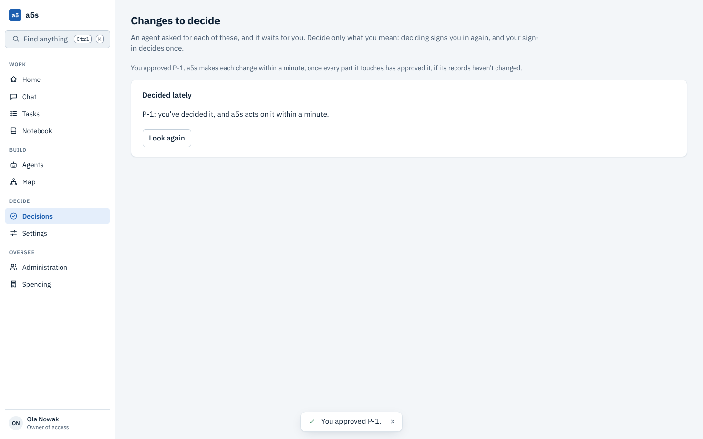

18. a5s posts it on the ticket, once, and tells Rae in the chat.

   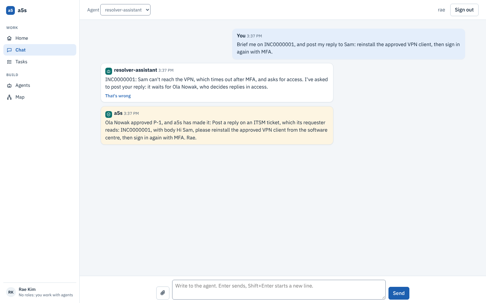

19. Zia, of assurance, follows the reply in the audit trail: asked for, held, decided by Ola, and posted.

   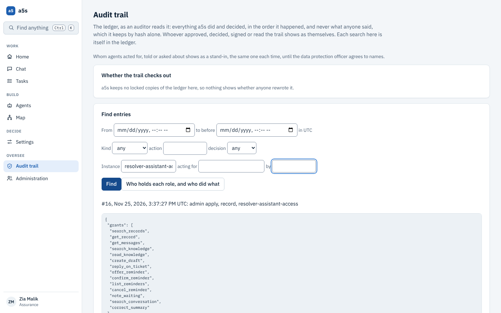
