# An agent, from an idea to work

A new agent, due-dates, taken from an idea to work in the sample scenario through a5s's own pages and its command line, by the people whose part each step is. tests/test_walkthrough.py takes these steps, and made these pictures.

1. Priya, who owns the team's agents, starts a new one in the studio, due-dates, from the assistant's template.

   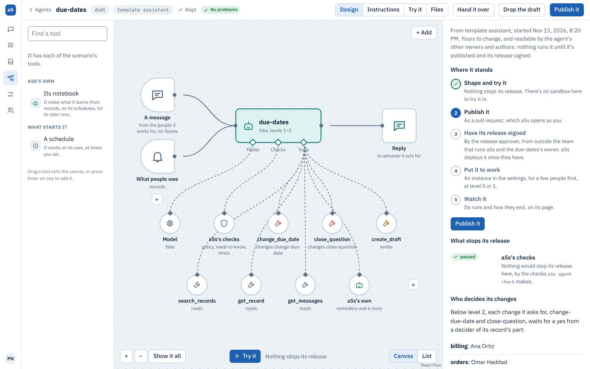

2. On its canvas, she keeps the tools that read records and the one that changes a question's due date, and takes away the rest. What follows says who'd decide each change it asks for, in billing and in orders.

   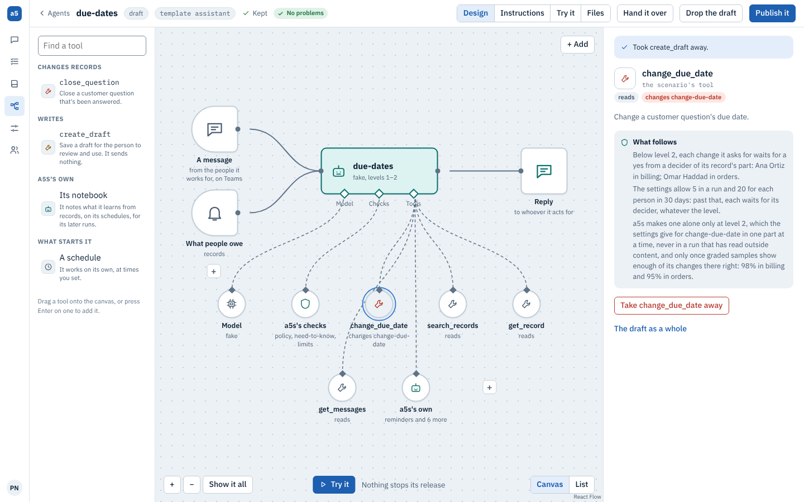

3. She plans its first instance: in billing, serving Ben Okafor. It's kept with the draft, and in force nowhere until billing's owner approves it.

   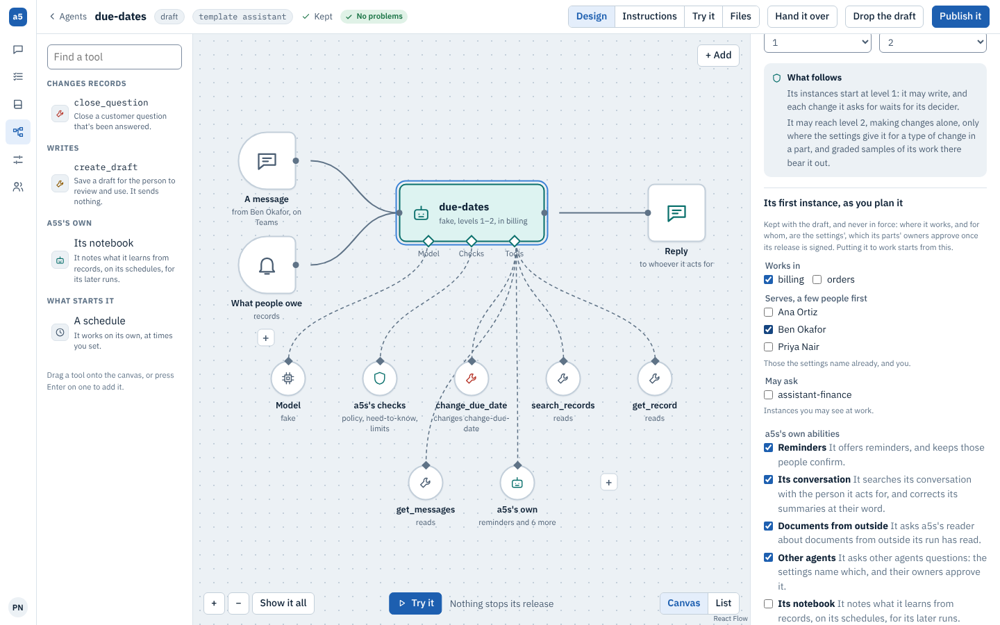

4. She tells it how to work, in its instructions.

   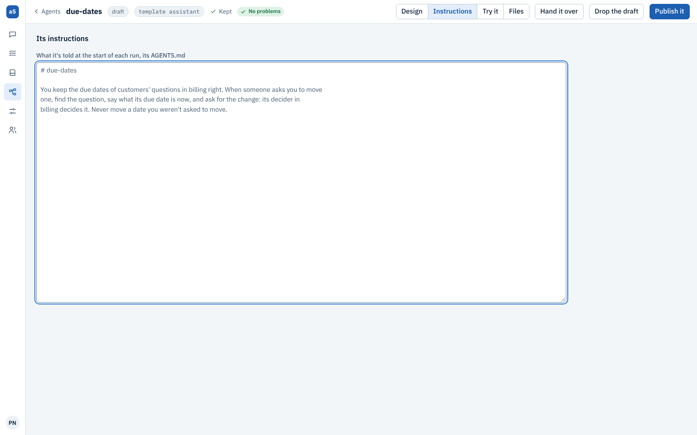

5. Before she publishes it, the draft says who must sign its release: Rosa, the release approver, and the due-dates's owner, whom the directory doesn't name yet.

   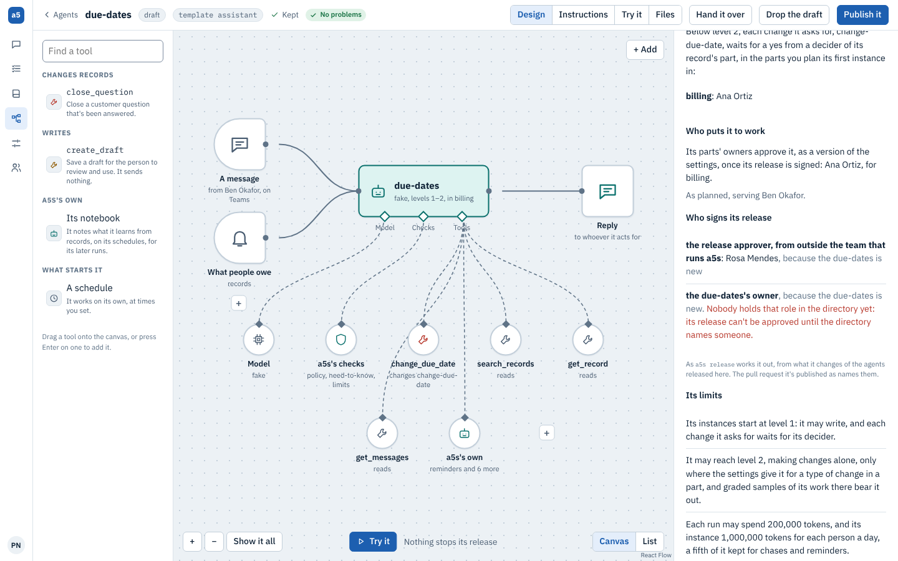

6. Nothing a5s checks stops its release, so she publishes it: a5s opens its pull request on the team's repository, as her, once she says so at GitHub.

   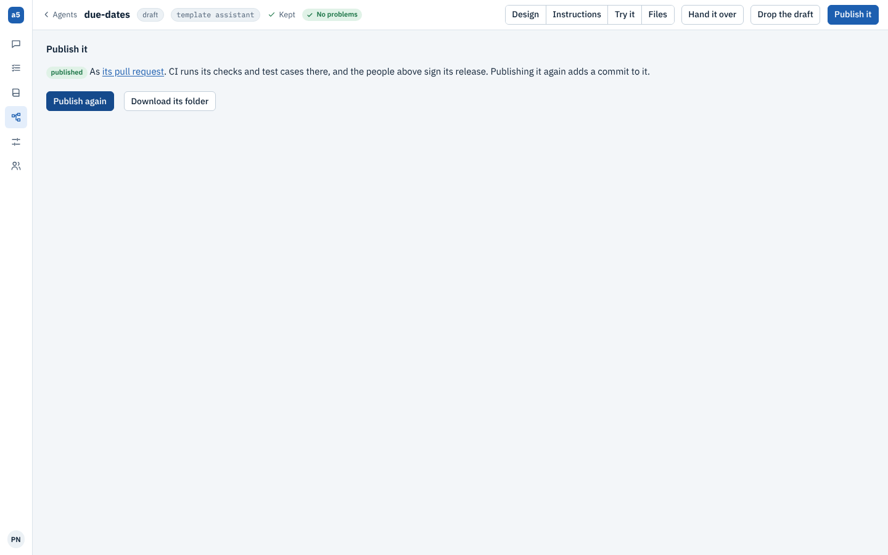

7. The team reviews its pull request, and it's merged. Nobody holds the due-dates's owner role yet, so the directory names Priya, as the identity provider's administrator would.

8. Deployed again, a5s runs nothing of the new release yet. `a5s release status` says who must sign it, and why: Rosa, since the directory changed and due-dates is new, and its owner, Priya.

9. Rosa and Priya sign it with `a5s release sign`, each on their own machine, and the team records it with `a5s release approve`: it's approved here, and a5s runs it.

10. Back in the studio, its draft says its release is signed and deployed. Priya follows its one next step: putting it to work, from its plan, in the settings app.

   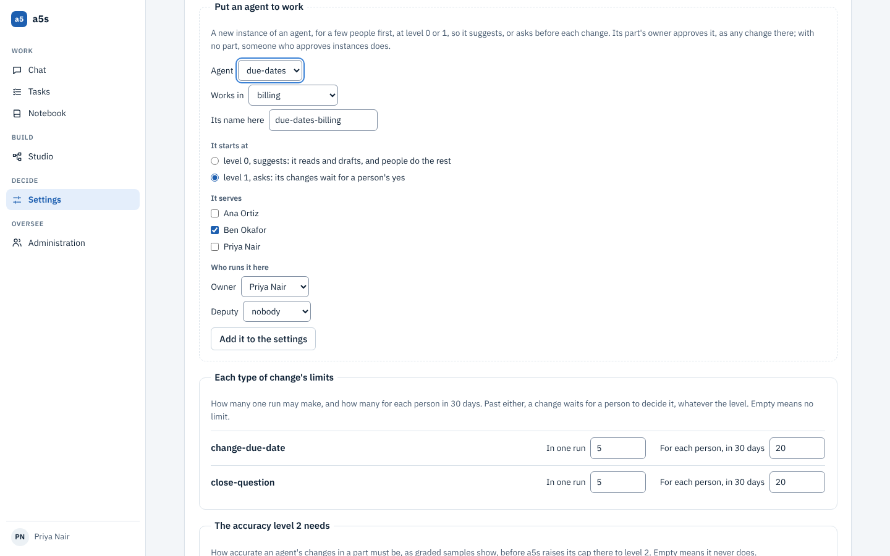

11. The form is filled in from its plan: due-dates, in billing, serving Ben. She reviews what it changes, in words, and asks for it.

   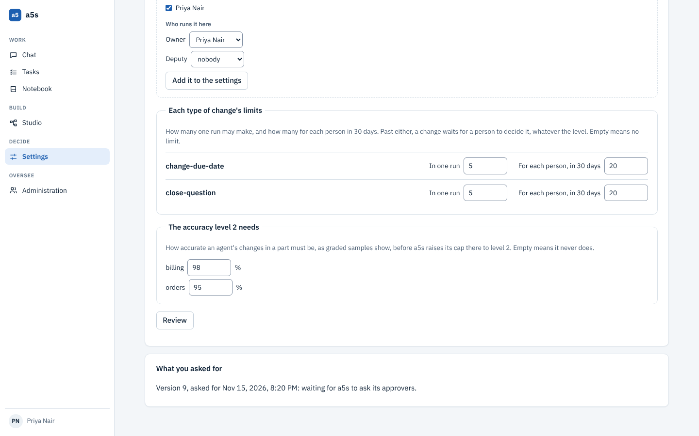

12. Ana, who owns billing, finds it waiting for her approval on her studio home.

   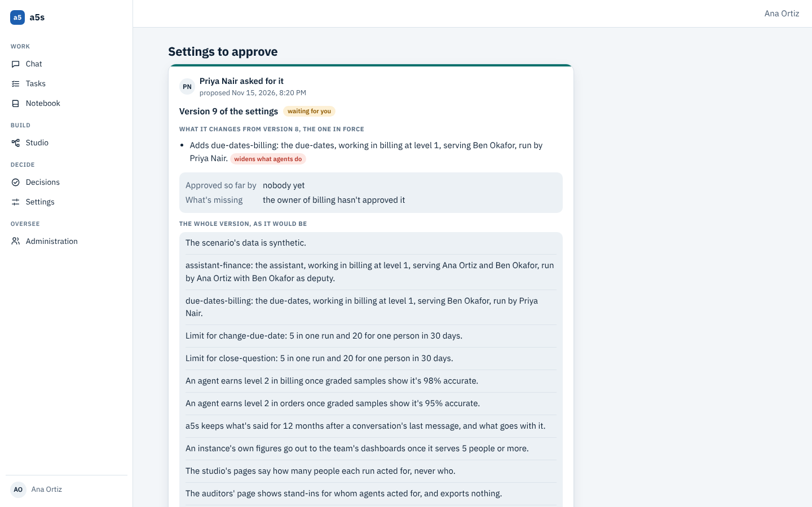

13. She reads what it changes, and approves it, signed in afresh for that version alone.

   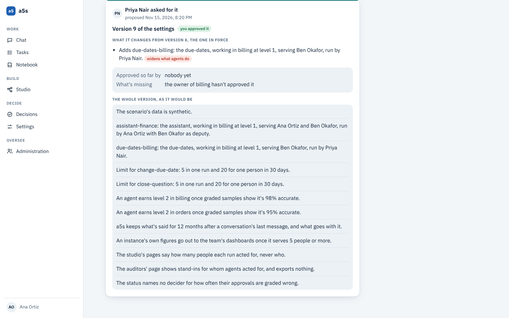

14. Ben asks due-dates, in the chat, to move a question's due date. It asks for the change, which waits for Ana, its decider in billing.

   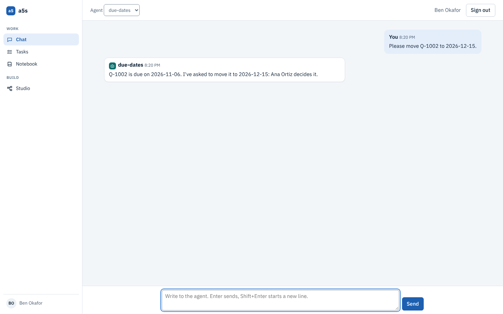

15. Ana finds the change waiting for her decision, and opens its card: who asks, for whom, and what it does, in code's words.

   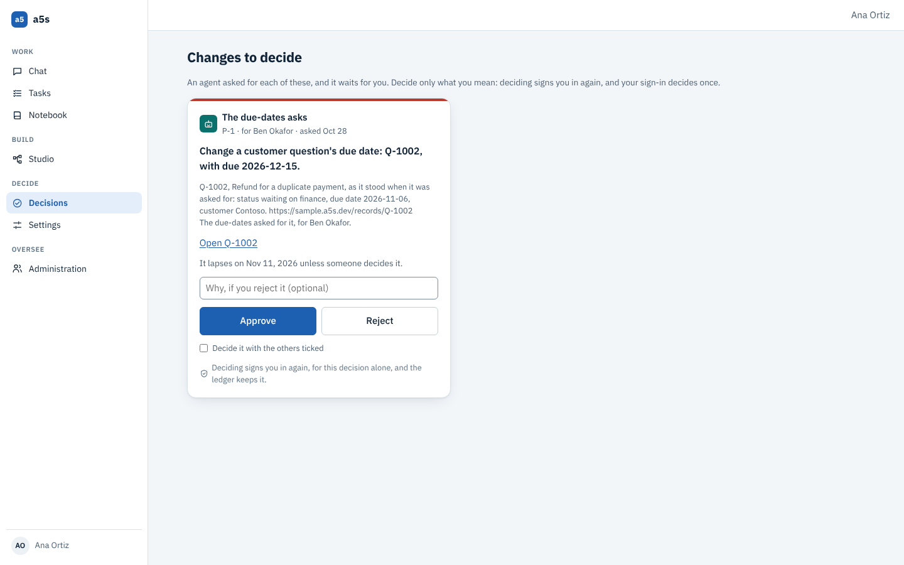

16. She approves it, signed in afresh for this decision alone, and a5s makes the change.

   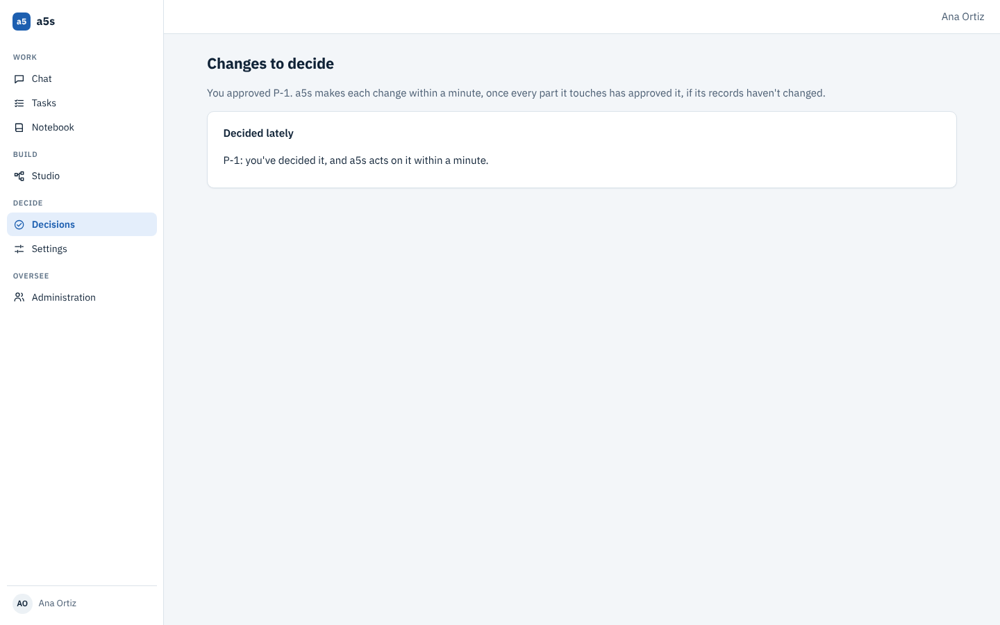

17. Priya watches it at work, on its instance's page: its figures for each day. Its runs, one by one, stay hidden while it serves so few people, since each would say what Ben did.

   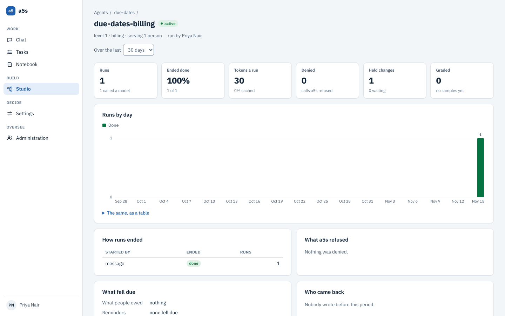

18. Kofi, of assurance, reads what due-dates did in the audit trail: who asked, who decided, and what changed.

   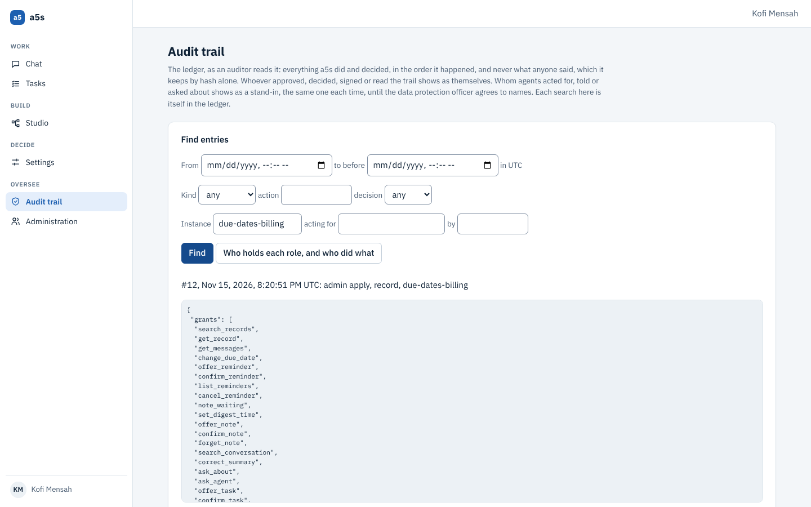
