# The desk assistant, built again in the studio

The desk's assistant, built again from nothing in the studio, as desk-helper, by the desk's own people, its ITSM behind its MCP server. tests/test_walkthrough_desk.py takes these steps, and made these pictures.

1. Dev, who owns the desk's agents, starts a new one, desk-helper, from nothing: the blank start, which needs no tool of anyone's, so it fits the desk.

   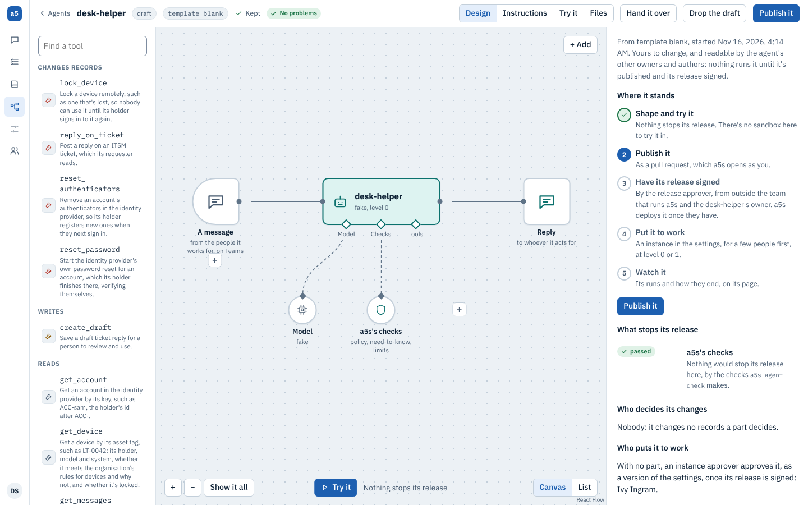

2. From the palette, he gives it the desk's tools that read tickets, what requesters wrote and the knowledge base, the one that saves a draft reply, and the identity provider's self-service: an account, its own password reset, and removing authenticators; and device management's: a device, and locking a lost one. All three systems' come through their MCP servers.

   

3. He gives it a5s's own abilities the desk needs: reminders, its conversation, documents from outside, and the two preferences people set through it.

   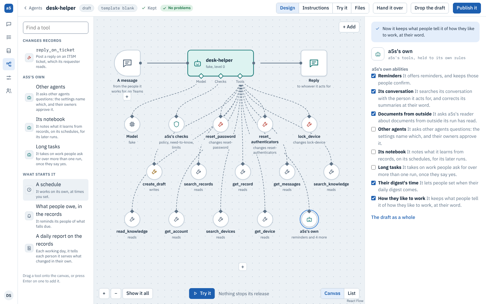

4. What starts its runs: messages from its people, on Teams and Matrix, and what its people owe in the ITSM's tickets, which it reminds them of.

   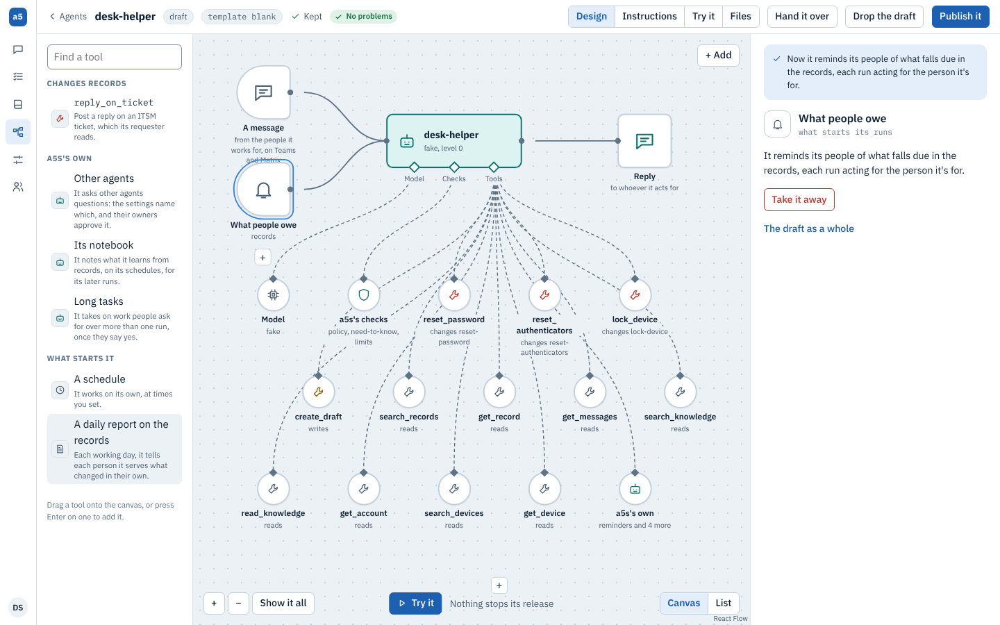

5. On the agent itself: whom it works for, what it does, and its levels. It asks for changes, and may make a reset alone, at level 2, only where the settings and graded samples give it, as the desk's own assistant.

   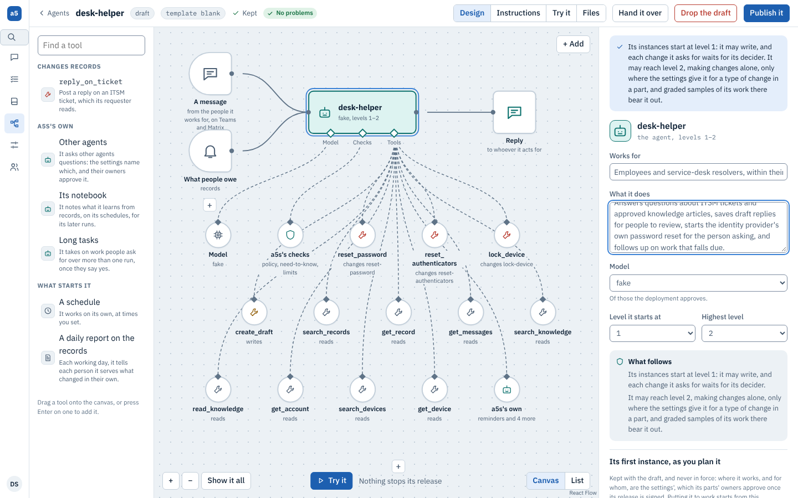

6. He plans its first instance: in access, serving the sales team, as the desk's own assistant serves them. It's in force nowhere until access's owner approves it.

   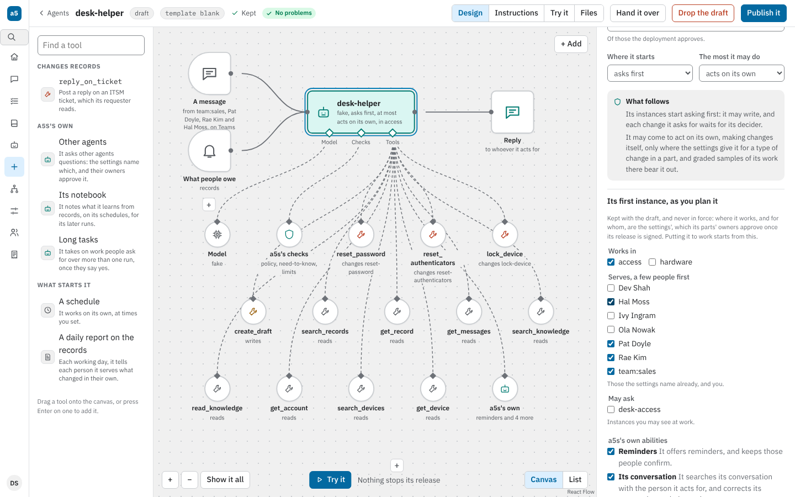

7. He tells it how to work, in its instructions.

   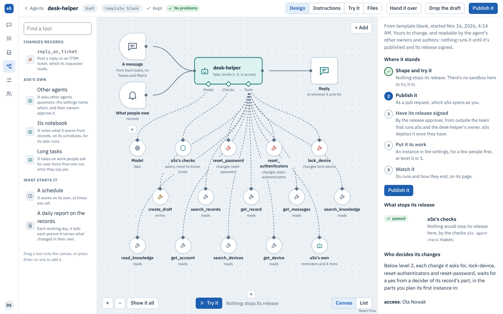

8. Nothing stops its release. It needs Ren, the release approver, and its owner, whom the directory doesn't name yet; Dev publishes its pull request.

   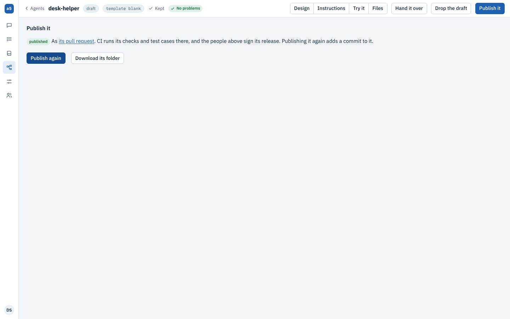

9. What desk-helper may do, and what starts it, is what the hand-written desk assistant's definition gives it, in the studio's words: nothing more, and nothing missing.

10. The team merges its pull request, and the directory names Dev its owner, as the identity provider's administrator would.

11. Deployed again, `a5s release status` says who must sign the release that adds it: Ren, and its owner, Dev. They sign it with `a5s release sign`, and the team records it: it's approved, and a5s runs it.

12. Back in the studio, its draft says its release is signed and deployed, and Dev puts it to work from its plan, in the studio's settings.

   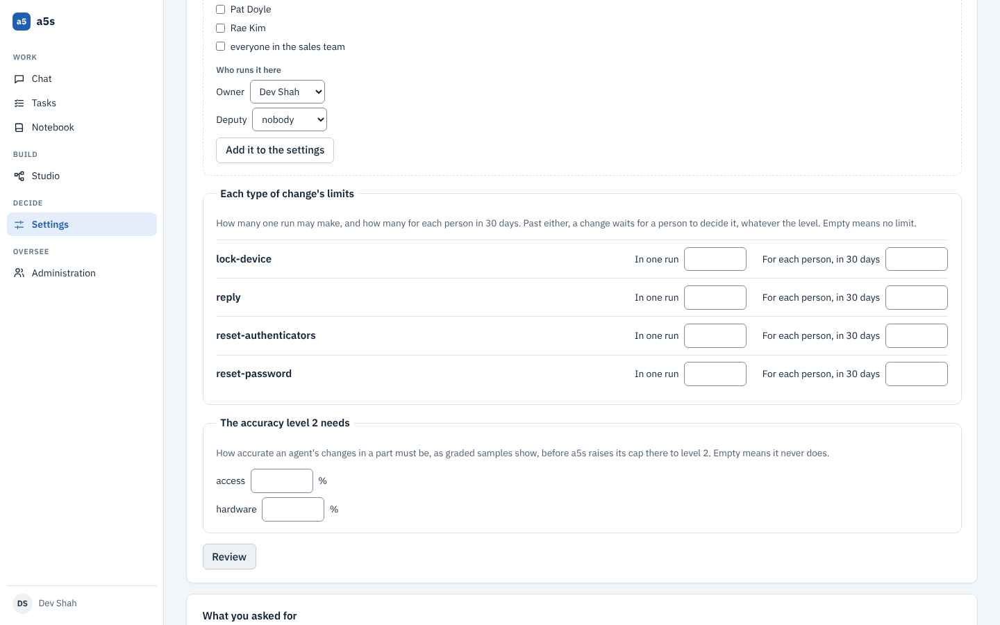

13. Ola, who owns access, where it's to work, finds it waiting for their approval on their studio home, and approves it, signed in afresh for that version alone.

   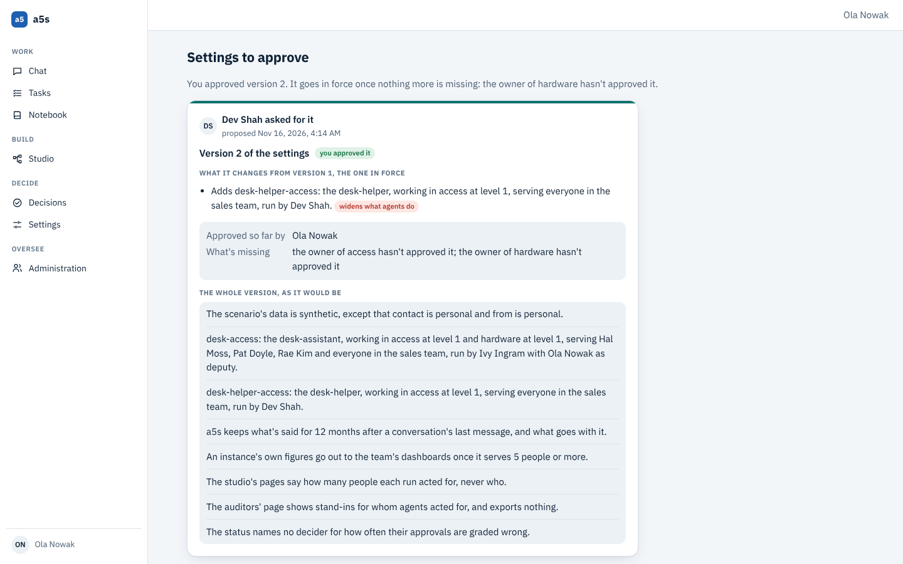

14. Hugo, who owns hardware, since the desk's own assistant works there, and a version counts once each part's owner approves it whole, finds it waiting for their approval on their studio home, and approves it, signed in afresh for that version alone.

   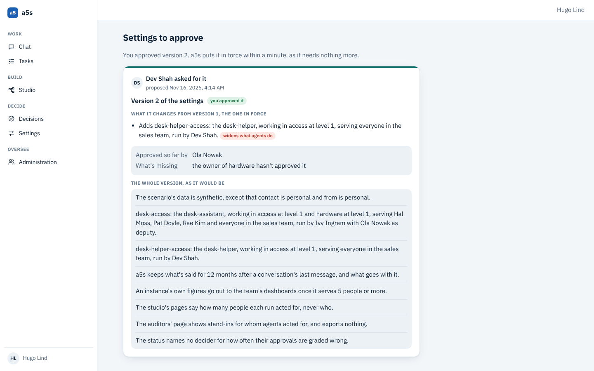

15. Sam, in sales, asks desk-helper in the chat which tickets are about the VPN. It searches the ITSM, through its MCP server, and answers from the ticket.

   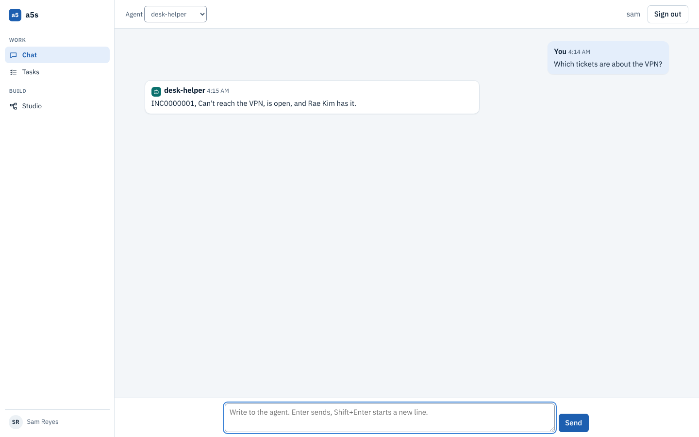

16. Zia, of assurance, reads what desk-helper did in the audit trail.

   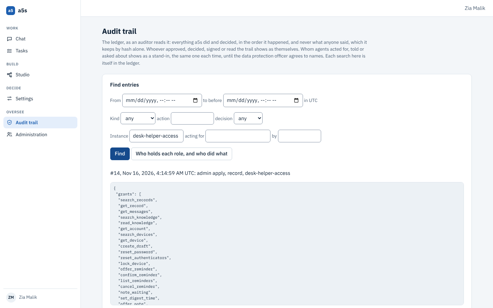
