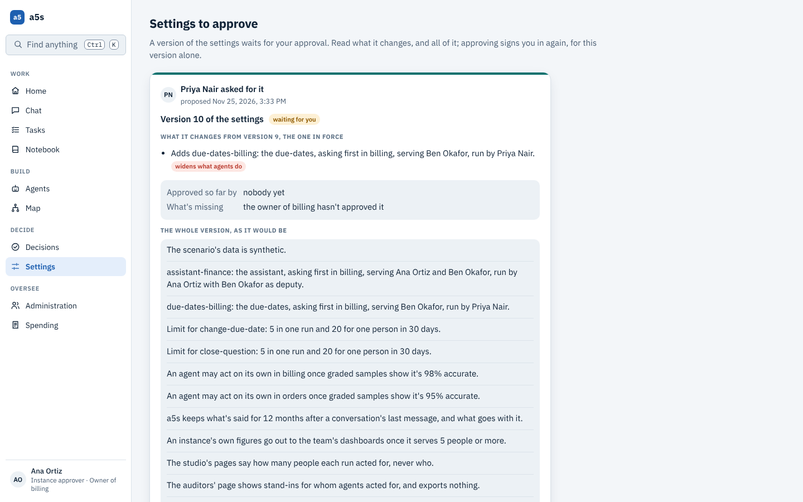
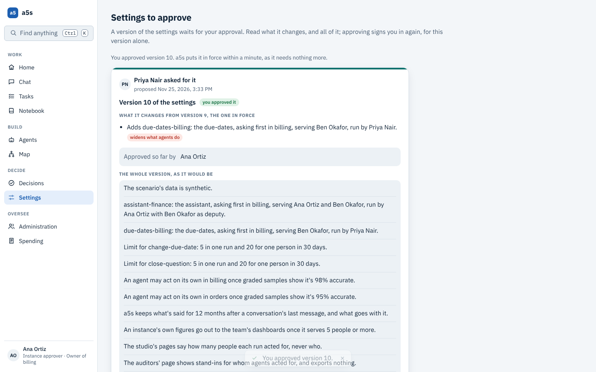
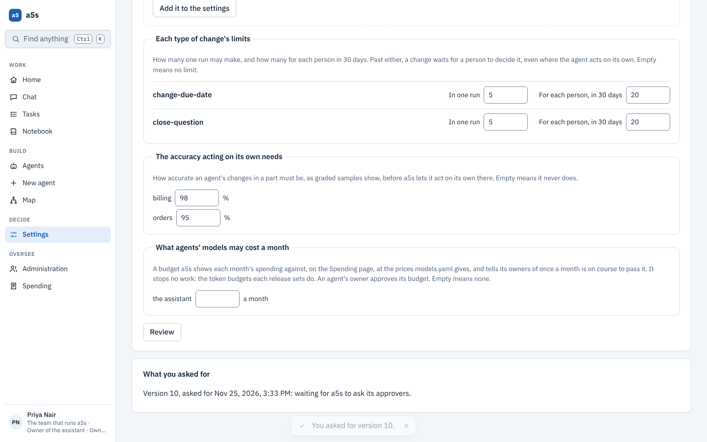

# Approving settings and releases

For the people whose approval changes what agents may do: part owners, instance approvers, the data protection officer and assurance, who approve versions of the settings, and the people who sign a release.

## What a version of the settings is

The settings say what each instance of an agent may do, where and for whom: its parts and how far it may act in each, whom it serves, who runs it, its model and its budgets. They change only as a whole new version, numbered, and nothing in a version counts until everyone it needs has approved it, each signed in afresh.

## Know when a version waits for you

- **In your chat**, a card, *Settings to approve*, whose button, **Review and approve**, opens the version on a5s's page. Telling an agent doesn't approve anything.
- **On the studio's home**, under *Waiting on you*.

## Who must approve what

| A version that | Needs |
| --- | --- |
| Only narrows what agents may do in a part: a lower level, a type of change taken back, or a stricter accuracy threshold | That part's owner alone. Everyone else it would have needed hears of it in their digest |
| Does anything else | Approval of the whole version: the owner of every part any instance in it works in, and of any part whose threshold or four eyes changes; the agent's owner for its budget; an instance approver for an instance in no part, or for new classes of data; a role's owner for giving a group that role; and the data protection officer for their choices |
| Takes four eyes away from a part, or loosens it | Two people: the part's owner, and an instance approver or another part's owner |

A part's delegates decide agents' changes there, but approve no settings.

## Read and approve a version

The version's page, *Settings to approve*, says where it stands: *waiting for you*, *you approved it*, *in force*, *superseded* or *refused*. It lists who has approved it so far, what's still missing, and the whole version as it would be.

1. Read what it changes, in words, and its [impact preview](#read-the-impact-preview).
2. Choose **Approve version {n}**, only if you mean these changes.
3. Sign in again, for this version alone, with your second factor where your organisation asks for one. Each sign-in approves once.

a5s puts it in force within a minute once nothing more is missing; until then, the page says what still is.

If a5s's own check refuses an approval afterwards, your digest says why: approve it again on the settings page, signing in afresh.

## Read the impact preview

*What it would have done differently* shows what the version would have changed over the agents' last 28 days: each of their tool calls, up to the latest 2,000, decided again under the new version.

- *Calls this version would decide differently* lists each tool, instance and part, what the version in force decided, what this one would, *made alone*, *held for a person* or *refused*, and why.
- If nothing would have differed, it says so.
- Calls of instances you may not watch are counted, never shown.
- It also says where a setting to act on its own wouldn't count yet, as a5s's cap still holds the agent to asking first, and what the version changes that it can't decide again.

## Ask for a change to the settings

The Settings page, `/studio/settings`, shows the version *In force*, any *Waiting for approval* and what still holds them, and *Ask for a change*.

1. Choose **Change it here** for forms, or **Edit the text** for the settings as they're written. For each instance, the forms ask what it works at in each part, which changes it makes on its own, whom it serves, its model, and who runs it. Below them are putting an agent to work, each type of change's limits, the accuracy acting on its own needs, and what agents' models may cost a month. Four eyes is changed in the text alone.
2. Choose **Review**. a5s says what the version would change, marking each change that *widens what agents do*, whose approval it needs, and its impact preview.
3. Choose **Ask its approvers**. a5s asks them within a minute, and puts it in force once they've all approved it.

You can have one request waiting at a time, and make five a day.

## Sign a release

A release is a version of a5s and its agents, with every file it runs, the models it may use and what each agent may do. The core runs only a release its people have approved, and opens no run until then. Each signs it with their own key, on their own machine:

| A release that changes | Is signed by |
| --- | --- |
| The trusted core, or what its image is built from | The release approver and assurance |
| The directory, the scenario's tools, or anything that lets an agent or model do more | The release approver |
| Adds a new agent | The release approver and the agent's owner |
| Only an agent's instructions | The agent's owner and an engineer of the team that runs a5s, and the release approver too where the agent acts on its own |

The release approver counts only from outside the team that runs a5s. When a release waits for you, your studio home says so, and as whom.

1. Read what it changes: `a5s release show`.
2. Sign it: `a5s release sign --as <your id>`, with your own key, which never leaves your machine.
3. Send your signature to the team that runs a5s, who record it with `a5s release approve`. `a5s release status` says who's still needed.

## Put a stopped model back

a5s stops a model that stalls on more than half of at least 20 calls in a day, and the Model health page, `/studio/health`, marks it *stopped until the release approver puts it back*. It stays stopped until the release approver, from outside the team that runs a5s, puts it back: `a5s health --restore <model>`, signed in as themselves, with their second factor where the organisation asks for one. The ledger records who did.

For how a5s works this out, see [policy](../architecture.md#policy) and [independence](../architecture.md#independence).
