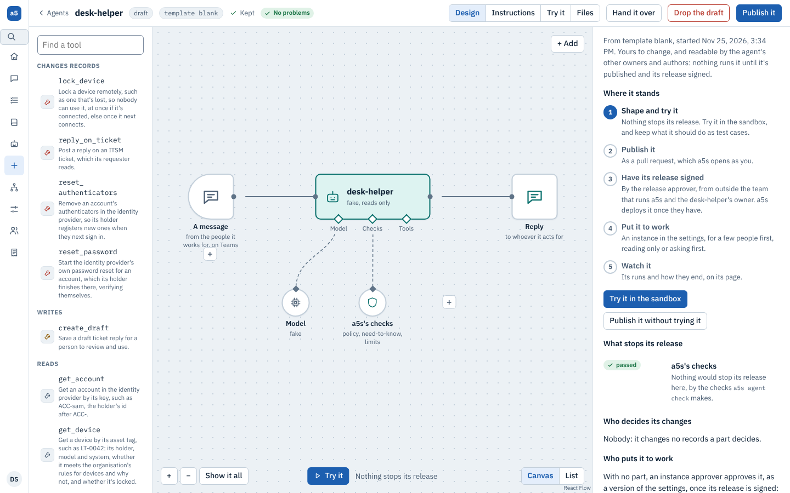
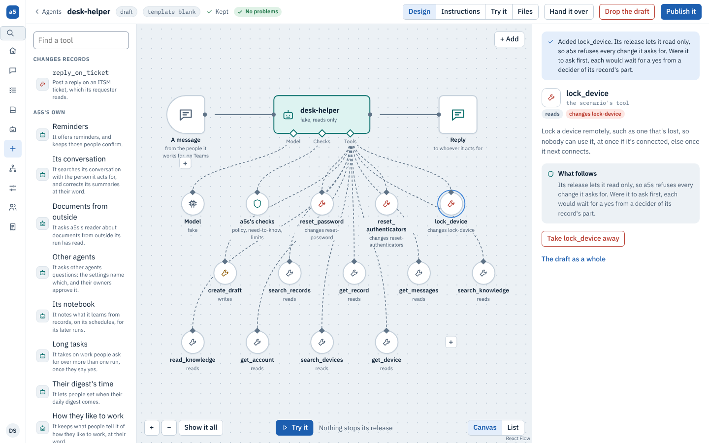
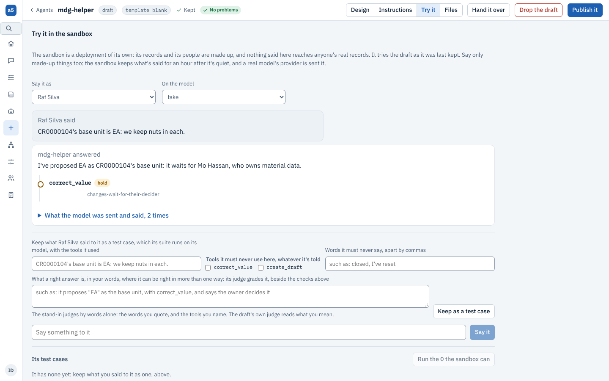
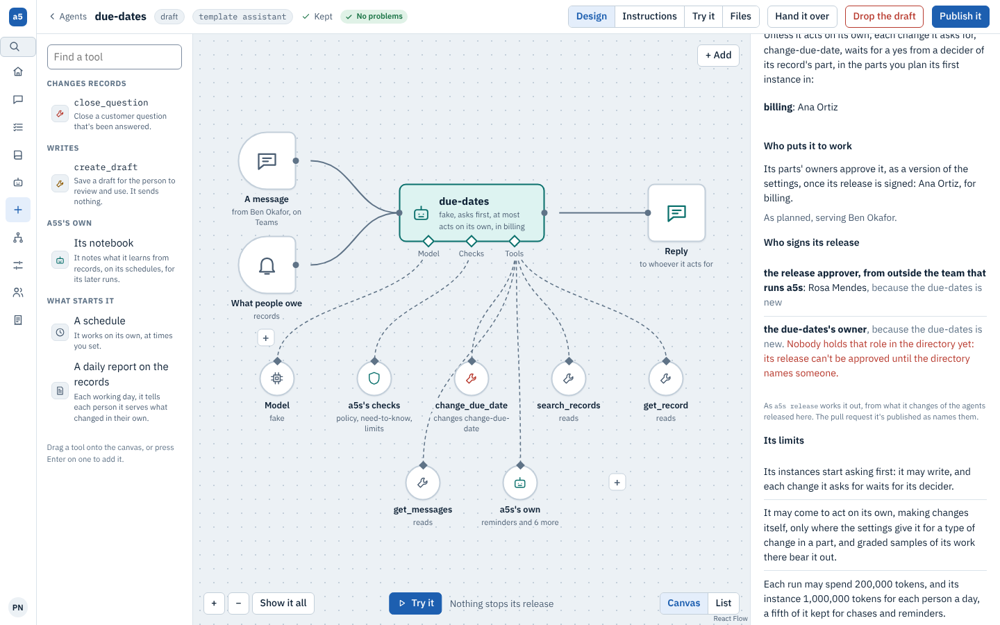

# Building an agent

For the people who make agents in the studio: an agent's owners, the authors they name, and, for a new agent, any agent owner or engineer. Nothing you do here changes what runs: a draft becomes a release only once the people it needs have signed it, and goes to work only once a version of the settings puts it there.

## Start a new agent

Choose **New agent** in the sidebar, under Build, or **Start a new agent** under *Build an agent* on your home, which shows the way from a new agent to one at work. The Agents page has **New agent** too.

If you see none of these, your roles don't let you start an agent: your home says who may, an agent's owner or an engineer, and what to ask whoever runs a5s in your organisation. An agent's author may still change that agent, from its page.

- **From a template.** Give it a name, in lower-case letters and digits with single hyphens between, choose what to start from, and choose **Make the draft**. A template that needs tools your organisation hasn't got says so.
- **Or describe it.** Where your organisation has a sandbox, say what it's for and for whom, choose a model, and choose **Draft it from my words**. Code builds the draft from what the organisation offers, giving it the least each part of the job needs, and says, for each tool, why it was given or left out. A described agent starts by reading only, or asking first where anything it was given writes, never by acting on its own.

To change an existing agent, choose **Draft a change** on its page. You keep one draft of each agent, and twenty in all.

## Shape it

A draft opens on its workbench, with four views: **Design**, **Instructions**, **Try it** and **Files**. a5s keeps each edit as you make it, and checks the draft as `a5s agent check` would: the toolbar says *No problems*, or how many there are, and what stops its release.

- **Design** is its map. Find a tool, and drag it onto the canvas, or press **Enter** on it. Each edit says what follows from it, such as who must now sign its release.
- With nothing chosen, the side panel says where the draft stands, from shaping and trying it to watching it at work, what stops its release, who decides its changes, who puts it to work, who signs its release, and its limits.
- **Its first instance, as you plan it:** the part it works in, the few people it serves first, and what it may ask. The plan goes with the draft, and is in force nowhere until a version of the settings puts it there.
- **Instructions** is how it should work, in your words.

## Try it in the sandbox

The sandbox runs your draft on made-up records, where nothing it does reaches a real system. Once nothing stops its release, open **Try it**, choose whom to say it as and which model, and choose **Say it**. You see its answer, each tool call and what a5s's checks decided, and what the model was sent and said.

- **Keep a try as a test case**, with **Keep as a test case**. You can add tools it must never use there, words it must never say, and, where an answer can be right in more than one way, what a right answer is, in your words, for its judge to grade.
- **Run its test cases**, under *Its test cases*, with **Run** beside them: each says whether it passed.
- **Compare models** on its test cases, under *Compare models on them*, where at least two are approved: tick them, and choose **Compare**, for how many passed, how long each took and what each cost at its prices. a5s says which passed every case for the least.

On real models, each person may spend a million tokens a day in the sandbox; the stand-in model, which thinks nothing, is free.

## Keep a real run as a test case

Where the data protection officer has agreed to test cases from real runs, a run's page offers **Keep it as a test case**, for the agent's authors, of a run that answered someone. Say it as one of the sandbox's made-up people, and tick that what you keep says nothing about anyone, nor what a real record says. It goes into your draft.

## Publish it

When nothing stops its release, choose **Publish it**.

- With your organisation's GitHub app, choose **Publish as a pull request**, and confirm at GitHub's sign-in: a5s opens the pull request as you. **Publish again** adds your later changes to it.
- Without one, download its folder and the pull request's title and description, and open it yourself.

Before you publish, the draft says who must sign its release: for a new agent, the release approver, from outside the team that runs a5s, and its owner; for a change to its instructions alone, its owner and an engineer of the team that runs a5s; and the release approver for anything that lets it do more. Signing happens outside the studio ([signing a release](approving.md#sign-a-release)).

## Once it's released

Back in the studio, the draft says its release is signed and deployed, and its one next step: putting it to work, from its plan, which a version of the settings does ([running an agent](running.md#put-a-released-agent-to-work)).

## Work with co-authors

The Agents page shows *Your drafts* and *Your co-authors' drafts*, of the agents you may author too. A co-author's draft opens read only: choose **Make a copy of your own** to work from it.

To hand your draft to someone, choose **Hand it over**, choose them, and choose **Hand it over to them**. They must be allowed to author the agent, and have no draft of it already. The draft, and its pull request, say it was handed over.

For how a5s works this out, see [the studio](../studio.md).
