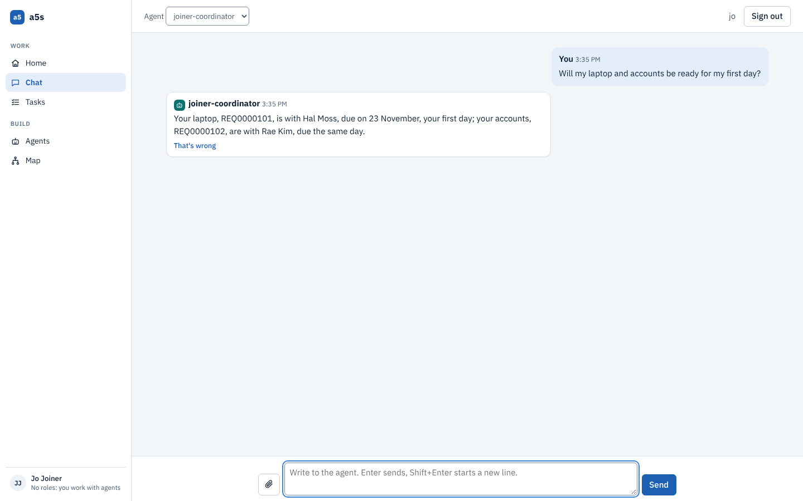
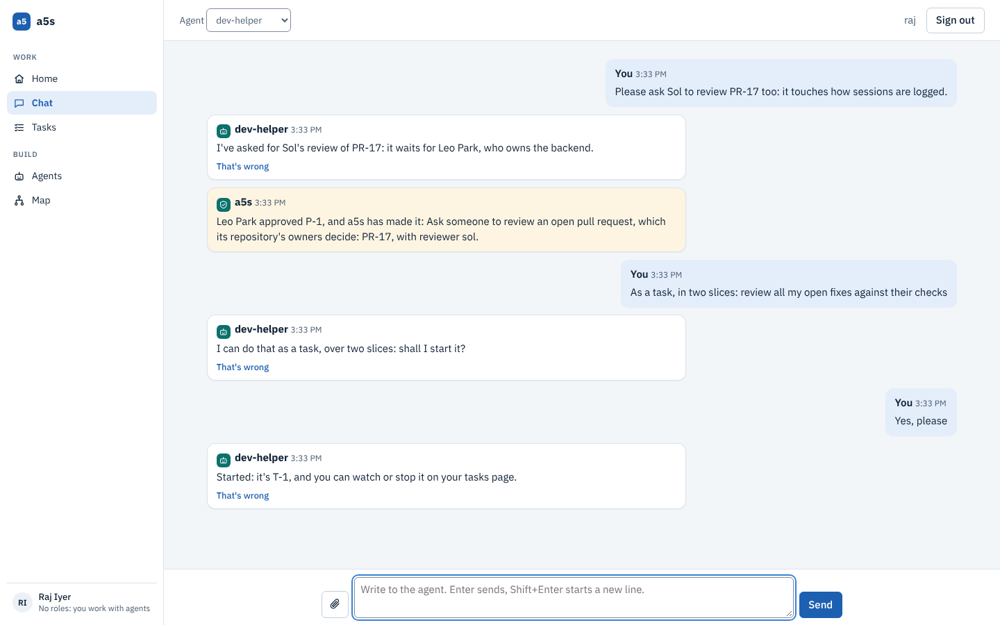
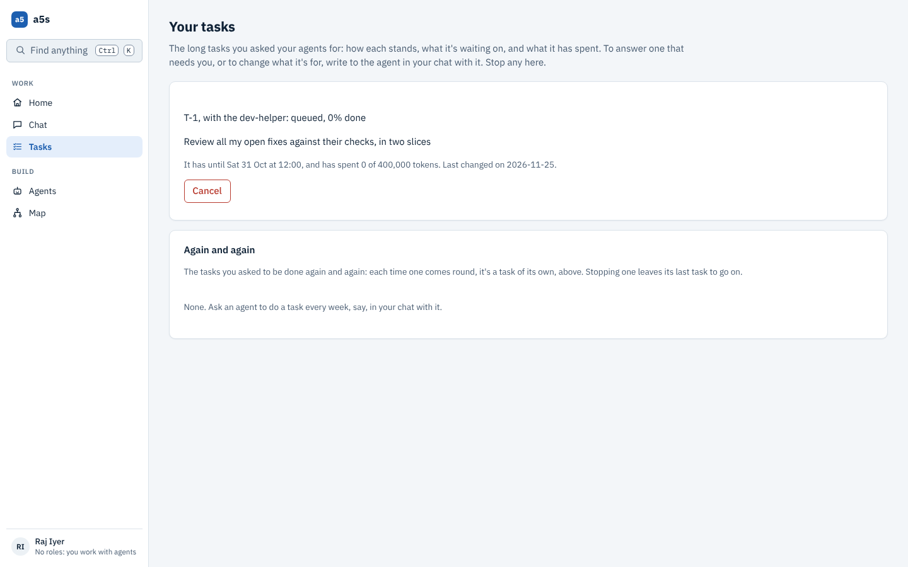
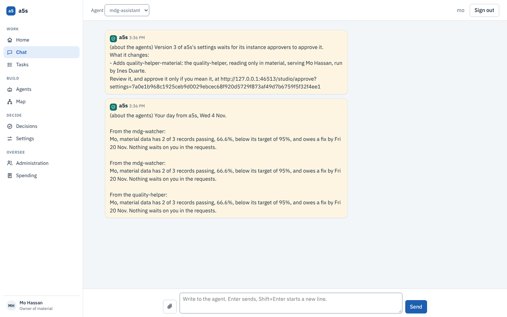
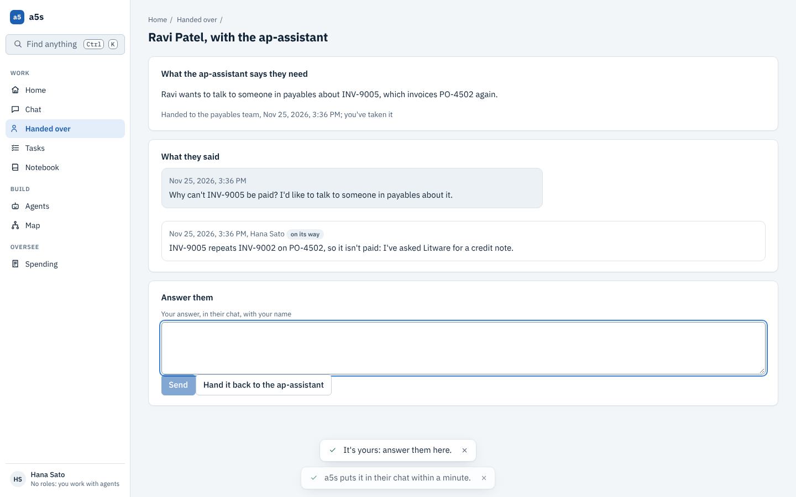

# Working with an agent

For everyone who asks an agent for help: in a5s's web chat, Teams, Slack or Matrix.

## Start a conversation

**In the web chat**, at `/chat/`, sign in with your organisation's sign-in, then choose the agent under **Agent**. The list holds only the agents that serve you. If none does yet, the chat says so, and the studio lists the agents you may ask for: open one's page there and choose **Ask for it**, and its owners decide ([running an agent](running.md#answer-someone-who-asks-for-an-agent)).

Write in the box at the bottom: **Enter** sends, and **Shift+Enter** starts a new line. If nothing comes back within ten minutes, the chat says so, and the answer appears in your conversation when it comes. What a5s and your agents send without being asked, such as reminders, comes into whichever chat you have open: one about another of your agents starts *(about the {agent})*, and one from a5s about them all, such as your day from a5s, starts *(about the agents)*.

**In other chats:**

- **Teams** knows you by your work account. Add an agent's app, so it can write to you first.
- **Slack:** each agent is an app of its own, and works in direct messages and group DMs, never in channels, where anyone who joins reads what was said before.
- **Matrix:** invite the agent's bot to a chat. Only people on your organisation's own server can use it, and it can't read encrypted messages yet.

If a5s says it doesn't know who you are, ask an instance approver, or whoever runs a5s, to add you to the directory.

## What an agent can see for you

- An agent works only on records in its parts that everyone it's helping may see. When it searches, it simply doesn't find the rest.
- Ask about a record you may not see, and it hears just what it would hear of a record that doesn't exist: that you can ask whoever runs it. It never says which part a record is in, or who owns it.
- Where an agent wrote a value itself, rather than taking it from the records or from you, a5s adds a note saying so: check it before you rely on it.
- An agent that acts in another system as you, with your own permissions, needs your account there first. Connect it on `/studio/you`, with **Connect** beside the system's name.

## Start afresh

Send *start afresh*, or */afresh*, as a message on its own. The agent doesn't answer it: a5s says it has started afresh, and from then the agent no longer reads what came before in that chat, which a5s keeps on record as before. A file or email from before no longer holds its changes back. In a group chat, it starts the group's conversation afresh for everyone.

## Send a file or a screenshot

Use the paperclip, paste a screenshot into the box, or drop files on it. In the web chat you can send up to five files with a message, four megabytes in all: text, CSV, Markdown, JSON, PDF and images.

- The agent never reads the file itself. a5s's reader answers its questions about it, as content from outside, and never takes anything in it as an instruction.
- An image goes only to a model approved for images; otherwise the agent asks you what it shows. From a PDF, a5s reads the first 50 pages; for a scan with no text in it, the agent asks you what it says.
- After a file, any change the agent asks for waits for a person, and it won't set a reminder, start a task or hand your conversation over, until you [start afresh](#start-afresh), or the file is further back than the agent reads.
- a5s deletes the file a day after your message is answered, and after a week at most.

## Ask for longer work as a task

For work that takes more than one sitting, such as going through every invoice that waits, the agent offers a task, such as *I can do that as task T-1. Shall I start it?* It starts only once you say yes, in a later message, within a day, in your own chat with the agent.

- **Watch it** on the Tasks page, `/studio/tasks`, under *Your tasks*: each task's status, how far it has got, its plan, what it has found so far, its deadline and what it has spent. Reload the page to see the latest.
- **When it's done, or needs you,** the agent writes to you in your chat. Answer it there, and it goes on with your words. A task that waits past its deadline fails.
- **Cancel it** with **Cancel**, then **Cancel it**. It stops at its next step and keeps what it found. To change what it's for instead, write to the agent.

## Have work repeat

Ask the agent for a task that repeats, such as every Monday at nine, by your own clock. If you don't say when, it's weekdays at nine. It starts once you say yes, within a day, and each time it comes round it's a task of its own. An agent repeats work for you at most four times a day, and keeps at most five repeats for you.

- **To change its days or time,** ask the agent: it offers the repeat as it would be, and the old one stops once you say yes.
- **To stop it,** ask the agent, or choose **Stop**, then **Stop it**, under *Again and again* on the Tasks page. A task it already started goes on.

## Reminders, follow-ups and your day

- **Reminders.** An agent offers to remind you, or to follow something up, and sets it once you say yes, within a day, up to a year ahead. Given a day, it comes in that day's digest; given a time, it comes then. To see or cancel your reminders, ask the agent, one to one. Telling it you're waiting on something until a date pauses its chasing about it.
- **Your day from a5s.** One message on each working day, at the start of your working day, with what each agent has for you: in the web chat as *Your day from a5s*, and in Teams, Slack and Matrix from each agent in its own chat. To move it, ask an agent that offers it, to a time within your working hours.
- **Messages you didn't ask for.** Up to five a day come at once. Any more wait, and come together.

## Work with an agent in a group chat

Bring an agent into a Teams group chat, though not a team's channel, a Slack group DM, or a Matrix room you invite its bot to: up to 20 people, each known to a5s. It answers only messages that mention it. The web chat has no group chats.

- In a group, an agent works for everyone in the chat, so it says only what all of them may see.
- The group has a conversation of its own. Someone added later is given nothing said before.
- What's one person's own stays one to one: how you like to work, your digest, your reminders, tasks and handing a conversation over.

## Tell an agent's owners an answer was wrong

Under each answer in the web chat, choose **That's wrong**, say what was wrong, and choose **Tell its owners**. In Teams, use the thumbs-down; in Slack and Matrix, react with 👎 or ❌. You can do it once for each answer.

The agent's owners see the answer, the run behind it and what you wrote, and who you are only if the data protection officer lets them. It doesn't change what the agent may do: it shows its owners what to put right.

## Undo a change made for you

A change an agent made for you can be undone for a while, where its tool says how: a day, unless the tool says otherwise, and a week at most.

- **Find it.** a5s says so beside the agent's next message when the agent made a change on its own, and in its own message when a decider approved one. Your studio home lists each change you can still undo.
- **Undo it.** Open its page from the link, choose **Undo it**, and sign in again, for that alone. a5s puts the record back within a minute, as it was before the change, so long as nobody has changed it since. If a5s couldn't, your digest says why.
- An undone change counts against the agent's accuracy, as a wrong grade of its work.

## When your conversation is handed to a team

Some agents can hand your conversation to a team of people, such as the service desk, at your word, in your own chat with the agent. a5s tells you which team will answer you there, and what they read: the agent's brief, and what you've said since you last left the chat a day or more, never the agent's answers or anything older.

While the team has it, the agent stays quiet, and their answers come with the name of whoever wrote, and their team. Once they hand it back, the agent answers you again, knowing what was said. If nobody answers or hands it back for three days, it goes back to the agent.

## Take a conversation handed to your team

If agents may hand conversations to your team, your sidebar has **Handed over**, `/studio/handovers`. Each conversation there says who it's with, and whether it *Waits for one of you*, is *Yours*, or was taken by someone else.

1. Open one, and read *What the {agent} says they need*, its brief, and *What they said*, the person's own words alone. A record you may not see shows as *[a record you may not see]*.
2. Choose **Take it**: it's yours to answer.
3. Write in *Your answer, in their chat, with your name*, and choose **Send**. a5s puts it in their chat within a minute.
4. When you're done, choose **Hand it back**, and the agent answers them again.

## In your language

Agents answer you in the language you write in. Where your organisation's directory gives you a language, they write to you in it, unless you write in another. a5s's own words, on its pages and in its notes, are in English.
