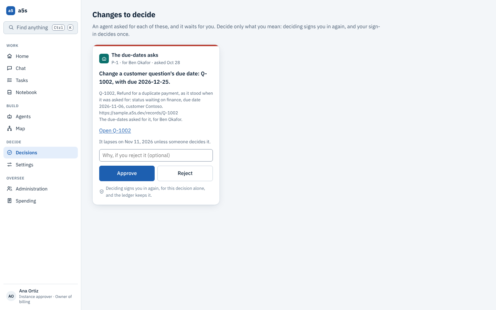
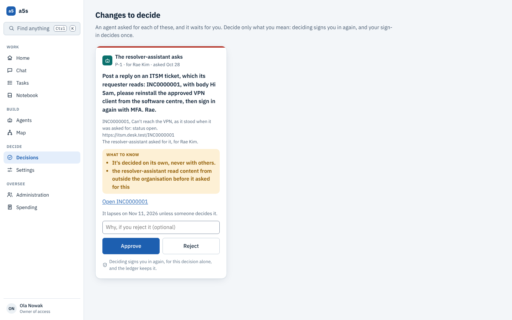
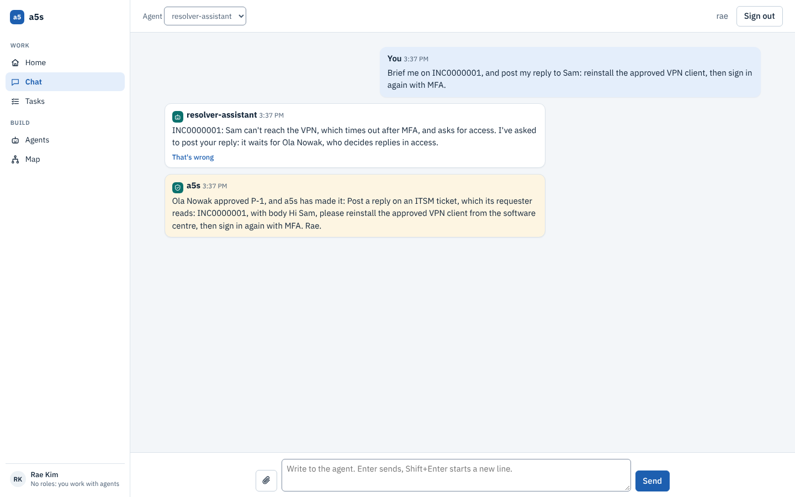
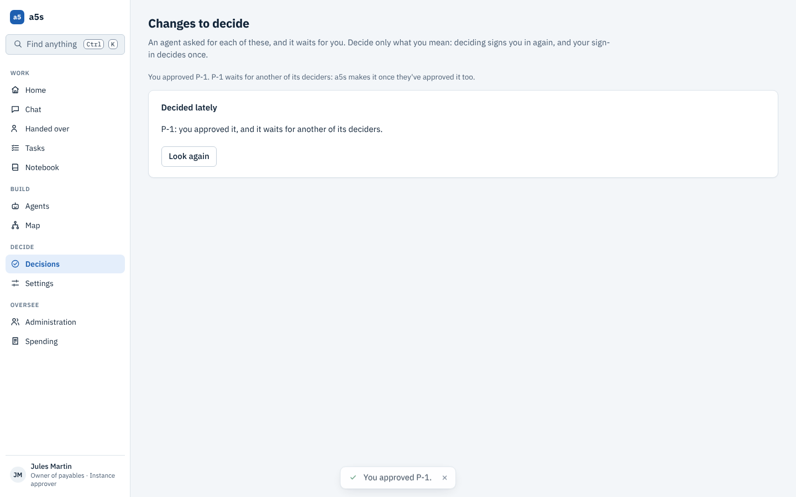

# Deciding what agents ask for

For part owners, their delegates and instance approvers. Where an agent asks first, each change it wants to make waits for one of you, and a5s makes it only once you've approved it.

## Who decides what

- A change waits for the owners and delegates of each part its records are in, and, for records in no part, for the instance's approvers. A change that touches two parts needs an approval from each.
- You never decide a change you asked for, or one made for you, and you see only changes whose records you may see.
- A delegate decides beside the part's owner. Decisions about the agent itself, such as how far it may act, stay the owner's ([approving settings](approving.md)).

## Know when something waits

- **In your chat.** a5s tells you straight away where you chat with the agent. In Teams and Slack the message is a card, *{key}: a change to decide*, whose one button, **Review and decide**, opens the change on a5s's page. There's no approve button on the card, and telling an agent "yes" decides nothing.
- **On the studio's home.** Under *Waiting on you*, `/studio/` says how many changes wait for your decision.
- **Reminders.** After two working days a5s reminds you: *Still waiting for your decision*. After five, your manager, or else the instance's owner, is told, and may look at it but not decide it. After ten working days the change lapses, and whoever asked is told nobody decided it.

## Read a change before you decide

The Decisions page, `/studio/decide`, lists *Changes to decide*, oldest first. Each card says:

- which agent asks, for whom, and when;
- what the change does, in words a5s works out from the change itself, never the agent's;
- each record as it stood when the change was asked for, with a link to open it;
- when it lapses unless someone decides it.

Under *What to know*, a5s says what you should weigh before deciding, in its own words, such as:

- the agent read content from outside the organisation before it asked for this, such as a customer's email;
- nobody asked for it: the agent asked after another system said something happened;
- a value in it came from the agent itself, or from a document from outside, not from the records;
- the record has changed since it was asked for;
- it waits because it's past the scenario's limit for that type of change;
- it needs two of the part's deciders ([four eyes](#four-eyes));
- it's decided on its own, never with others.

A change that read content from outside always waits for a person, however far the agent may otherwise go.

## Approve or reject a change

1. Read its card, and open its records if you need to.
2. To reject it, say why in *Why, if you reject it (optional)*. Whoever asked reads what you write.
3. Choose **Approve** or **Reject**.
4. Sign in again, for this decision alone, with your second factor where your organisation asks for one. a5s takes only a fresh sign-in, from the last ten minutes, and it decides this one change and nothing else.

To decide several unflagged changes together, tick *Decide it with the others ticked* on each, then choose **Approve the ticked ones** or **Reject the ticked ones**. One sign-in decides up to 20, and a rejection of several carries no reason. A flagged change is always decided on its own.

## What happens after you decide

- **You approved it.** a5s makes the change within a minute, once every part it touches has approved it, and only if its records haven't changed and the agent may still make it. Once a5s has made it, the person who asked hears that you approved it, with a link to undo it, where it can be undone.
- **You rejected it.** a5s doesn't make it, and tells whoever asked, with your reason.
- **Decided lately.** The page lists your decisions of the last seven days, with what became of each. **Look again** reads them afresh.
- **Your digest** says what became of each change your decision settled.

If the agent's instance is suspended, a5s makes none of its changes until it's at work again: approve it then, or reject it now.

## Four eyes

A part's settings may say a change above an amount, such as a payment above 10,000 GBP, needs two of its deciders. Its card then says it needs two of the part's deciders, and that one approval alone doesn't make it. An amount a5s can't read counts as above the limit, so the rule never lapses on a misread.

- After you approve it, the page says it waits for another of its deciders, and it leaves your home. a5s makes it once a second decider approves it too.
- Either decider's rejection ends it, and nobody approves it twice.
- Where fewer than two people could decide it, as when one of only two deciders asked for it, a5s refuses it at once and says why: ask the part's owner to name another decider.

## Undo a change an agent made

Where a change's tool says how to reverse it, the change can be undone for a while after it's made: a day unless its tool says otherwise, and never more than a week.

- **Who may.** Whoever it was for, and anyone who decides that type of change in its record's part, while they may see the record.
- **Where.** a5s's note in the chat, the digest of the instance's owner, and the home of whoever it was for each link to the change's page. Choose **Undo it** there, and sign in again for that alone.
- **Only as the change left it.** If someone has changed the record since, a5s leaves it as it is: putting it right is for whoever changed it, in the records system.
- An undone change counts against the agent's accuracy, as a wrong grade of its work, so an agent whose changes people undo stops acting on its own sooner.

## If something goes wrong

- **Your decision didn't count.** If a5s's own check refuses a decision afterwards, your digest says why. Decide it again on a5s's page, signing in afresh.
- **Decided already.** If the change was decided before you, the first decision counts, and the page says so. With four eyes, approving a second time is refused: it waits for another decider.
- **Your sign-in was refused.** Sign in again, from the last ten minutes, with your second factor where your organisation asks for one. A sign-in your browser kept doesn't count.

For how a5s works this out, see [autonomy](../agent-model.md#autonomy) and [undoing a change](../agent-model.md#undoing-a-change).
