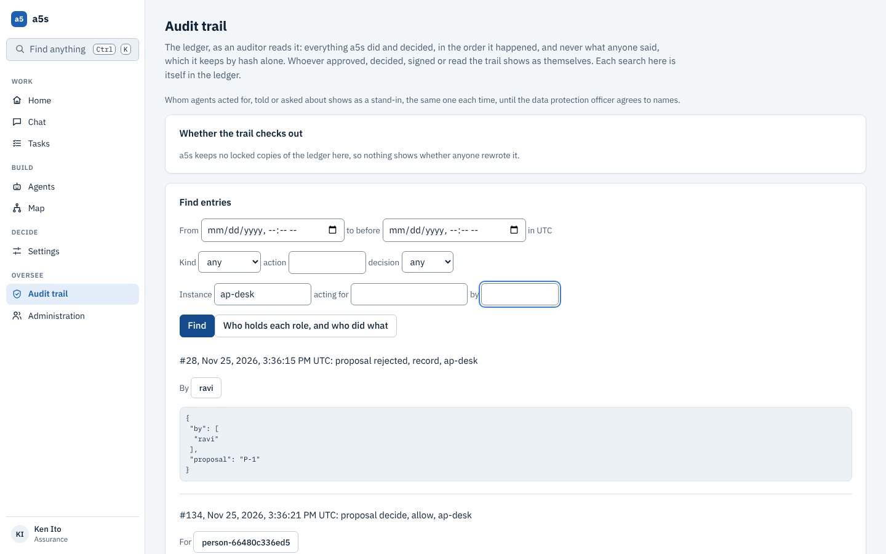

# Auditing and administering

For assurance, auditors, and everyone who looks after who holds which role. The team that runs a5s has its own [runbooks](../runbooks.md).

## Read the audit trail

The Audit trail page, `/studio/audit`, is for auditors and assurance, and needs your sign-in to show a second factor, where your organisation asks for one.

- **Whether the trail checks out.** The page says whether the ledger matches its locked copies: *It checks out*, *It doesn't check out*, *Not checked lately* or *Not checked yet*. An entry that doesn't match, or isn't copied yet, carries a badge saying so.
- **Find entries** by when, from and to before, in UTC, by kind, action and decision, by instance, and by whom it acted for or who did it, then choose **Find**.
- **Who holds each role, and who did what:** the report of who holds each role now, and what was done in the period.

People who acted in one of a5s's roles, approving, deciding, signing or reading the trail, show as themselves. The people agents acted for show as stand-ins, such as *person-a2b07a61013d*, the same each time: choose one to find their other entries. Typing someone's real id finds nothing.

Only once the data protection officer lets the page name whom agents acted for does it offer **Export the period**, which saves the entries as a file anyone can check against the ledger, with `a5s audit verify`.

## Who holds which role

Roles come from your organisation's directory, and from its identity provider's groups, never from a5s: who someone is, and which groups they're in, is the identity provider's. The signed settings give groups a5s's roles, each with a scope, such as a part or an agent.

- Groups can give the instance approver, the data protection officer, the auditor and the grader roles, a part's owner and delegates, and an agent's authors and viewers.
- The release approver, assurance and an agent's owner come from the directory alone.
- Giving a group a role is a version of the settings, which the role's owner approves: a part's owner for their part, an agent's owner for their agent, the data protection officer for theirs, assurance for the auditor role, and an instance approver otherwise.
- A role a group gives counts from the person's next sign-in, and a role someone loses stops working then too.

## The Administration page

The Administration page, `/studio/admin`, is for anyone who owns, approves, decides or oversees in a5s: part owners and their delegates, agents' owners, instance and release approvers, assurance, auditors, the data protection officer and the team that runs a5s. It changes nothing; it shows:

- *Who holds each role*, and whether the directory or a group gave it;
- *Groups that give roles*;
- *What waits for whom*;
- *Nobody answers for*: agents and parts nobody owns, and instances nobody runs, each with what to do;
- *The latest acts*, over the last 30 days.

## Second factors, and signing in afresh

What counts asks for a fresh sign-in, from the last ten minutes, made for that act alone, with a second factor where your organisation asks for one: approving a version of the settings, deciding a change, grading, the data protection officer's requests, resuming an instance, undoing a change and putting a stopped model back. Suspending an instance asks for a fresh sign-in, but no second factor, as stopping one loosens nothing. Reading the audit trail needs a sign-in that shows a second factor, where your organisation asks for one.

If a sign-in is refused, a5s says why. One your browser kept, or one older than ten minutes, doesn't count: sign in again. If it showed no second factor, and you weren't asked for one as you signed in, signing in again won't change that: your organisation's sign-in policy decides when it asks, so ask whoever runs your organisation's sign-ins, such as your IT team, to ask for one when you sign in to a5s.

For how a5s works this out, see [administration and audit](../administration.md).
