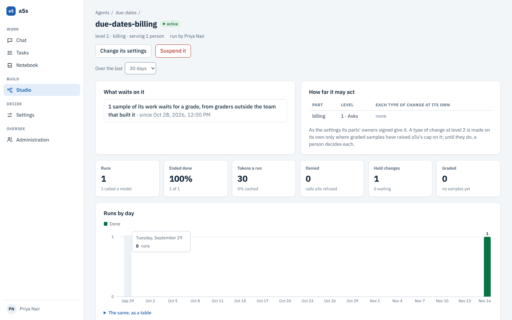
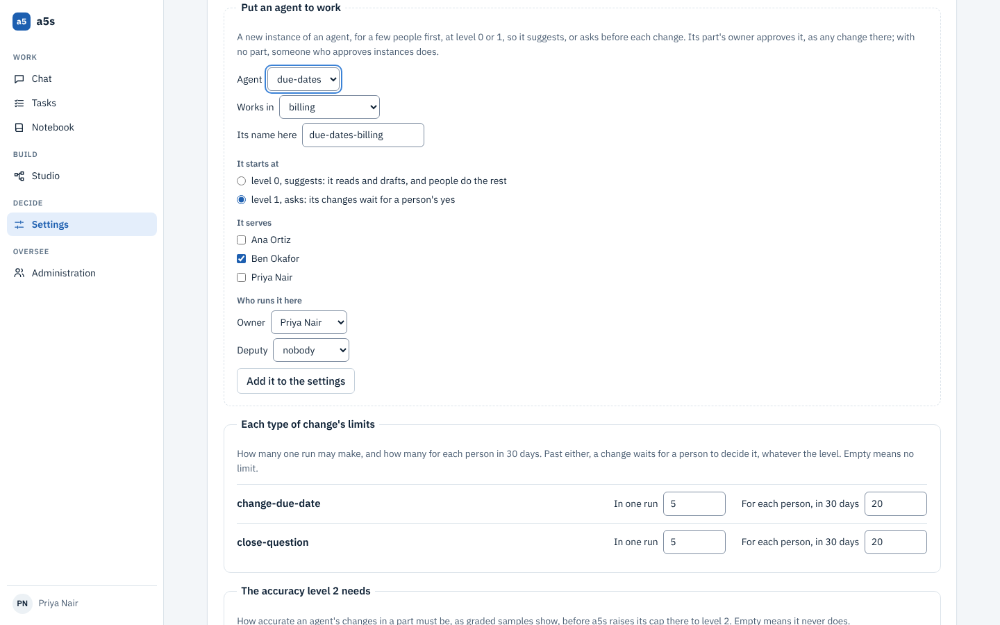

# Running an agent

For the people who own an agent, or run one of its instances, with its deputy: watching it work, putting it to work, and stopping it when needed.

## See what waits on you

The studio's home, `/studio/`, lists what waits on you under *Waiting on you*, each with why it's yours and a link to where you do it: versions of the settings to approve, changes to decide, people asking for your agent, answers people said were wrong, and a budget running out among them. `/studio/you`, *What you may do*, lists each role you hold, what it lets you do, and what gave it you: your organisation's directory, or one of its groups.

## Find your agents

The Agents page lists the agents you may know of, each saying why you see it, such as *you author it*. An agent's own page has its map, *How it's wired*, what it does, its tools, how far it may act, and *Where it runs*: each instance, its status, what it may do, its parts, whom it serves, who runs it, and its release.

## Watch an instance at work

An instance's page is open to its owner and deputy, its agent's owners, the owners and delegates of its parts, and instance approvers. It says how far the instance may act in each part, what waits on it, and, over the last 7, 30 or 90 days:

- its figures: runs, how many ended done, tokens a run, what a5s denied, held changes, how many were graded, and how often its judge agrees with people;
- *Runs by day*, in your own time zone, done, cut short, failed and still running, with *The same, as a table*;
- how runs ended, what a5s refused, what fell due, and who came back;
- its runs, one by one, newest first.

While an instance serves only a few people, fewer than five unless the data protection officer chose otherwise, its runs one by one stay hidden, as each would say what one person did, unless the officer agrees to show names.

## Read one run

A run's page says what started it, the records it read, and *Its path*: the tools it called through a5s's checks, on its agent's map, with how many times and how many a5s refused. *What it did, in order* lists each call, *allowed*, *refused* or *held for a decision*. It opens only for someone who may see every record the run handled.

## Put a released agent to work

Once an agent is released and no instance runs it, its page offers *Put it to work*.

1. Choose **Put it to work in the settings**. A form opens, filled in from the agent's plan, if its draft had one: the agent, the part it works in, its name there, how far it starts, *reads only* or *asks first*, whom it serves, and who runs it.
2. Choose **Add it to the settings**, then review the version and ask its approvers, as for [any version of the settings](approving.md#ask-for-a-change-to-the-settings).

It works once the owner of every part any instance in the version works in has approved it. An agent never starts by acting on its own: graded samples earn that later ([grading](grading.md)).

## Suspend or resume an instance

An instance's owner or deputy, its agent's owners, the owners and delegates of its parts, and the team that runs a5s may suspend it.

1. On its page, right below its head, *Suspend or resume it* says first whom suspending reaches: it stops at its next step, even in a run already going, and starts no runs, so it answers none of the people it serves until it's resumed. Nothing it keeps is lost.
2. Choose **Sign in and suspend it**, and sign in again, for this alone. a5s suspends it within a minute, once it has checked that sign-in again.

The people it serves are told it's suspended, who suspended it and that they can resume it. To resume it, choose **Sign in and resume it** in the same place, with your second factor where your organisation asks for one. Whoever suspended it may resume it, and so may the release approver, from outside the team that runs a5s. If a5s couldn't do either, your digest says why.

## Answer someone who asks for an agent

When someone asks for your agent from its page, your home says *{person} asks for the {agent}*. On the agent's page, choose **Serve them through** one of its instances, or **Decline**. Serving them makes a version of the settings that adds them to whom the instance serves, which its approvers approve as any other. An ask nobody answers ends after 30 days.

## Answers people said were wrong

When someone says an answer was wrong, it's listed on the agent's page, under *Answers people said were wrong*: the answer, the run behind it and what they said, and who they are only if the data protection officer lets you see it. Grade each right, wrong or critical, to see where its instructions need putting right. It changes nothing the agent may do.

## Look after its notebook

The Notebook page, `/studio/notebook`, holds what your agents noted from records on their schedules, for their later runs: each note with the records it comes from, up to 50 for each instance. A note goes once its records change, as a5s reads them again each day. Choose **Remove** for any no longer worth keeping.

## Watch what it costs

The Spending page, `/studio/spending`, shows what each agent spent this month, its budget, and its forecast at the last week's pace, to its owners and instance approvers, and what each instance you may watch spent. Months run by the calendar, in UTC. A budget guides: it stops no work. The token budgets each release sets are what stop a run.

## What your digest tells you

As an instance's owner or deputy, your daily digest tells you of each change the agent made on its own, each change someone undid, and each time a5s's cap for a type of change moves, such as *a5s's cap on assistant-finance for change-due-date in billing is now "asks first"*, with why. An agent's owner, or a part's owner, can lower a cap, with `a5s caps lower`; nobody raises one by hand.

For how a5s works this out, see [the agent model](../agent-model.md) and [the studio](../studio.md).
