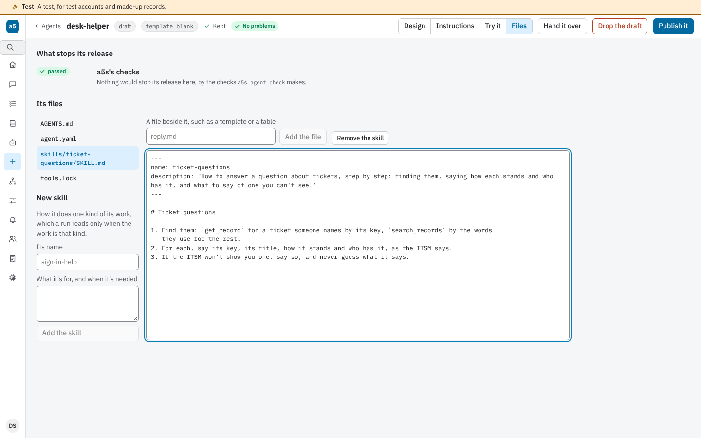

# Giving an agent a skill

For an agent's authors and owners, and the engineers who sign its releases. A skill is one kind of an agent's work, written down for it to read when the work is that kind: how to help someone who can't sign in, say, or how to word a reply to a supplier. a5s's skills are [Agent Skills](https://agentskills.io), the open format many agents read, with a5s's rules for what a run may do with one.

## When it's a skill

An agent reads three kinds of text, each for a job of its own:

| Put it in | When it says | Who keeps it |
| --- | --- | --- |
| Its instructions, `AGENTS.md` | what it must always do, or never: a run reads all of them, every time | its authors, in its release |
| A skill | how it does one kind of its work, step by step: a run reads it only when the work is that kind | its authors, in its release |
| Knowledge | what the organisation knows, such as its procedures and policies: a run looks it up, and it can go stale | each article's owner, outside the release |

Keep the instructions short, and move what only some runs need into a skill. A run is told only each skill's name and what it's for, a line each, and reads the rest when it needs it. A skill never decides anything: where code decides, as a check or a match does, a skill says how to tell people what code found.

## The examples a5s ships

Three of the scenarios have one each, tested with their scenario (`tests/test_scenario_skills.py`):

- **[sign-in-help](../../scenarios/service-desk/agents/desk-assistant/skills/sign-in-help/SKILL.md)**, the desk assistant's: how to tell a forgotten password from a lost phone or key, and which self-service fits each, with a table beside it, [`what-people-say.csv`](../../scenarios/service-desk/agents/desk-assistant/skills/sign-in-help/what-people-say.csv), of the words people use for each.
- **[supplier-replies](../../scenarios/procure-to-pay/agents/ap-assistant/skills/supplier-replies/SKILL.md)**, the accounts payable assistant's: how to word a draft reply to a supplier, from a template beside it, [`reply.md`](../../scenarios/procure-to-pay/agents/ap-assistant/skills/supplier-replies/reply.md).
- **[check-results](../../scenarios/master-data/agents/mdg-assistant/skills/check-results/SKILL.md)**, the master data assistant's: how to tell a requester what the check found, finding by finding, in its `SKILL.md` alone.

## Write one

A skill is a folder in the agent's own, under `skills/`, named as the skill is: lower-case letters and digits, with single hyphens between, in 64 characters at most. It holds a `SKILL.md`, which begins with the skill's name and what it's for, between lines of `---`:

```markdown
---
name: sign-in-help
description: How to help someone who can't sign in, step by step, whether they forgot their password, lost the phone or key they sign in with, or their account won't let them in, and which self-service fits each.
---

# Sign-in help

People who can't sign in rarely say which kind of trouble it is. Find out first, then start the one self-service that fits, on their own account alone.
```

- **What it's for**, its `description`, is all a run sees of it until it reads it. Say what it does and when it's needed, in 1,024 characters at most.
- **The rest** is how to do the work, in steps or short rules, naming the agent's tools as its instructions do.
- **Beside it**, a skill may bring more for a run to read: a template, a table, a longer reference. Name each in `SKILL.md`, as supplier-replies names its template, or no run knows to read it.

a5s refuses, as `a5s agent check` and the studio's checks say:

- **Anything but text.** A skill's files are Markdown, text, CSV, JSON or YAML. The format allows scripts, but no run can run one: an agent acts only through the tools its release pins.
- **A name that isn't its folder's.** A skill's `name` must be its folder's, and it must say what it's for.

Of the format's other fields, `allowed-tools` gives an agent nothing: its tools are the ones its release pins, whatever a skill says.

## Try it, and keep a test case

In the studio, a draft's **Files** holds its skills, beside its other files:

- **New skill.** Give its name and what it's for, and choose **Add the skill**. The draft gains the skill's `SKILL.md`, which opens for you to write its steps.
- **A file beside it.** With one of the skill's files open, give the file's name, such as `reply.md`, and choose **Add the file**.
- **Remove the skill**, or **Remove this file**, asks you first. The release in force keeps the skill until another replaces it.

The studio checks the draft as you go, as `a5s agent check` does, and its release's pull request carries its skills with the rest of its folder. Outside the studio, a skill is the same folder, under the agent's `skills/` in git.



Try it as you'd try any change, in the sandbox ([building an agent](building.md#try-it-in-the-sandbox)), and keep a try that needed the skill as a test case: its release's regression suite then shows the skill still does its job.

## Release it

A skill is part of its agent's release, pinned by the release's digest, so changing one makes a new release. It's signed as a change to the agent's instructions is: by its owner and an engineer, anyone in the team that runs a5s, and, for an agent that may act on its own, by the release approver too, since nobody decides its changes before they're made ([signing a release](approving.md#sign-a-release)).

## Bring in one from elsewhere

Agent Skills are shared as folders, mostly in git repositories. To use one another organisation's agents use:

1. **Copy its folder** into the agent's `skills/`, with its licence.
2. **Take out what a5s refuses**, such as its scripts. What a script did becomes a tool, if anyone builds it ([adding a tool](tools.md)).
3. **Name the agent's own tools** where the skill names others', so it never tells a run to use what it hasn't got.
4. **Read all of it**, as you would instructions you didn't write. A run follows what a skill says, so look for anything that would have the agent do what its instructions don't let it, or tell anyone what it shouldn't.
5. **Say where it came from** in the pull request, and at which commit, so its signers can compare.

Then release it as any other.
