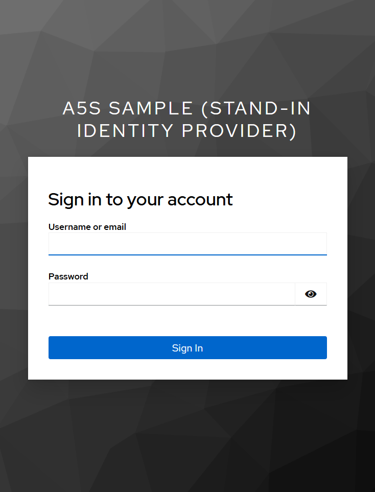
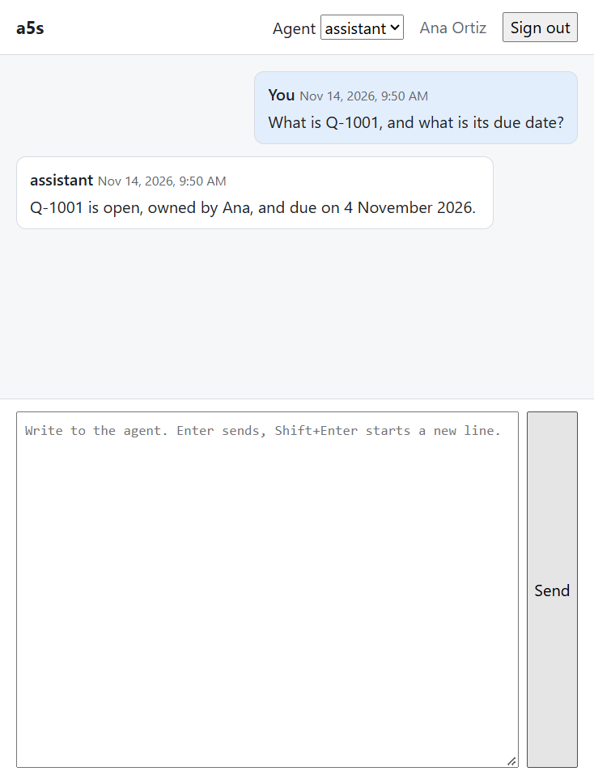
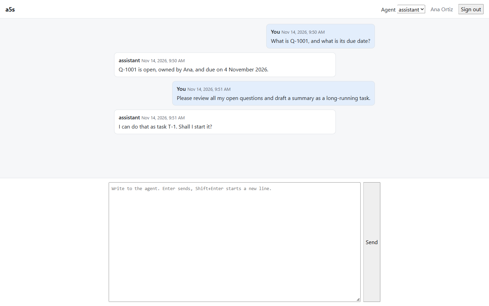
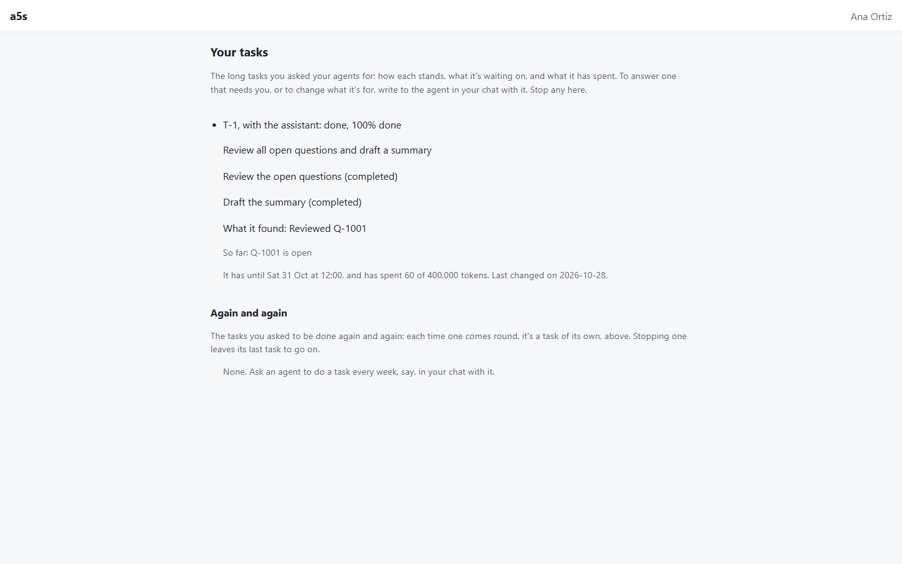
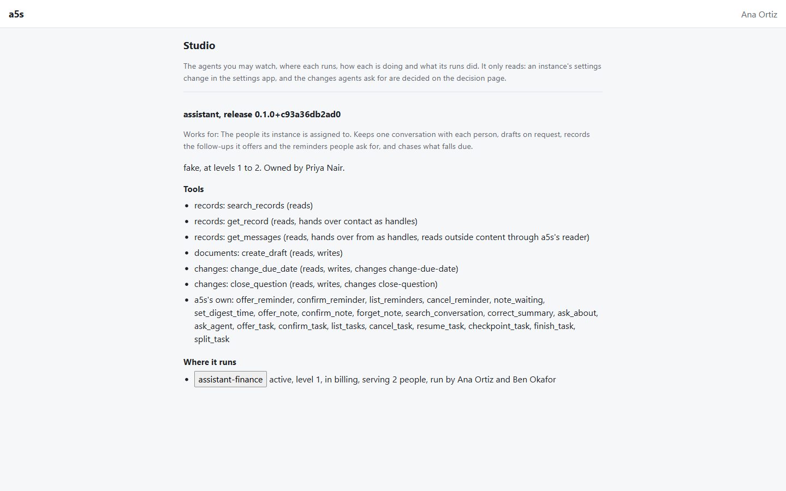
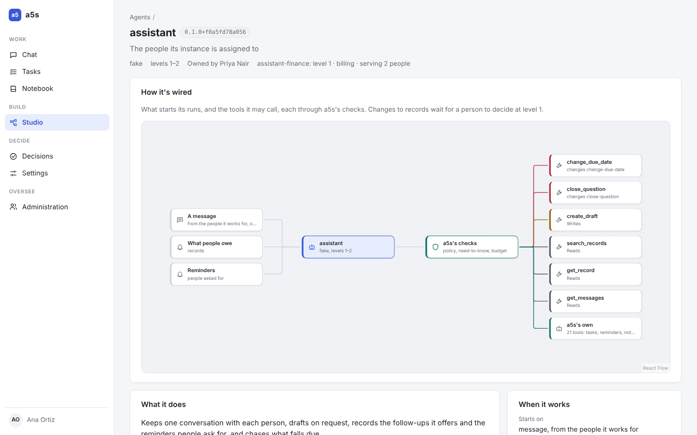
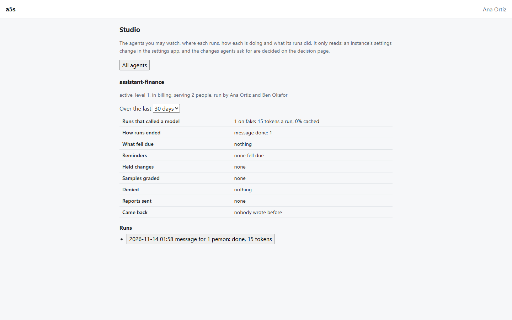
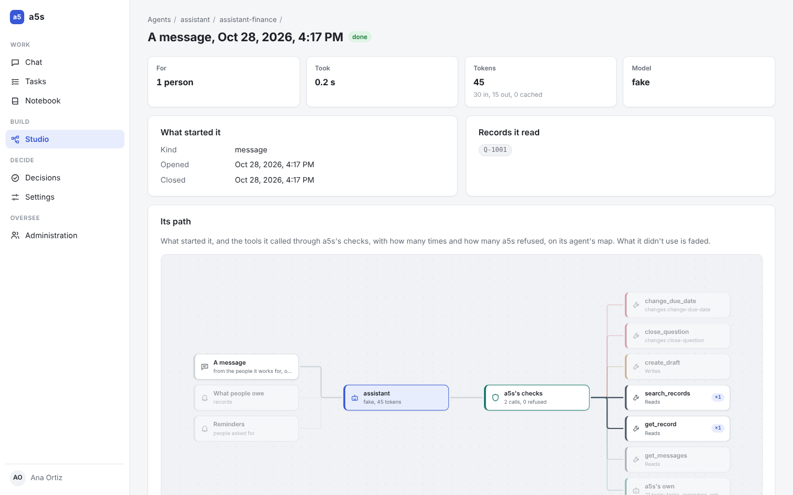

# Using a5s today

**What this is:** The current user and operator interface, with synthetic records and a scripted demo model. The pages are real a5s pages; the model's answers here demonstrate the journey, not a live-model evaluation. No real people, credentials or business records appear.

## For a person asking an agent for help

### 1. Sign in

The web chat uses the organisation's identity provider through OpenID Connect. a5s checks who the person is and which agents serve them. In development, without an identity provider, the local channel can name a person explicitly instead.

### 2. Have a conversation

The person chooses an agent and writes to it. Here Ana asks about `Q-1001`, and the assistant answers from the synthetic record. Each person has a conversation with the agent, not one shared with every other user. Tools and records stay within the run's permissions.

The same agents can work through Matrix or Teams where the deployment enables them. The command line and web chat use the local channel.

### 3. Ask for longer work, then confirm it

For work that needs more than one run, the agent offers a durable task and asks before starting it. Ana's answer in a later message confirms it; merely receiving the offer does not start work.

a5s then works on the task in bounded runs of its own. A fresh worker resumes from the saved plan and checkpoint after a restart, rather than depending on a process staying alive.

### 4. See progress, results and controls

At `/tasks/`, the person sees their own tasks: each task's agent, status, plan, partial findings, result, deadline and tokens spent. Active tasks can be cancelled. Tasks that repeat appear separately, and stopping one does not cancel its already-running task.

To answer a task that needs its owner, the person returns to their chat with the agent. Today the page is a separate route, without a prominent link from the chat, and later progress needs a refresh rather than appearing automatically.

## For the person who runs an agent

The studio at `/studio/` is currently **read-only**: the agents, each agent's page with a map of how it's wired, a dashboard for each instance, and a page for each run with its path. Every page of a5s shares its sidebar, which lists only the pages the signed-in person may use, and the studio shows only what they may see. These pictures come from a5s running, with synthetic records: `A5S_DOC_IMAGES=docs/images uv run pytest tests/test_doc_images.py` makes them again.

### The agents

Each agent shows its release, model, autonomy levels and how many of its tools change records, write or only read, and the instances that run it, with each one's status, level, part and the people it serves.

### An agent's page

An agent's page opens on a map of how it's wired: what starts its runs, the agent, a5s's checks, which every call to a tool passes through, and its tools, coloured by what they do, changes first. Below the map are what it does and its instructions, its tools by kind, when it works, what it knows and may spend, and where it runs.

### The instance's dashboard and runs

An owner or another authorised person can choose an instance and period to see its runs, how they ended and their tokens, its runs by day in their own time zone, split by how they ended, and its obligations, reminders, held changes, graded samples, denials and reports. Each day's figures show on hover or keyboard focus, and the same figures are in a table under the chart. Conversation text is not shown.

### A run

Each run shows what started it, whom it acted for, the records it read, and its path on its agent's map: each tool it called, how many times, and how many of those a5s refused, with what it didn't use faded. Its calls follow in order, each with the policy's decision.

The command line, Python client and core API expose the same operational model to code and CI, not just to the page. Operators' aggregate metrics can also go to the organisation's monitoring, without personal data.

## For the person building and deploying an agent

Today that path is deliberately code-led:

1. Create the agent's folder: `agent.yaml`, `AGENTS.md`, skills and test cases. `a5s agent templates` lists the agents a new one may start from, the reference agents and each scenario's, and `a5s agent new finance-helper --from assistant` makes its folder from one, with its own id, a first release and its tools pinned.
2. Choose existing reviewed tools, connectors and MCP tools; pin their schemas in `tools.lock`. `a5s agent check` then says what would stop its release here: a definition that doesn't load, budgets that don't fit, a tool the scenario hasn't got or that's no longer pinned as it is, or a model the deployment doesn't approve.
3. Run the agent's tests with synthetic equivalents and, where the release requires it, real models.
4. Open a pull request and let CI run.
5. Have the people the release needs sign its manifest with `a5s release`.
6. Approve signed settings for each instance: its audience, parts, permissions, owners and budgets.
7. Deploy the approved release through the existing container or Helm path.
8. Watch it in the studio, and suspend or resume it through the existing authorised controls.

The settings app and the approval, decision, grading, notebook and officer pages support that path. The studio does not hold signing keys or publish around them.

## What is not here yet

The studio now keeps drafts: an agent's owner starts a new agent from a template, or a change to one they own, and edits it, its tools and its instructions, with what would stop its release, who would sign it, and its map shown as they go. They try it in [the sandbox](studio.md#the-sandbox), a deployment of its own, as one of the scenario's made-up people, and see what it answered, each call it made with the policy's decision, and what its model was sent. It does not yet publish a draft from the page: that's the next authoring step in [the studio plan](studio.md#build-in-order), not a capability claimed by the screens above.

The present journey is therefore:

- **A user:** sign in → converse → confirm longer work → inspect or cancel it.
- **An operator:** catalogue → instance dashboard → run detail.
- **A developer:** code and tests → PR and CI → signed release → approved settings → deployment → studio monitoring.

[Testing a5s](testing.md) has the commands for each test layer, what each proves, and how to read failures and scorecards.
